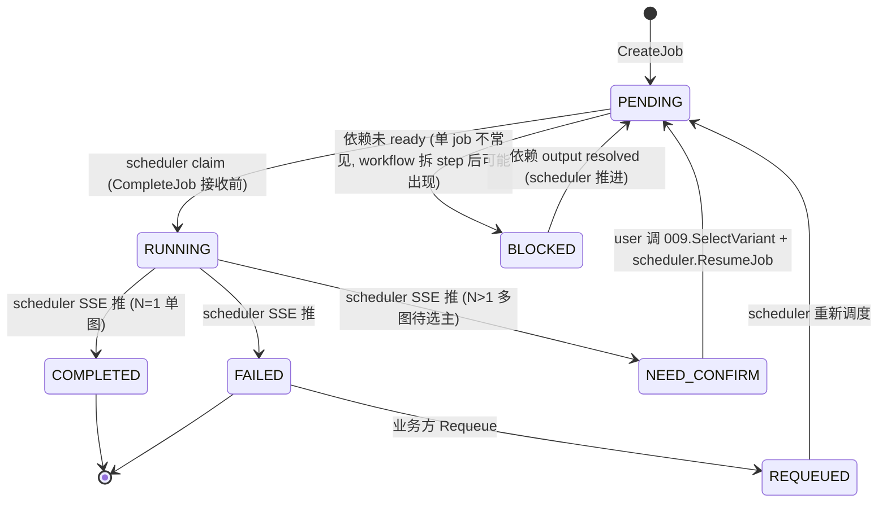

# Workflow 文档规范格式
所有工作流（workflow）统一存放于 `docs/<service>/0001-<workflow>/<workflow>.md`，采用连续数字编号命名：`0001-标识名.md`、`0002-标识名.md`，以此类推。

采用懒创建机制，仅在需要时创建。

## 标准模板

下面是可供参考的示例:

``````md
---
1. name: Job Scheduler Execution
2. desc: 单个 job 的端到端处理——业务方
---


## 一句话说明

单个 AI 生成 job 的跨服务协作——materials 提交 + scheduler 调度 + browser-extension 执行 + **SSE 状态回流 + NEED_CONFIRM 多图选图**。**v3 起 001 仅描述单 job 链路；workflow 提交逻辑在 002**。


## 执行时间线（**每个接口内嵌内部处理**）

```text
business              materials                              scheduler                          browser
   |                     |                                       |                                 |
   |-- POST /jobs ------>|                                       |                                 |
   |                     | 1. CreateJob                          |                                 |
   |                     |    ├─ 012 ResolveWorkflowBindings     |                                 |
   |                     |    │    (input + binding 合并 vs input_schema 校验)
   |                     |    ├─ 017 user_team_auth 校验          |                                 |
   |                     |    │    (workflow + binding 资源 team 访问权)
   |                     |    ├─ 009 CreateGeneratedAsset         |                                 |
   |                     |    │    (job_id=exec_id, run_time, index=1, is_primary=true)
   |                     |    ├─ 写 GenerationJob 表               |                                 |
   |                     |    │    (status=PENDING, input=合并后值, workflow_id, run_time)
   |                     |    └─ 返回 job 对象 + asset (index=1)   |                                 |
   |<-- 201 Created -----|                                       |                                 |
   |                     |                                       |                                 |
   |                     |-- SubmitJob RPC ---------------------->|                                 |
   |                     |    ├─ 校验 job_id 存在 + status=PENDING  |                                 |
   |                     |    │    (**幂等**: 重复提交同 job_id 直接返回当前 status)
   |                     |    ├─ 写 scheduler 内部 queue           |                                 |
   |                     |    │    (job_id 作为 scheduler 内部 key, submitter 自保证不重复)
   |                     |    └─ 返回 accepted (bool)              |                                 |
   |                     |      (**不返回 submit_id**——scheduler 不创建 id,  |                                 |
   |                     |       job_id 由 CreateJob 分配, submit_id 概念不存在) |                                |
   |                     |                                       |                                 |
   |                     |<=========== SSE 长连接建立（materials 启动/发第一个 job 时） ===========>|
   |                     |                                       |                                 |
```

## 关键流程参数传递

列出时序图中，关键流程的，参数传递。特别是跨服务的参数传递说明。包括上游服务必须传递的参数，这些参数在下游服务起到什么作用。


## 状态流转（**NEED_CONFIRM 重点**）



## 幂等设计
请求重复执行下的幂等设计。

``````

## 编号规则
遍历 `docs/<service>` 目录，读取当前已存在 workflow 目录的最大编号，在此基础上加一作为新 workflow 的编号。如果 Workflow 已经废弃，直接在目录名后添加 -del 即可。

## 何时需要创建 change.md
除了 bug 和 简单的错误处理，其他变更都需要创建 change.md 记录变更历史。