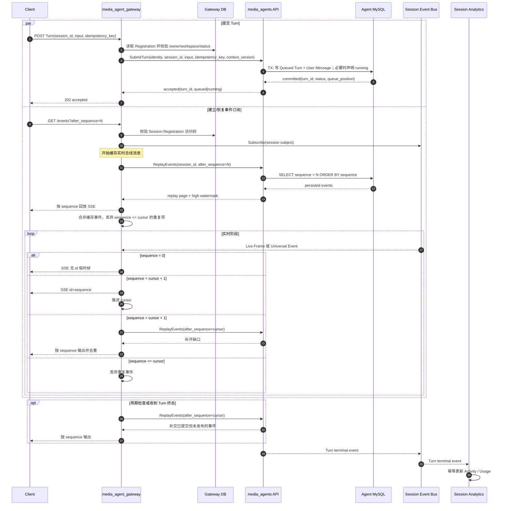

## 一句话说明

Gateway 校验 Agent Session Registration 后把 Turn 命令交给 Agent；页面事件连接先订阅 Session Event Bus，再通过 Agent 查询接口回放已提交 Universal Event，最后按 Agent Session Sequence 去重并持续转发 SSE。

## 触发与结果

| 项目 | 内容 |
|:---|:---|
| Turn 触发 | Web 用户提交输入，或 Agent Task Dispatch 提交持久化任务输入 |
| 订阅触发 | 客户端以 `session_id + after_sequence` 建立 Session Event Subscription |
| 前置条件 | 调用者已认证且有权访问 active Agent Session Registration |
| Turn 结果 | Agent 返回稳定 turn_id 和 queued/running；Gateway 不等待执行完成 |
| 订阅结果 | 已提交事件无缺口、可重复地到达 UI；临时帧尽力实时传输 |
| 客户端断开 | 只释放本 Gateway 订阅，不改变 Agent Turn 或其他订阅 |

## 执行时间线

### 步骤说明

1. **Gateway 只授权和转发**：Gateway Registration 决定用户能否访问 Session；Agent Runtime Session 决定输入是立即 running 还是 queued。Gateway 不创建 Turn、Message 或 pending message。
2. **Agent 接受才算成功**：只有 Agent MySQL 已提交 Queued Turn 后 Gateway 才返回 202。Gateway 超时且结果不明确时，以同一 `idempotency_key` 重试或查询 Agent，不创建新 ID。
3. **先订阅再回放**：Gateway 必须先订阅 Session subject 并缓存消息，再调用 Agent `ReplayEvents`。回放和缓存重叠由 Session sequence 去重，因此页面刷新窗口内正常发布的事件不会丢。
4. **补偿数据库提交/发布间隙**：Agent 先提交 MySQL 再发布总线。若在两步之间失败，Gateway 通过 sequence 跳号、周期检查以及 Turn 终态补查重新调用 `ReplayEvents`。当前连接最终补齐；页面重连也能从 MySQL 恢复。
5. **总线不是恢复事实**：初始实现采用 Redis Pub/Sub 的按 Session 广播语义。Gateway 不使用共享 Consumer Group 分摊事件；每个持有相关 SSE 的 Gateway 都订阅对应 Session subject。
6. **临时帧语义**：Live Event Frame 没有持久 sequence，允许因断线、慢消费者或总线故障丢失；UI 最终由完成 Message、工具快照和终态事件收敛。
7. **连接与执行解耦**：关闭 SSE 只取消当前订阅。中断必须调用 Agent `InterruptTurn`；Gateway、Redis 或浏览器不能直接改变 Turn 状态。

## 状态与不变量

- Gateway 不持有 Turn 状态机；queued/running/completed/failed/interrupted/cancelled 均由 Agent Runtime Session 决定。
- 同一 Session 多个 SSE 订阅相互独立，任一断开不能取消 Agent Turn。
- 业务 cursor 只由 Agent Session Sequence 推进；Redis message id、Kafka offset 和 Gateway 内存下标不得写回客户端 cursor。
- 持久事件以 `session_id + sequence` 去重；Live Event Frame 不承诺重放。
- 同一 Session Turn 串行性由 Agent 队列和数据库约束保证，与请求落在哪个 Gateway 无关。

## 关键参数

| 参数 | 产生方 | 使用方 | 语义 |
|:---|:---|:---|:---|
| session_id | Gateway Registration | Agent、Bus、Client | 跨上下文稳定会话标识 |
| idempotency_key | Client/Agent Task | Agent | 防止重复创建 Turn |
| turn_id | Agent | Gateway、Client、Analytics | Agent 执行轮次标识 |
| sequence | Agent MySQL | Gateway、Client | Universal Event 的 Session 内严格递增游标 |
| after_sequence | Client/Gateway | Agent Replay API | 已确认处理的最后持久化事件 |
| context_version | Registration | Agent | 本次提交对应的运行上下文版本 |

## 一致性边界

| 边界 | 原子提交事实 | 不包含的副作用 |
|:---|:---|:---|
| Gateway Registration 读取 | 无写事务，仅授权快照 | Agent SubmitTurn |
| Agent TX-ENQUEUE | Queued Turn、User Message、enqueue sequence | Gateway HTTP 响应 |
| Agent TX-EVENT | Universal Event、Session sequence、可选 Message | Session Event Bus publish、SSE 写入 |
| Agent TX-FINAL | flush 后终态、Chat Status、终态事件 | 总线发布、Analytics 投影 |

Gateway 禁止开启跨 Gateway DB 与 Agent MySQL 的事务。跨服务通过稳定 idempotency key、sequence 回放和最终一致投影协调。

## 幂等、重试与补偿

| 步骤 | 幂等键 | 重试策略 | 补偿/恢复 |
|:---|:---|:---|:---|
| SubmitTurn | session_id + idempotency_key | 超时可用相同 key 重试 | Agent 返回既有 turn_id |
| Subscribe bus | connection_id + session_id | 断线重新建立 | 随后 ReplayEvents 补齐 |
| ReplayEvents | session_id + after_sequence | 可安全分页重试 | sequence 去重 |
| Bus delivery | event_id/sequence | 允许重复 | sequence <= cursor 丢弃 |
| Publish 缺失 | sequence gap/periodic check | 查询 Agent | 从 Agent MySQL 补齐 |
| Analytics | terminal event_id | 至少一次 | Inbox 去重，可重建 |

## 权限与失败

Gateway 从 Cookie JWT 或用户 Service Token 取得身份，读取本地 Registration 校验 user/workspace/status，然后通过 mTLS 调 Agent。Agent 接受 Gateway 服务身份，但仍校验 `session_id + context_version` 已注册；请求体中的 user/workspace/agent 字段不得覆盖 Gateway 持久化身份。

| 失败 | 是否自动重试 | 处理 |
|:---|:---|:---|
| Session 不存在或无访问权 | 否 | 调 Agent 前拒绝 |
| Agent Submit 超时、结果不明 | 查询/同 key 重试 | 不生成第二个 Turn |
| Agent 返回 session busy | 不应出现为错误 | 正常持久化为 queued；仅队列不可用时失败 |
| Session Event Bus 不可用 | 是，降级 | 保持 SSE 并周期 ReplayEvents，或让客户端重连 |
| Bus 消息跳号 | 立即补查 | 暂存高 sequence，回放缺口后顺序输出 |
| 慢消费者溢出 | 不阻塞 Agent | 关闭单订阅，客户端从最后 sequence 重连 |
| Client 断开 | 不适用 | 释放订阅，Turn 继续 |
| Agent Replay 不可用 | 有限重试 | 不伪造事件；SSE 返回可重连错误 |

## 结果事件

Gateway 不产生 Turn 领域事件。它把 Agent 已提交的 `TurnQueued`、`TurnStarted`、`TurnCompleted`、`TurnFailed` 和 `TurnInterrupted` 适配为 SSE，并把终态事件交给 Session Analytics 与 Agent Task Dispatch。
