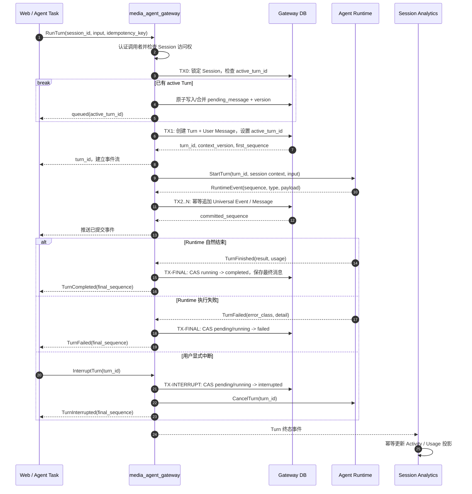
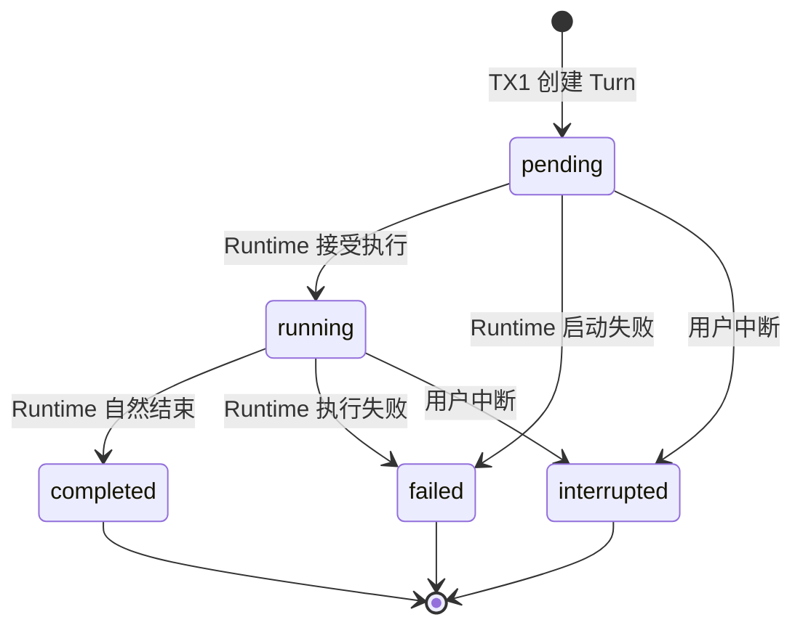

## 一句话说明

Gateway 在一次本地事务中创建 Turn 和用户消息，随后驱动 Agent Runtime 执行；Runtime 产生的事件被分批持久化，执行自然结束、失败或被显式中断后，Gateway 再提交 Turn 终态并异步更新 Session Analytics。

## 触发与结果

| 项目 | 内容 |
|:---|:---|
| 触发 | Web 用户提交消息，或 `agent_task_dispatch` 请求执行一个持久化 Agent Task |
| 前置条件 | Agent Session 为 active；调用者有权访问该 Session |
| 成功结果 | Turn 进入 completed，Message 和 Universal Event 可以按 sequence 完整回放 |
| 显式中断 | Turn 进入 interrupted；已经提交的 Message 和 Event 保留 |
| 执行失败 | Turn 进入 failed，并保存稳定错误分类；已经提交的 Message 和 Event 保留 |
| 客户端断开 | 不改变 Turn 状态；客户端可使用最后收到的 sequence 重新连接 |
| Session 已有 active Turn | 不创建并发 Turn；把输入保存为唯一 pending message 并返回 queued |

## 执行时间线

### 步骤说明

1. **认证与授权**：Web 请求使用 Cookie JWT 或用户 Service Token。Agent Task 是 Gateway 内部执行入口，使用可信服务身份，并携带 Task 已固定的 user/workspace/session 信息。
2. **创建业务事实**：TX1 原子创建 Turn 和 User Message。只有 TX1 提交成功后才能启动 Runtime，避免出现没有持久化 Turn 的孤儿执行。
3. **启动 Runtime**：使用 TX1 固定的 `context_version` 构建运行上下文。本轮执行期间配置变化不修改既有 Turn。
4. **持久化事件**：Gateway 先提交 Runtime Event，再向客户端推送。客户端看到的 sequence 因而一定可以从数据库恢复。
5. **生成 Message**：会形成会话历史的 assistant/tool 内容写入 Message；只用于运行回放的增量状态写入 Universal Event。同一 Runtime Event 可以在一个本地事务中产生二者。
6. **提交终态**：Runtime 自然结束、执行失败或用户显式中断是三条不同终止路径。终态使用 compare-and-set，避免晚到的完成事件覆盖 interrupted。
7. **完成后排空 follow-up**：仅 completed 路径原子 take-and-clear pending message，并创建下一 Turn。派发失败时使用 pending_message_version 做条件恢复；用户更新的新内容优先。
8. **更新投影**：Turn 终态提交后通过 Outbox 产生事件；Session Analytics 更新失败不回滚 Turn，可以独立重试和重建。

## 关键参数

| 参数 | 产生方 | 使用方 | 语义 |
|:---|:---|:---|:---|
| `session_id` | Client / Agent Task | Gateway | 定位固定的 user、workspace、agent 交互边界 |
| `idempotency_key` | Client / Agent Task | Gateway | 防止同一用户输入创建多个 Turn |
| `turn_id` | Gateway | Runtime、Client、Analytics | 单轮执行的稳定标识 |
| `context_version` | Agent Session | Runtime | 固定本轮使用的控制配置版本 |
| `sequence` | Gateway 或受约束的 Runtime stream | DB、Client | Session/Turn 内严格递增的恢复游标 |
| `committed_sequence` | Gateway DB | Client | 客户端可以安全保存的最后持久化游标 |

## 状态与不变量

- `completed`、`failed`、`interrupted` 均为终态，不允许互相覆盖。
- Turn 固定属于一个 Session；`session_id` 和 `context_version` 创建后不可改变。
- 客户端 SSE/HTTP 连接状态不是 Turn 状态，连接断开不会产生 interrupted。
- 同一 Session 最多一个 pending/running Turn；数据库部分唯一索引和 Session `active_turn_id` 双重保证。
- follow-up 只是待执行输入，不是 Turn；只有当前 Turn 自然 completed 后才转换成新 Turn。

## 一致性边界

| 事务 | 原子提交内容 | 不包含的副作用 |
|:---|:---|:---|
| TX1 | Turn、User Message、初始 sequence | 启动 Runtime |
| TX2..N | 一批 Universal Event，以及由该批事件形成的 Message | 客户端网络推送 |
| TX-FINAL | Turn 终态、最终 Message、清空 active_turn_id、Outbox Event | Session Analytics 投影更新、pending drain |
| TX-INTERRUPT | Turn interrupted、Outbox Event | Runtime 是否立即停止 |

Gateway 不在调用 Runtime 期间持有数据库事务。Runtime 取消失败时，Turn 仍保持 interrupted；之后到达的 Runtime Event 可以记录为诊断事件，但不能改变终态或继续生成用户可见内容。

## 幂等、重试与恢复

| 环节 | 幂等键 | 重试与恢复规则 |
|:---|:---|:---|
| 创建 Turn | `session_id + idempotency_key` | 重复请求返回既有 Turn，不创建第二条 User Message |
| 启动 Runtime | `turn_id` | 启动结果不明确时先查询 Runtime/Turn 状态，不直接创建新 Turn |
| 追加事件 | `turn_id + sequence` | 重复事件忽略；发现 sequence 缺口时暂停推送并请求 Runtime 补齐或终止为协议错误 |
| 提交终态 | `turn_id + expected_status` | compare-and-set；重复终态事件返回当前终态 |
| 更新 Analytics | `terminal_event_id` | 至少一次消费，Inbox 去重，可从 Gateway 事实重建 |
| 暂存 follow-up | `session_id + pending_message_version` | 同一 Session 只有一份；并发更新使用 CAS |
| 排空 follow-up | `session_id + pending_message_version` | completed 后原子 take-and-clear；派发失败条件恢复 |

Runtime 失败后不得自动重新执行整个 Turn，因为此前可能已经调用外部 MCP 或其他非幂等工具。只有在能够证明尚未发生不可逆副作用，或所有工具调用都以稳定幂等键保护时，才允许原 `turn_id` 恢复执行；否则保留 failed，由用户创建新 Turn。

## 权限与身份传递

- Web 入口解析 Cookie JWT 或用户 Service Token，并以真实 Session 归属检查 `user_id` 和 `workspace_id`，不信任请求体覆盖身份。
- Agent Task 执行使用服务身份进入本 Workflow，但 Task 中的代表用户和 Workspace 必须来自已持久化任务事实。
- Runtime 获得本 Session 的 `session_token`，用于直接调用 Platform MCP 和平台内业务 MCP；Gateway 不向 Runtime 暴露 Platform Token。
- MCP 或业务服务根据 Session Token 解析用户、Workspace、Session，并在资源所有服务内完成最终授权。

## 失败分类

| 失败 | 是否自动重试 | 处理 |
|:---|:---|:---|
| Session 不存在、无访问权、输入非法 | 否 | 创建 Turn 前返回错误 |
| Runtime 启动瞬时失败且确认未启动 | 可以 | 使用同一 `turn_id` 有限重试 |
| Runtime 结果不明确 | 否，先查询 | 协调 Runtime 状态，避免重复执行 |
| Event 重复 | 不需要 | 按 `turn_id + sequence` 忽略 |
| Event sequence 缺失或冲突 | 否 | 标记协议错误并终止 Turn |
| 客户端连接断开 | 不适用 | Turn 继续执行，客户端按游标重连 |
| Analytics 更新失败 | 是 | 独立重试，不影响 Turn 终态 |

## 结果事件

| 事件 | 产生条件 | 关键载荷 | 消费方 |
|:---|:---|:---|:---|
| `TurnCompleted` | Turn 成功进入 completed | turn_id, session_id, user_id, workspace_id, usage, final_sequence | Session Analytics、Agent Task |
| `TurnFailed` | Turn 成功进入 failed | turn_id, error_class, final_sequence | Session Analytics、Agent Task |
| `TurnInterrupted` | Turn 成功进入 interrupted | turn_id, interrupted_by, final_sequence | Session Analytics、Agent Task |
