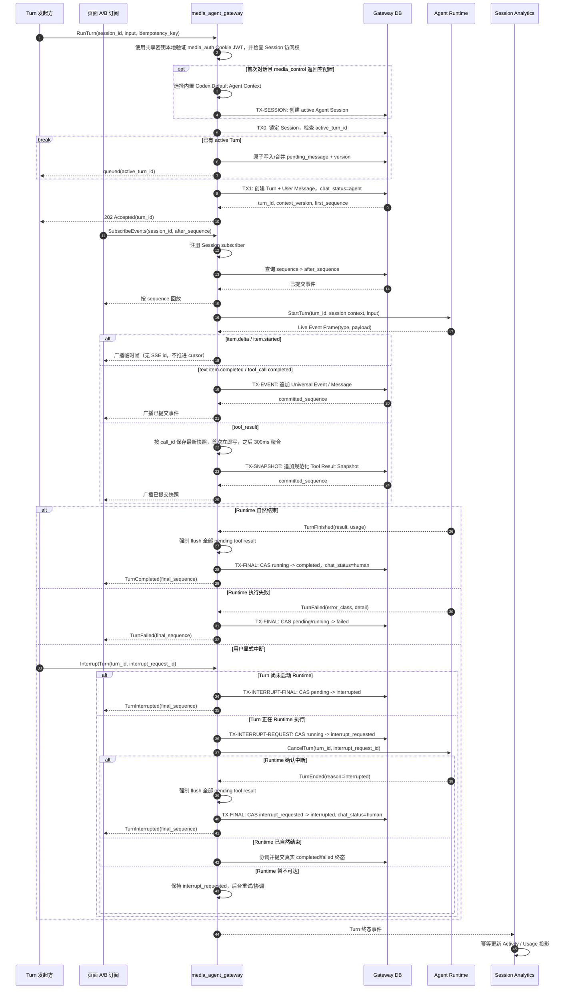
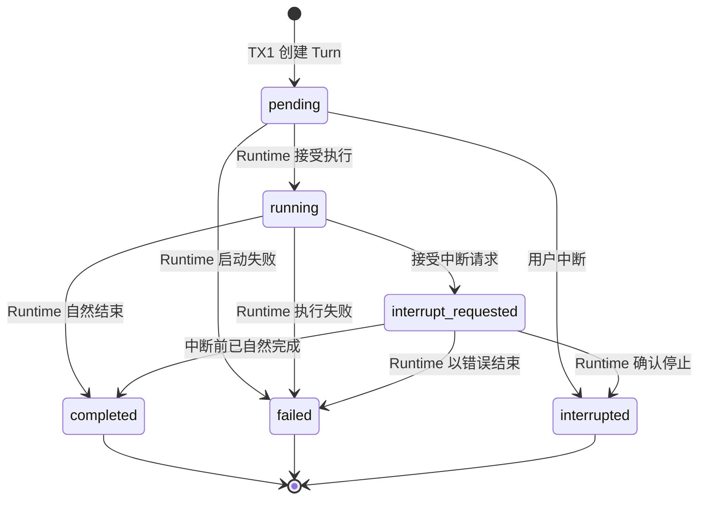

## 一句话说明

Gateway 在本地事务中创建 Turn 和用户消息后，以独立于 HTTP 客户端的后台生命周期驱动 Agent Runtime；高频实时帧即时广播，权威事件按 kind 规范化并持久化，Turn 终止前强制 flush 所有待写快照，再提交和广播终态。

## 触发与结果

| 项目 | 内容 |
|:---|:---|
| 触发 | Web 用户提交消息，或 `agent_task_dispatch` 请求执行一个持久化 Agent Task |
| 前置条件 | 调用者已经登录且有权访问该 Session；首次对话可由 Gateway 使用 Default Agent Context 创建 active Session |
| 成功结果 | Turn 进入 completed；最终 Message、Tool Result Snapshot、Session 生命周期事实可以按 sequence 恢复，流式 delta 不承诺逐帧回放 |
| 显式中断 | Turn 进入 interrupted；已经提交的 Message 和 Event 保留 |
| 执行失败 | Turn 进入 failed，并保存稳定错误分类；已经提交的 Message 和 Event 保留 |
| 客户端断开 | 不改变 Turn 状态；客户端可使用最后收到的 sequence 重新连接 |
| Session 已有 active Turn | 不创建并发 Turn；把输入保存为唯一 pending message 并返回 queued |

## 执行时间线

### 步骤说明

1. **认证与授权**：Web 请求使用 Cookie JWT 或用户 Service Token。Agent Task 是 Gateway 内部执行入口，使用可信服务身份，并携带 Task 已固定的 user/workspace/session 信息。
2. **创建业务事实**：TX1 原子创建 Turn 和 User Message，并把 Session `chat_status` 切换为 agent。只有 TX1 提交成功后才能启动 Runtime，避免出现没有持久化 Turn 的孤儿执行。
3. **启动 Runtime**：使用与发起请求分离的后台 Context 和 TX1 固定的 `context_version` 构建运行上下文。发起请求或任意订阅断开均不取消本轮执行。
4. **按 kind 持久化与广播**：`item.started` 和 `item.delta` 是 Live Event Frame，只实时广播且不携带 SSE id；文本在 `item.completed` 时整块写入；tool call 以 `turn_id + call_id` 幂等写入；tool result 首次立即写入，之后按 300ms 窗口聚合最新值，每次提交使用新的 Session sequence。只有已提交事件推进客户端 cursor。
5. **规范化工具结果**：tool result 在持久化边界按 Runtime capability 做一次 UTF-8 安全截断并移除 JSONB 不支持的 NUL；持久化 payload 包含 `truncated`、`original_bytes` 和 `stored_bytes`。截断后的同一 payload 同时用于数据库、SSE 与历史读模型，禁止二次截断。
6. **生成 Message**：assistant 文本只由 message kind 的 `item.completed` 生成权威 Message；tool call 与 tool result 作为 Universal Event/Tool Result Snapshot 保存。UI 收到 completed 后以完整内容替换已累计 delta，并在 Session 终态后刷新历史。
7. **提交终态**：Runtime 自然结束、执行失败、用户中断、超时和上游 EOF 均先停止聚合 timer、强制 flush pending tool result，等待持久化完成后再在同一事务提交 Turn 终态并把 Session `chat_status` 切回 human，随后广播终态事件。终态使用 compare-and-set，避免晚到完成事件覆盖 interrupted。
8. **完成后排空 follow-up**：仅 completed 路径原子 take-and-clear pending message，并创建下一 Turn。派发失败时使用 pending_message_version 做条件恢复；用户更新的新内容优先。
9. **更新投影**：Turn 终态提交后通过 Outbox 产生事件；Session Analytics 更新失败不回滚 Turn，可以独立重试和重建。

## 关键参数

| 参数 | 产生方 | 使用方 | 语义 |
|:---|:---|:---|:---|
| `session_id` | Client / Agent Task | Gateway | 定位固定的 user、workspace、agent 交互边界 |
| `idempotency_key` | Client / Agent Task | Gateway | 防止同一用户输入创建多个 Turn |
| `turn_id` | Gateway | Runtime、Client、Analytics | 单轮执行的稳定标识 |
| `context_version` | Agent Session | Runtime | 固定本轮使用的控制配置版本 |
| `sequence` | Gateway DB | DB、Client | 仅分配给已持久化 Universal Event 的 Session 内严格递增恢复游标；事务先锁 Session 行再计算 `MAX + 1`；临时帧没有 sequence |
| `committed_sequence` | Gateway DB | Client | 客户端可以安全保存的最后持久化游标 |

## 状态与不变量

- `completed`、`failed`、`interrupted` 均为终态，不允许互相覆盖。
- `interrupt_requested` 是非终态，只表达已持久化的中断意图；它不能作为 Agent 已停止的依据。
- Turn 固定属于一个 Session；`session_id` 和 `context_version` 创建后不可改变。
- `chat_status` 是 Session 的交互控制投影：存在 running Turn 时必须为 agent；Turn 终态提交后必须为 human。Turn 状态仍是执行事实的权威来源。
- 客户端 SSE/HTTP 连接状态不是 Turn 状态，连接断开不会产生 interrupted。
- Turn 发起请求不承载 Runtime SSE；Session Event Subscription 是独立只读连接，同一 Session 允许多个订阅者。
- 同一 Session 最多一个 pending/running Turn；数据库部分唯一索引和 Session `active_turn_id` 双重保证。
- follow-up 只是待执行输入，不是 Turn；只有当前 Turn 自然 completed 后才转换成新 Turn。

## 一致性边界

| 事务 | 原子提交内容 | 不包含的副作用 |
|:---|:---|:---|
| TX1 | Turn、User Message、`chat_status=agent` | 启动 Runtime |
| TX-EVENT | 一个完成项或生命周期 Universal Event，以及由它形成的 Message | 客户端网络推送 |
| TX-SNAPSHOT | 一个规范化 Tool Result Snapshot，使用新的 sequence 追加 | 客户端网络推送 |
| TX-FINAL | 已 flush 的全部事件之后的 Turn 终态、`chat_status=human`、Outbox Event | Session Analytics 投影更新、pending drain |
| TX-INTERRUPT-REQUEST | `running -> interrupt_requested`、中断请求 ID、发起人和时间 | 调用 Runtime、提交 interrupted 终态 |
| TX-INTERRUPT-FINAL | 尚未启动 Runtime 的 `pending -> interrupted`、`chat_status=human`、Outbox Event | 调用 Runtime |

Gateway 不在调用 Runtime 期间持有数据库事务。Runtime 暂不可达时，Turn 保持 `interrupt_requested` 并由后台重试或终止事件协调；不能在 Runtime 尚未停止时对外宣称 `interrupted`。若自然完成先提交，则晚到的中断确认不得覆盖 `completed/failed`。

## 幂等、重试与恢复

| 环节 | 幂等键 | 重试与恢复规则 |
|:---|:---|:---|
| 创建 Turn | `session_id + idempotency_key` | 重复请求返回既有 Turn，不创建第二条 User Message |
| 启动 Runtime | `turn_id` | 启动结果不明确时先查询 Runtime/Turn 状态，不直接创建新 Turn |
| 请求中断 | `turn_id + interrupt_request_id` | 重复请求返回同一送达结果；Runtime 取消命令使用相同请求 ID 重试 |
| 写入完成项 | `turn_id + item_id`，tool call 额外使用 `call_id` | Runtime 重放时忽略已持久化完成项；Gateway sequence 只在实际追加时分配 |
| 写入工具结果快照 | `turn_id + call_id + snapshot_version` | 聚合窗口内只保留最新值；每次 flush 追加新 sequence；终态 flush 可重复调用且无新值时 no-op |
| 提交终态 | `turn_id + expected_status` | compare-and-set；重复终态事件返回当前终态 |
| 更新 Analytics | `terminal_event_id` | 至少一次消费，Inbox 去重，可从 Gateway 事实重建 |
| 暂存 follow-up | `session_id + pending_message_version` | 同一 Session 只有一份；并发更新使用 CAS |
| 排空 follow-up | `session_id + pending_message_version` | completed 后原子 take-and-clear；派发失败条件恢复 |

Runtime 失败后不得自动重新执行整个 Turn，因为此前可能已经调用外部 MCP 或其他非幂等工具。只有在能够证明尚未发生不可逆副作用，或所有工具调用都以稳定幂等键保护时，才允许原 `turn_id` 恢复执行；否则保留 failed，由用户创建新 Turn。

## 权限与身份传递

- Web 入口解析 Cookie JWT 或用户 Service Token，并以真实 Session 归属检查 `user_id` 和 `workspace_id`，不信任请求体覆盖身份。
- 用户没有 Workspace/Agent 配置时，Gateway 可以选择 Default Agent Context；空配置不授予额外资源权限，也不跳过用户身份校验。
- Agent Task 执行使用服务身份进入本 Workflow，但 Task 中的代表用户和 Workspace 必须来自已持久化任务事实。
- Runtime 获得本 Session 的 `session_token`，用于直接调用 Platform MCP 和平台内业务 MCP；Gateway 不向 Runtime 暴露 Platform Token。
- MCP 或业务服务根据 Session Token 解析用户、Workspace、Session，并在资源所有服务内完成最终授权。

## 失败分类

| 失败 | 是否自动重试 | 处理 |
|:---|:---|:---|
| Session 不存在、无访问权、输入非法 | 否 | 创建 Turn 前返回错误 |
| Runtime 启动瞬时失败且确认未启动 | 可以 | 使用同一 `turn_id` 有限重试 |
| Runtime 结果不明确 | 否，先查询 | 协调 Runtime 状态，避免重复执行 |
| Runtime 取消请求不可达 | 是 | 保持 `interrupt_requested`，使用同一 `interrupt_request_id` 重试并等待权威终止事件 |
| Runtime 收到中断前已经结束 | 不适用 | 协调真实 `completed/failed` 终态，不伪造 `interrupted` |
| Event 重复 | 不需要 | 按 `turn_id + sequence` 忽略 |
| 持久化 sequence 冲突 | 否 | 回滚当前写入并终止 Turn；临时帧没有 sequence，不参与缺口校验 |
| 客户端连接断开 | 不适用 | Turn 继续执行，客户端按游标重连 |
| 订阅慢或广播缓冲溢出 | 不重试内存投递 | 关闭该订阅；客户端使用最后 sequence 建立新订阅并回放 |
| Analytics 更新失败 | 是 | 独立重试，不影响 Turn 终态 |

## 结果事件

| 事件 | 产生条件 | 关键载荷 | 消费方 |
|:---|:---|:---|:---|
| `TurnCompleted` | Turn 成功进入 completed | turn_id, session_id, user_id, workspace_id, usage, final_sequence | Session Analytics、Agent Task |
| `TurnFailed` | Turn 成功进入 failed | turn_id, error_class, final_sequence | Session Analytics、Agent Task |
| `TurnInterrupted` | Turn 成功进入 interrupted | turn_id, interrupted_by, final_sequence | Session Analytics、Agent Task |
