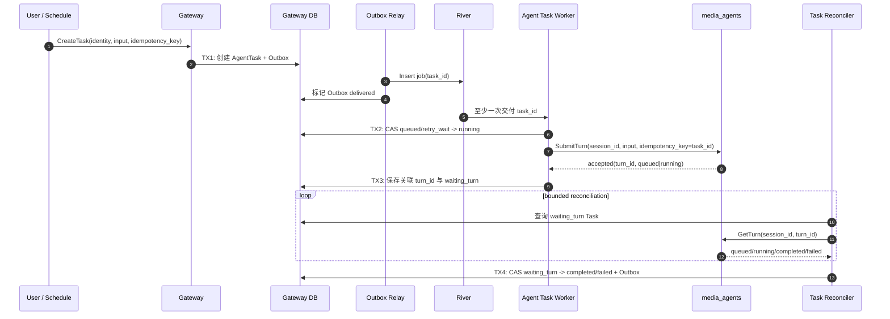

## 一句话说明

Gateway 持久化 Agent Task 并通过 River 调度；Worker 认领任务后使用 `task_id` 作为稳定幂等键向 Agent 提交 Queued Turn，再依据 Agent Turn 终态事件收敛 Task。

## 触发与结果

| 项目 | 内容 |
|:---|:---|
| 触发 | 用户、Schedule 或平台流程创建 Agent Task |
| 前置条件 | user/workspace/agent/session 身份完整且幂等键有效 |
| 成功结果 | Agent 接受 Queued Turn，最终 Turn completed 后 Task completed |
| 排队结果 | 目标 Session 正在执行其他 Turn；Task 保持 running/waiting_turn，等待 Agent FIFO 执行 |
| 失败结果 | Agent 拒绝提交，或关联 Turn 进入 failed/interrupted/cancelled |

## 执行时间线

### 步骤说明

1. Agent Task 是 Gateway 业务事实，River Job 只是可替换投递机制，Agent Turn 是独立执行事实。
2. Worker 不直接运行 Runtime，也不尝试取得 Session 锁；它只向 Agent 提交命令。Agent 决定立即 running 或持久化 queued。
3. `task_id` 是 SubmitTurn 幂等键。Worker 丢失、River 重复和调用超时均查询/重试同一 Turn，不创建第二个 Turn。
4. Task 等待终态不占用数据库长事务。有界 Reconciler 通过 Agent GetTurn 权威查询收敛；按 Session 的实时总线只用于交互流，不承担全局 durable consumer 职责。

## 状态与不变量

`queued -> running -> waiting_turn -> completed/failed/cancelled`；瞬时投递失败可由 `running -> retry_wait -> running`。三个终态不可互相覆盖。

- 一个 Task 最多关联一个有效 Agent turn_id。
- Agent Queued Turn 的队列次序由 Agent enqueue sequence 决定，River 次序不能覆盖它。
- Task cancelled 不等于 Runtime Turn 已中断；需要显式调用 Agent Interrupt/Cancel 并按实际终态收敛。

## 一致性边界

| 事务 | 原子事实 | 事务外动作 |
|:---|:---|:---|
| TX1 | AgentTask、创建事件 Outbox | River 入队 |
| TX2 | Task running、attempt | Agent SubmitTurn |
| Agent TX-ENQUEUE | Queued Turn、User Message | Gateway Task 更新 |
| TX3 | Task waiting_turn、turn_id | Agent 执行 |
| TX4 | Task 终态、终态 Outbox | Analytics/Batch/Schedule 消费 |

## 幂等、重试与补偿

| 环节 | 幂等键 | 规则 |
|:---|:---|:---|
| 创建 Task | owner + idempotency_key | 返回既有 Task |
| River 投递 | task_id | 允许重复 Job |
| 认领 | task_id + expected_status | CAS，终态直接确认消费 |
| SubmitTurn | session_id + task_id | 相同 key 返回既有 turn_id |
| 等待终态 | turn_id + terminal event_id | 重复事件 no-op；漏投查询 Agent |
| Task 终态 | task_id + expected_status | 晚到结果不得覆盖既有终态 |

## 权限与失败

Web 创建使用 Cookie JWT 或用户 Service Token；Schedule 使用代表固定用户的受控身份。Worker 用内部服务令牌与 acting user ID 向 Control 读取 Runtime Context，不持久化用户 Cookie。Gateway 把已持久化 Task 身份与 Agent Session Registration 交叉校验后，以服务身份调用 Agent。

| 失败 | 处理 |
|:---|:---|
| 无权限或输入非法 | TX1 前拒绝 |
| Outbox/River 不可用 | 保留 queued，Relay 重试 |
| Agent Submit 结果不明确 | 使用 task_id 查询/重试，不创建新 Turn |
| Turn 长时间 queued | Task 保持 waiting_turn，暴露队列状态，不在 Gateway 抢锁 |
| 终态通知漏投 | 有界 Reconciler 通过 Agent GetTurn 权威查询补偿 |
| 用户取消 | 先 CAS Task，再按产品语义显式取消 queued Turn 或中断 running Turn |

## 结果事件

产生 `AgentTaskCompleted` 或 `AgentTaskFailed`；其依据是 Agent 的关联 Turn 终态，而不是 River Job 完成。
