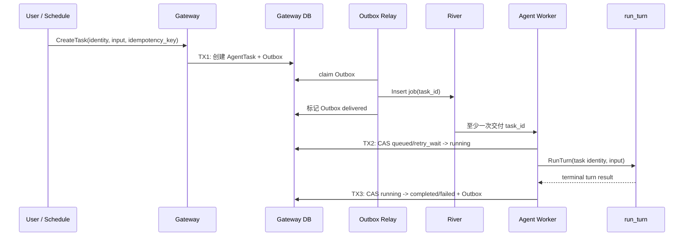

## 一句话说明
Gateway 持久化 Agent Task 后通过 River 调度，Worker 认领任务并在目标 Session 中执行 Turn。

## 触发与结果
| 项目 | 内容 |
|:---|:---|
| 触发 | 用户、Schedule 或平台流程创建 Agent Task |
| 前置条件 | user/workspace/agent 身份完整且幂等键有效 |
| 成功结果 | Task completed 并关联结果 Turn |
| 失败结果 | failed/cancelled 或保留下一次重试时间 |

## 执行时间线

### 步骤说明
1. Task 是业务事实，River Job 只是可替换的投递机制；TX1 成功即表示请求已接受。
2. Outbox Relay 可重复插入 Job，Worker 必须先读取 Task 并 CAS 认领，不能以 River Job 状态判断业务状态。
3. Worker 只从已持久化 Task 读取代表用户、Workspace 和 Agent，不信任队列 payload 覆盖身份。
4. `run_turn` 返回结果不明确时先查询关联 Turn；不得直接创建新 Turn。

## 关键参数
`idempotency_key` 保证业务任务唯一；`run_after` 支持延迟执行；身份快照用于授权和审计。

## 状态与不变量
`queued -> running -> completed/failed/cancelled`；瞬时失败可由 `running -> retry_wait -> running` 恢复。三个终态不可互相覆盖。一个 Task 最多关联一个有效结果 Turn；River 重试次数不是 Task 业务重试次数。

## 一致性边界
| 事务 | 原子事实 | 事务外动作 |
|:---|:---|:---|
| TX1 | AgentTask、创建事件 Outbox | River 入队 |
| TX2 | Task running、attempt、lease | 执行 Turn |
| TX3 | Task 终态、结果引用、终态 Outbox | Analytics/Batch/Schedule 消费 |

## 幂等、重试与补偿
| 环节 | 幂等键 | 规则 |
|:---|:---|:---|
| 创建 | owner + idempotency_key | 返回既有 Task |
| 投递 | task_id | 允许重复 Job |
| 认领 | task_id + expected_status | CAS，终态直接确认消费 |
| Turn 执行 | task_id | 查询已有 turn_id 后再决定恢复 |
| 终态 | task_id + attempt | 晚到结果不得覆盖 cancelled/其他终态 |

只有确认尚未发生不可逆工具副作用的瞬时错误可以自动重试；否则 Task 进入 failed，由新命令显式重跑。

## 权限与失败
Web 创建使用 Cookie JWT 或用户 Service Token；Schedule 使用由 Control 托管、代表固定用户的 Platform Token。Gateway 校验 Workspace 权限后持久化身份快照。Worker 使用 mTLS 服务身份领取任务；Runtime 调 MCP 使用 Session Token。

| 失败 | 处理 |
|:---|:---|
| 无权限或输入非法 | TX1 前拒绝，不创建 Task |
| Outbox/River 不可用 | 保留 queued，Relay 重试 |
| Worker 丢失 lease | 新 Worker 可重新认领；先协调已有 Turn |
| 用户取消 | CAS 为 cancelled；晚到结果只审计不覆盖 |

## 结果事件
产生 `AgentTaskCompleted` 或 `AgentTaskFailed`。
