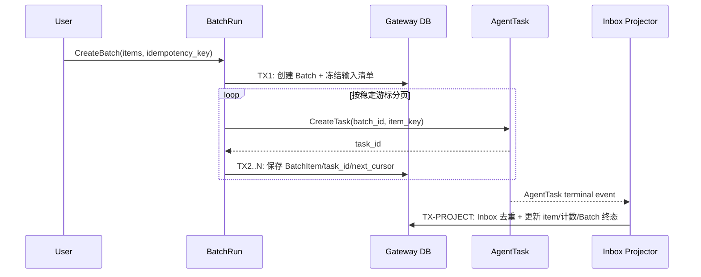

## 一句话说明
Batch Run 将稳定输入集合拆成独立 Agent Task，并通过任务事件汇总进度、失败和取消。

## 触发与结果
| 项目 | 内容 |
|:---|:---|
| 触发 | 创建 Batch Run |
| 前置条件 | 输入集合有效且调用者有 Workspace 权限 |
| 成功结果 | 所有任务进入终态并汇总 Batch 结果 |
| 失败结果 | 保留部分结果，Batch 标记 partial_failed/cancelled |

## 执行时间线

### 步骤说明
1. TX1 冻结输入顺序，后续重试始终产生相同 `item_key`。
2. 拆分不是一个大事务；每页提交游标，进程退出后从最后游标继续。
3. Batch 终态由 BatchRun Domain 根据所有 Item 状态决定，Workflow 只投递 Task 和应用结果事件。

## 关键参数
`batch_id + item_key` 是 Task 幂等键；取消版本阻止晚到任务重新启动。

## 状态与不变量
Batch 为 `creating -> running -> completed/partial_failed/failed/cancelled`。终态不可覆盖；计数必须等于各 Item 状态的投影和。取消只改变未开始 Item，已运行 Task 允许自然结束，其晚到结果保留但不得把 Batch 改回 running。

## 一致性边界
| 事务 | 原子事实 | 事务外动作 |
|:---|:---|:---|
| TX1 | Batch、冻结输入、拆分游标 | 创建 Task |
| TX2..N | 一页 BatchItem、task_id、next_cursor | 下一页拆分 |
| TX-PROJECT | Inbox、Item 终态、聚合计数、可能的 Batch 终态 | 结果通知 |

## 幂等、重试与补偿
`owner + idempotency_key` 去重 Batch；`batch_id + item_key` 去重 Task；`event_id` 去重终态事件。拆分失败从持久化游标继续，不删除已创建 Task。投影计数不一致时从 BatchItem 重建，而非手工补数。

## 权限与失败
创建和查询按 Batch 所属 Workspace 授权；内部拆分使用 mTLS 服务身份，但代表用户/Workspace 取自 Batch 事实。

| 失败 | 处理 |
|:---|:---|
| 输入非法或无权限 | TX1 前拒绝 |
| 分页拆分失败 | Batch 保持 creating/running，从游标重试 |
| 单个 Task 失败 | Item failed，最终可能 partial_failed |
| 重复/晚到事件 | Inbox 去重；终态不反转 |

## 结果事件
产生 `BatchRunCompleted`、`BatchRunPartiallyFailed` 或 `BatchRunCancelled`。
