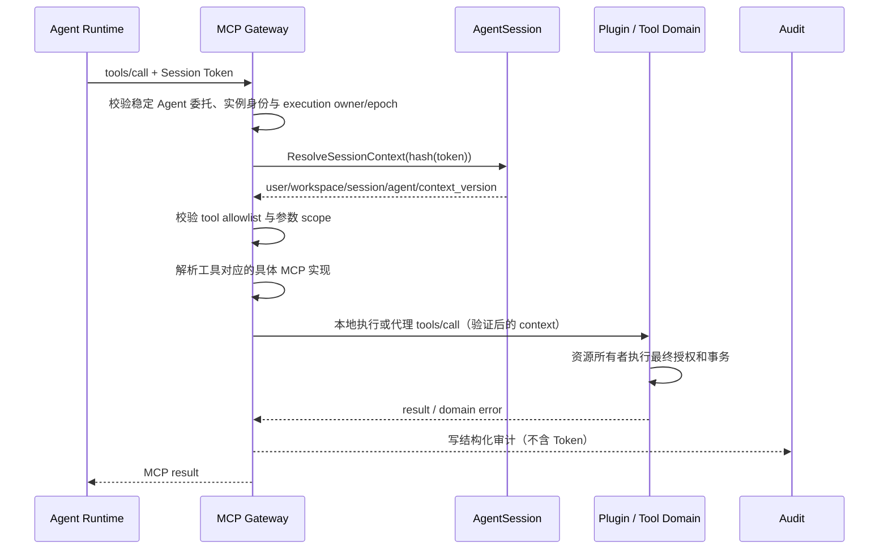

## 一句话说明
内部和外部 Agent 仅连接 Gateway 的统一 MCP 入口。User 分支验证 mcp.access 及当前组织/可选 Workspace，托管分支校验 Session Token、解析固定用户/Workspace/Session 上下文，向 Agent 暴露有权访问的工具；Platform MCP 在 Gateway 内执行，其他 MCP 调用路由到具体 Plugin 或业务服务实现。

## 触发与结果
| 项目 | 内容 |
|:---|:---|
| 触发 | Agent 通过 Gateway 查询工具或发起 MCP tool call |
| 前置条件 | Session active，稳定 Agent 委托匹配；托管 Session 的实例凭证和 running Turn/epoch 有效 |
| 成功结果 | 工具在固定 Session Context 下返回结果 |
| 失败结果 | 认证、授权或工具错误，不泄露 Platform Token |

## 执行时间线

### 步骤说明
Session Token 只证明并解析 Agent Session 上下文，不直接授予所有资源权限。MCP Gateway 在工具发现和每次调用时负责工具级授权；拥有资源的 Domain 必须再次依据解析后的 user/workspace 判断 action。

## 关键参数
Session Token 只用于解析上下文；用户、workspace、session、agent 不信任请求体覆盖。

## 状态与不变量
本 Workflow 不拥有持久化业务状态机。Session active/revoked 由 AgentSession 聚合决定，目标资源状态由 Tool Domain 决定。

## 一致性边界
身份解析是只读操作；工具业务事实仅在目标 Domain 的本地事务中提交；结构化调用审计只记录已验证 Session/user/workspace、执行身份、协议方法和结果分类，不含 Token、参数正文或结果正文。日志可靠采集和失败告警由部署观测设施承担，采集失败不得回滚或重放已经提交的工具事实。

## 幂等、重试与补偿
| 调用类型 | 重试规则 |
|:---|:---|
| 只读工具 | 网络失败可用同一请求重试 |
| 带稳定幂等键的写工具 | 由资源 Domain 返回既有结果 |
| 非幂等写工具结果不明确 | 不自动重试，先查询目标资源 |
| Token 无效或 Session 非 active | 不重试，Runtime 终止或刷新 Session 配置 |

## 权限与失败
Session Token 是 Agent Session 认证；受控 Agent/实例身份限制哪些 Runtime 能提交 Token；Platform MCP 校验工具 allowlist；目标 Domain 执行最终资源授权。任何一层都不信任请求体中的 user/workspace 覆盖解析上下文。

| 失败 | MCP 结果 |
|:---|:---|
| 稳定 Agent/实例凭证或 Session Token 无效 | unauthenticated |
| 工具未启用或资源无权访问 | permission_denied |
| 参数或资源状态非法 | invalid_argument / failed_precondition |
| 下游结果不明确 | unavailable，并标记不得盲重试 |

## 结果事件
无统一业务事件；记录结构化调用审计。

## 统一入口边界

Gateway 对 Agent 提供 MCP Server 接口，对后端 MCP 实现承担客户端职责。Agent 不配置后端 MCP 地址；后端凭据不直接透传 Agent 的入口凭据，身份传递按各后端认证契约适配。具体 Plugin/业务服务保留工具实现与最终资源授权。MCP 注册目录由 Gateway 的 MCP Catalog 拥有。工具、Prompt 使用稳定 Definition slug 命名空间；资源及模板 URI 使用保留原 URI 的来源前缀。使用官方 SDK 标准协议与兼容版本，每次请求重新授权；分页 cursor 绑定调用主体、组织/Workspace、托管 Session（如有）与来源版本，详情见 agent-mcp-gateway 实现规格。

## 连接与协议版本

入口使用无状态 HTTP 请求模型，官方 SDK 兼容 initialize 版本与 server/discover。入口不持有必须转移的 MCP 协议 Session；仅签名分页 cursor 需要跨 Gateway 保持有效。上游在一次请求内完成独立协议协商、全部发现分页和调用，结束即关闭；不建立跨请求后台连接或保存上游 Session 引用。上游分页过程复用同一连接，避免不同协议 Session 的 cursor 混用。未来若新增后台订阅，须另行设计协议引用持久化与接管。

入口 SDK 的协议上下文不传到上游；取消与 deadline 保留，认证和业务身份只通过显式、服务计算的 header 传递。发现受总条数、页数、响应大小和整体30秒 deadline 限制。调用前重新读取当前权限与目录状态；权限撤销发生在发现之后仍必须阻止发送业务调用。外部 needs_reauth 返回 Definition ID 与不可重试标记，由用户重新连接。

## 平台内媒体业务调用

User 不伪造 Session，不暴露 Session 专属平台工具。Gateway 根据当前 use_workflow/use_materials 事实决定内部业务来源可见性，托管运行约束仍取交集。平台媒体来源不要求重复创建 Binding；第三方来源保留原流程。

媒体工具统一批量参数，Gateway 只代理，不执行批次业务编排。Gateway 向 Worker 签发后端请求断言和面向 Workflow/Materials 的不同受众委托；Worker 直接访问资源 API，不回调 Gateway。资源服务验证身份/操作范围并执行原有 ACL。委托最长 60 秒，不承诺追溯撤销已提交操作。具体合约见媒体 MCP spec。

2026-10-30：内置业务来源增加 media-materials，按 materials 权限独立选择，不依赖 workflow 权限。每个来源分别与固定 Binding 限制相交；素材来源仅获 Materials 委托，不能取得 Workflow 写入凭据。每次调用重新计算当前可用来源。
