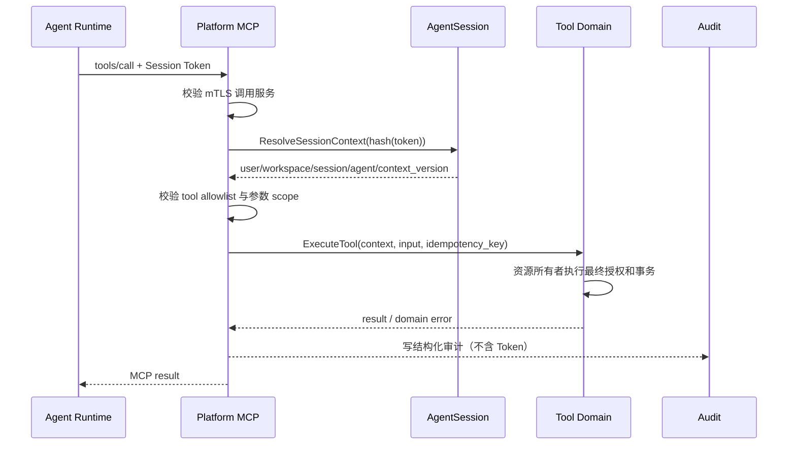

## 一句话说明
Agent 直连 Gateway Platform MCP，Gateway 校验 Session Token、解析固定用户/Workspace/Session 上下文后执行平台工具。

## 触发与结果
| 项目 | 内容 |
|:---|:---|
| 触发 | Agent 发起 Platform MCP tool call |
| 前置条件 | Session active，调用服务通过 mTLS allowlist |
| 成功结果 | 工具在固定 Session Context 下返回结果 |
| 失败结果 | 认证、授权或工具错误，不泄露 Platform Token |

## 执行时间线

### 步骤说明
Session Token 只证明并解析 Agent Session 上下文，不直接授予所有资源权限。Platform MCP 负责工具级授权；拥有资源的 Domain 必须再次依据解析后的 user/workspace 判断 action。

## 关键参数
Session Token 只用于解析上下文；用户、workspace、session、agent 不信任请求体覆盖。

## 状态与不变量
本 Workflow 不拥有持久化业务状态机。Session active/revoked 由 AgentSession 聚合决定，目标资源状态由 Tool Domain 决定。

## 一致性边界
身份解析是只读操作；工具业务事实仅在目标 Domain 的本地事务中提交；审计失败不得回滚已经提交的工具事实，但必须进入可靠重试/告警。

## 幂等、重试与补偿
| 调用类型 | 重试规则 |
|:---|:---|
| 只读工具 | 网络失败可用同一请求重试 |
| 带稳定幂等键的写工具 | 由资源 Domain 返回既有结果 |
| 非幂等写工具结果不明确 | 不自动重试，先查询目标资源 |
| Token 无效或 Session 非 active | 不重试，Runtime 终止或刷新 Session 配置 |

## 权限与失败
Session Token 是 Agent Session 认证；mTLS 限制哪些 Runtime 服务能提交 Token；Platform MCP 校验工具 allowlist；目标 Domain 执行最终资源授权。任何一层都不信任请求体中的 user/workspace 覆盖解析上下文。

| 失败 | MCP 结果 |
|:---|:---|
| mTLS/Session Token 无效 | unauthenticated |
| 工具未启用或资源无权访问 | permission_denied |
| 参数或资源状态非法 | invalid_argument / failed_precondition |
| 下游结果不明确 | unavailable，并标记不得盲重试 |

## 结果事件
无统一业务事件；记录结构化调用审计。
