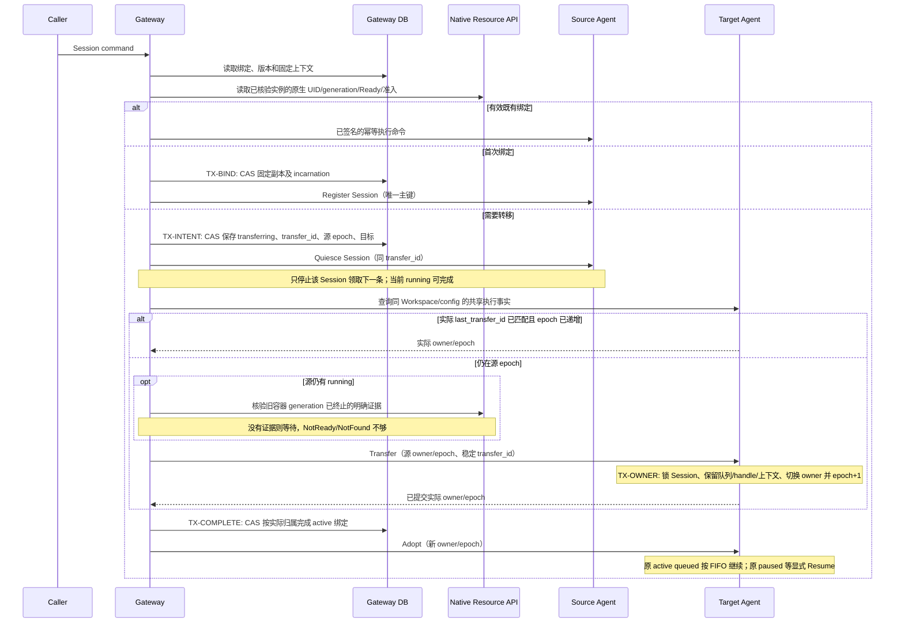

## 一句话说明

Gateway 根据 Workspace 的 Ready 副本集合为 Session 选择并持久化绑定；副本不可用或 draining 时协调旧执行结果并重绑，Agent 保证 Session 级执行互斥；Gateway 在业务排空后提交副本目标，StatefulSet 执行 Kubernetes 缩容。Docker 本期不扩缩容。

## 触发与结果

| 项目 | 内容 |
|:---|:---|
| 触发 | 新 Session 注册、已有 Session 发起执行、绑定副本不可用或缩容 |
| 成功 | 沿用有效绑定，或在协调执行后持久化新绑定 |
| 暂不可执行 | 没有 Ready 副本，或旧执行结果/所有权尚未协调；保留 Session 与绑定，不随机请求其他 Pod |
| 扩容 | 新 Session 可使用新增 Ready 副本，已有有效绑定不变 |
| 缩容 | 目标副本 draining，当前 running 结束；queued Turn 保留 FIFO 并在 Session 重绑后继续，之后移除排空副本 |

## 执行时间线

### 步骤说明

1. Session Replica Binding 是 Gateway 的路由事实；执行状态属于 Agent。首次选取按 Session ID 对 Ready 副本做 rendezvous 选择，最终绑定必须提交数据库，竞争失败者重读而不是分别调用不同副本。
2. 在 Kubernetes 中按 StatefulSet ordinal 的 Headless DNS 定位副本；Headless Service 提供网络定位，持久化由 Workspace RWX PVC 提供。DNS 变化不修改 Session 身份。
3. 普通网络错误先按同一绑定查询/重试；确认不可用或 draining 后可协调重绑，但必须防止旧进程与替代进程同时执行。同一 running Turn 不能仅因租约到期或 Pod 不可达而被自动重放。
4. 共享卷使后端可加载原生会话文件，数据库仍是 Turn/Message/Universal Event 的事实源；重绑不会生成新的业务 Session 或底层 Runtime Handle。
5. 参考 agent-platform 的排空与重绑机制；执行队列保持本项目的 Agent-owned FIFO，不复制旧项目 Control-owned Turn claim 为第二个执行事实源。

6. draining 只停止领取新执行，不要求先清空整个 queued 队列。旧副本在当前 running Turn 提交终态后停止自动声明下一条；已接受 queued Turn 的身份、输入、enqueue_sequence 和 context_version 均不变。
7. Gateway 后台主动协调有 queued Turn 的 Session 重绑，不能等用户再发一条输入才恢复。新副本获得执行所有权后按原 FIFO 继续；缺少可用候选时保持 queued 并报告等待，不丢弃、不另建 Turn。若原队列因 failed/interrupted 暂停，重绑不隐式 resume。
8. 新副本执行 queued Turn 前按其固定 context_ref 经 Gateway 重新取得允许使用的执行凭据，不复制旧进程内秘密，不把凭据加入 Turn input 或数据库；网络故障保持当前 claim 并延迟重取；明确授权拒绝时失败并暂停，等待期间允许用户中断，不启动原生执行。

## 状态与不变量

Session 业务状态不因扩缩容而改变。绑定可变但 user/workspace/agent/context_version 固定；同一 Session 最多一个 running Turn，不同 Session 可跨副本并行。晚到的旧绑定结果不能覆盖新 binding_version，Turn 终态仍不可覆盖。SSE 连接不影响执行所有权或排空判断。

## 关键参数

| 参数 | 来源 | 语义 |
|:---|:---|:---|
| session_id | Gateway Registration | 稳定会话身份 |
| replica_id | Runtime Environment | Workspace 内稳定副本引用，Kubernetes 为 ordinal |
| binding_version | Gateway DB | 并发更新路由的条件版本 |
| incarnation_id | 受控实例登记 | 本次启动代次，进程重启不复用 |
| execution_epoch / transfer_id | Agent / Gateway DB | 执行提交代次与跨库恢复意图 |
| turn_id / idempotency_key | Agent / 调用方 | 重试与结果协调标识 |

## 一致性边界

TX-BIND 只写 Gateway 本地 Session 绑定，不跨 Agent/Control 库开启事务。观察副本、协调 Runtime 和缩容均在事务外；绑定提交后目标不可用时保留该绑定与失败结果，重试先查询事实。单 Session handoff 与实例 draining 均持久化，领取和完成按 Agent 行锁/当前 incarnation/epoch 校验。目标失效时先查询实际归属，再保留同 transfer_id CAS 更新目标；已提交的实际 owner 优先于意图中的旧目标。只有明确 HTTP 404 才能按缺失聚合处理，在 epoch+1 创建目标行并与旧源迟到创建争同一主键。

## 幂等、重试与补偿

| 步骤 | 幂等/并发边界 | 失败处理 |
|:---|:---|:---|
| 绑定 | session_id + expected binding_version | 冲突重读；不重复改绑 |
| SubmitTurn | session_id + idempotency_key | 返回既有 Turn，不创建第二次执行 |
| Runtime 恢复 | turn_id + 已保存 Runtime Handle | 先查询；结果未知按既有恢复规则失败并暂停队列 |
| 接管排队执行 | session_id + 原 turn_id / enqueue_sequence | 沿用原队列和暂停状态，不重复入队，所有权未收敛不执行 |
| 缩容 | Workspace 当前协调版本与目标副本 | 观察实际状态后继续，旧版本结果不覆盖新目标 |

Gateway 使用 Kubernetes 客户端读取 Pod/StatefulSet 状态，并直接向 Agent 发起业务命令与查询。自定义 Runtime Controller 不提供探活、执行状态或排空判定接口；StatefulSet 维护副本，kubelet 执行探针。Docker 本期只有单实例创建与通信，扩缩容/跨副本重绑不适用。

## 权限与失败

Gateway 从认证主体取得身份并校验 Registration 的用户/Workspace；副本观察仅使用内部服务身份。托管 Agent 校验 Gateway 签名、Session 范围和 owner/epoch。调用方不能通过输入指定任意副本、Endpoint 或其他 Workspace。没有可用副本时返回可恢复的不可用结果，不删除 Session；非幂等工具结果未知时禁止盲重试。

## 结果事件

路由协调不产生 Turn 终态；Turn 终态仍由 Agent 决定。目录与实例观测变化只影响路由选择和恢复，不直接修改交互事实。
