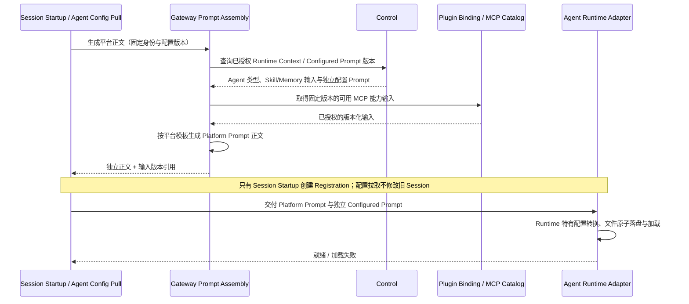

## 一句话说明

Session 启动或 Agent 经 Gateway 拉取已确认配置时，Gateway 使用固定的运行配置与已授权能力输入生成 Platform Prompt 正文；Configured Prompt 仍归 Control，Agent 分别接收两类内容并完成 Runtime 特有的落盘与加载。

## 触发与结果

| 项目 | 内容 |
|:---|:---|
| 触发 | 新 Session 启动，或 Agent 在确认更新通知后经 Gateway 拉取固定目标配置 |
| 前置条件 | 用户与 Workspace 已授权，Control 配置和 MCP Binding 的版本可解析 |
| 成功 | 生成独立 Platform Prompt 正文，与 Configured Prompt 分开交付 |
| 失败 | 不注册包含半成品 Prompt 的 Runtime Session，返回具体缺失项或可重试错误 |

## 执行时间线

### 步骤说明

1. Platform Prompt 描述平台能力、持久化文件约定、Skill/MCP/Memory 的使用方式；实际权限仍由 Gateway 与资源服务校验，正文不能授予权限。
2. Gateway 管理平台模板并生成正文，不编辑 Control 中用户配置的角色/任务 Prompt，也不在此流程把两类内容合成为唯一最终提示词。
3. Agent 决定文件名、目标路径、Runtime 参数和加载方式；两类内容的语义归属保持独立。共享文件发布须避免半写入以及不同 Session 快照互相覆盖。
4. Gateway 不缓存控制配置，每次代理 Control 的指定版本查询，在响应链路中生成 Platform Prompt 正文。纯配置拉取不创建或修改 Session Registration；Session Startup 的业务写入由其所属聚合负责。任何来源读取/加载都是事务外操作。

## 状态与不变量

无独立持久化状态机。Session 版本固定规则保持不变；Gateway 升级或模板变化不意味着既有 Session 自动更新。重试必须使用原 Session 的输入版本，不能读取当前配置悄悄替换旧内容。

## 关键参数

| 参数 | 来源 | 语义 |
|:---|:---|:---|
| user/workspace/agent | 已授权 Session 创建上下文 | 平台正文的固定身份输入 |
| context_version | Control / Registration | Configured Prompt 与运行配置版本 |
| 平台模板版本 | Gateway 定义、Control release 固定引用 | 平台正文生成所用不可变模板标识 |
| 能力输入版本 | Control、Gateway Catalog、Plugin Binding | 正文中 Skill/MCP/Memory 使用说明的来源 |

## 一致性边界

读取与渲染不持有跨服务事务。来源版本不一致时放弃结果并重新组装；不能交付混合版本正文。Control release 保存不可变模板版本引用，缺失引用的历史发布按版本1解释；新用户确认发布选择版本2。Session 启动链路固定本次生成的输入与结果引用，重试和副本切换不能因 Gateway 当前模板变化而重新解释旧 Session。正文与版本引用的持久化格式、共享 HOME 下的 Session 文件隔离及加载契约在 spec 中明确。

## 幂等、重试与补偿

| 步骤 | 重复处理规则 | 失败结果 |
|:---|:---|:---|
| 配置与能力查询 | 读取相同版本；瞬时失败有限重试 | 缺失/无权限不自动换用当前版本 |
| 正文生成 | 相同模板与输入确定性生成 | 校验失败返回明确错误，不输出半成品 |
| Agent 加载 | 原 Session 与正文版本重复交付 | 原子落盘；结果不明由启动 Workflow 查询协调 |

## 权限与失败

Gateway 使用已验证用户和固定 Workspace/Agent 请求来源服务，来源服务执行资源授权。请求体不能覆盖身份、指定任意模板或扩大能力范围。Provider API Key、Session Token 等秘密不进入 Prompt 正文、生成版本或日志。失败不修改 Configured Prompt，不重置既有 Runtime Session。

## 结果事件

无独立业务事件；运行注册结果由 agent_session_startup 发布。
