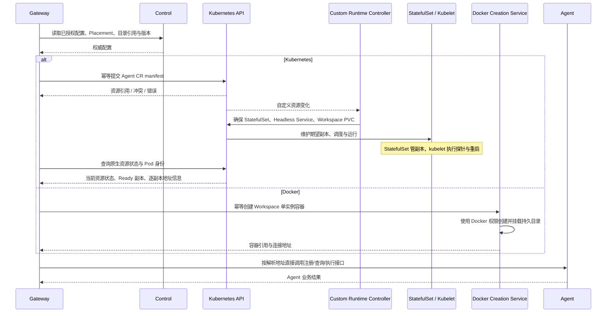

## 一句话说明

Gateway 取得 Control 已授权的配置与 Placement，使用 Kubernetes 客户端提交 Agent 自定义资源 manifest，由 Runtime Controller 创建承载资源；Docker 下调用有 Docker 权限的创建服务。创建后 Gateway 直接与 Agent 通信。

## 触发与结果

| 项目 | 内容 |
|:---|:---|
| 触发 | Control 生命周期协调或 Session 启动需要确保 Agent 资源存在 |
| 前置条件 | Workspace 与环境授权有效，配置/Placement 可解析 |
| Kubernetes 结果 | Agent CR 及关联 StatefulSet/Headless Service/Workspace PVC 存在，Gateway 可解析逐副本地址 |
| Docker 结果 | 对应 Workspace 的单个 Agent 容器存在，返回稳定连接地址 |
| 失败 | 保留业务目标与资源引用，重复请求幂等协调，不创建重复实例 |

## 执行时间线

### 步骤说明

1. Control 保持业务配置事实源，Gateway 生成 manifest 和调用环境创建接口，不让 Runtime Controller 承接控制面业务规则。
2. 自定义控制器对 Agent CR 协调关联资源，不直接管理每个 Pod 的健康或自己维持副本数；副本由 StatefulSet 维护，探针由 kubelet 执行。读取所管理资源用于资源协调不等于增加 Agent 探活接口。
3. Gateway 直接使用 Kubernetes 客户端提交/查询 manifest；自定义控制器不是 Gateway 的 RPC 健康代理。Gateway 创建后直接与 Agent 通信。
4. Docker 创建服务持有 Docker 权限；本期只做单实例创建，不模拟 StatefulSet、不实现扩缩容。
5. Kubernetes 的业务排空与 Session 重绑由 Gateway/Agent 协调，完成后提交目标副本数。Controller 不查询 running Turn，不决定是否可以继续队列。

## 状态与不变量

没有新的独立业务状态机。Control Workspace 目标、Kubernetes 资源状态、Session 注册状态和 Agent Turn 状态分别归其所有者。创建接受不等于 Ready；镜像或容器重启不改变 Session ID。Workspace 目录独占，普通重启保留文件。

## 一致性边界

Control 配置读取、Kubernetes API 请求、Docker 创建与 Agent 注册不进入同一数据库事务。资源标识由 Workspace/环境稳定确定；创建后 Session 注册事务仍由 agent_session_startup 管理。Gateway 不复制控制配置为新的事实表或缓存。

## 幂等、重试与补偿

| 步骤 | 边界 | 恢复 |
|:---|:---|:---|
| 获取配置 | Workspace/已确认版本 | 有限重试，归属未知不猜测 |
| 提交 manifest | 环境 + Namespace + 稳定资源名与 Workspace 归属 | 冲突重读，不覆盖其他 Workspace 资源 |
| 自定义资源协调 | Agent CR UID/当前 spec | 幂等确保关联 StatefulSet 等资源 |
| Docker 创建 | 环境 + Workspace 稳定创建键 | 先查既有结果再重试，不创建第二容器 |
| Agent 注册 | session_id + context_version | 返回同版本既有会话，结果不明先查询 |

## 权限与失败

Gateway 校验业务身份与 Control 的配置/环境授权，Kubernetes 客户端凭据仅允许管理规定的 Agent CR 与读取所需资源；Controller 拥有创建关联承载资源的权限。Docker 权限仅在创建服务内。实例配置引用与秘密使用受控交付，不放入消息、日志或任意用户 manifest。

无 Ready 副本时保持 starting/等待或返回可重试不可用，不假装 Agent 已注册。隔离/mount identity 错误不自动覆盖；创建后 Agent 业务错误由其自身接口解释，不要求 Controller 判断业务执行状态。

## 结果事件

创建协调只返回资源引用与可观察结果；Session/Turn 领域事件仍由相应 Domain 产生。

## 实现映射

Gateway biz/workflow 协调创建与 Session 注册；Kubernetes/Docker 客户端在 Gateway 基础设施适配。Kubernetes Runtime Controller 为独立部署的自定义控制器；Docker Runtime Controller 为有 Docker 权限的创建服务。CRD、manifest 与创建服务具体契约在 spec 中明确。

## 期望版本与缩容恢复

Control 保存版本化 Workload Target；Gateway 接口仅携带期望版本/幂等键，不接受用户 manifest 或任意镜像。Gateway 每次重新读取该目标和当前权限，原生 CR 中的排空意图只用于执行恢复，不成为配置事实源。目标版本变化时重读，不能用旧 scale 请求覆盖后续意图。

缩容先在 CR 标记固定目标版本与排空操作，再持久化各被移除序号实例的 draining，代理实例 BeginDrain/GetDrain。目标内副本不排空；已有绑定不因扩容迁移。running 未结束、flush 未完成或状态未知时保持旧承载副本；只有实际 quiesced，或原生旧代次正面终止证据加 Agent 本库 running 的 failed+paused 转移，才可完成迁移并提交新的 CR replicas。目标为0时排空后保留原 Session/queued，不自动重放；恢复运行后按原绑定协调接管。

CR 的 resourceVersion 与 Control target version 同时检查；已开始排空的目标先完成，后续目标随后重读协调，不用新操作编号覆盖正在执行的屏障。降低副本数后继续保留操作标记，等待 StatefulSet 已采纳且被移除 Pod 实际退出资源集合，再清除操作，避免立即扩容复用已退休的原生代次。多个 Gateway 可重复执行同一排空 operation。缩容提交后移出成员的登记标记 retired，后续同一序号的新原生代次可重新 active；尚在排空的原生代次重启不得清除屏障。Secret 引用不含明文凭据。RWX PVC 不挂删除 ownerReference，采用不触发自动重建丢数据的 Retain 策略；缺少支持 RWX 的 StorageClass 显示 Pending，不退回 RWO。

缩容到0前逐个读取绑定 Session 的 Agent 本库事实，不能仅依据当前实例的 running_count 忽略旧 incarnation 的运行。原生代次已变化且替代实例仍 active 时，先按 P3 规则恢复绑定，再施加实例排空屏障；旧运行仍未知或缺少可安全查询/转移的实例时保留承载数量。Docker 容器使用与创建服务文件一致的 UID/GID，以保证禁用额外 capabilities 后仍能读取自身启动证明和写入 Workspace。
