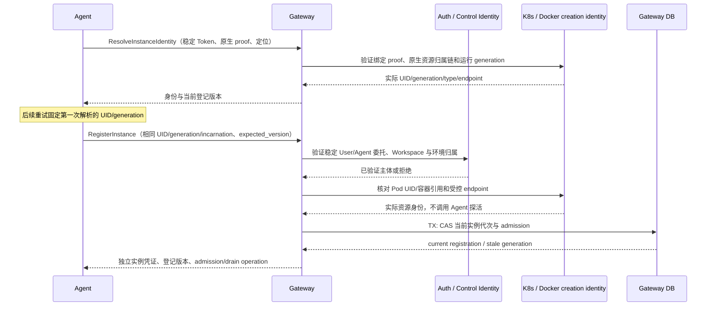

## 触发与结果

实例启动向 Gateway 注册；前提为稳定委托和环境资源身份可验证。成功提交当前实例代次；重复同代次成功等价，旧资源/无权拒绝，不确定返回503。

## 执行时间线

重复同代次与同资源成功等价；旧资源身份冲突拒绝，Control/Auth/环境不可用返回503，不把未知当不存在或自动注册。事务不包含外部查询；查询结果的资源版本在提交前校验，发生变化重新协调。Token 不存入日志或身份字段。该注册不改变 Session/Turn，也不把副本身份升级为 User 授权主体。

注册、配置拉取与结果上报使用同一受控链路。缩容 admission CAS 不可被同代次重复注册悄悄改回 active；新代次是否恢复准入由当前工作负载目标决定。

## 状态与不变量

Instance Registration 的当前代次/admission 由 Agent Instance Domain CAS 决定。Kubernetes Ready 不归此状态机；缩容 draining 不能被同代次重试注册覆盖。旧运行结果不能覆盖新代次，注册不改变 Session/Turn。

## 一致性与幂等

身份/资源查询在本地事务外，TX 只保存已核验的当前实例注册。重复键是 environment/workspace/config/replica/native generation/incarnation；同 generation 不同 incarnation 拒绝，原生 generation 变化要求新进程重新启动注册，不从超时推断不存在。数据库提交后响应丢失时按固定代次重试；使用原密钥版本重建同一凭证，不产生新代次。

## 关键参数与权限

Agent API Token 从受控创建/Token provisioning 取得；稳定 config ID 从 Control 核验，资源 UID/endpoint 从环境读取，incarnation 为当前进程启动标识。Gateway 验证委托、Workspace/环境关系，不信任自报URL/身份覆盖。后端凭据仅受控交付，不进入注册事实或日志。

## 结果事件

实例注册结果作为 Gateway 路由与配置应用观测的输入，不产生 Turn 终态。各值的具体 API 表达见核心接口规格。
