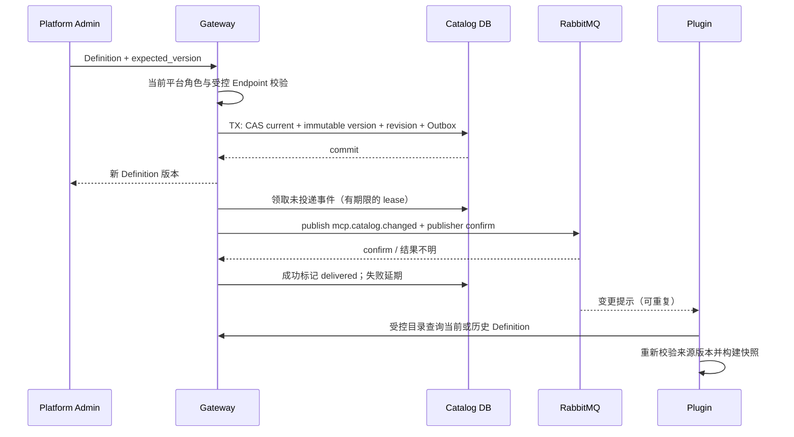

## 触发与结果

平台管理员登记、更新或启停 Definition。当前角色由 Auth GetMe 取得；请求体、Cookie 或未签名角色不能授予目录写权限。成功后返回新版本；旧版本继续可查询，版本冲突要求重读。

## 执行时间线

## 一致性、幂等与失败

目录聚合决定版本和状态；Workflow 只协调提交后的通知。目录事务中不调用 Broker/Plugin。事件以 Definition ID/version 唯一，重试使用同一 event_id；发布成功但确认或 delivered 更新丢失可以产生重复。消费者按版本去重并重新查询权威目录，不能把消息当完整配置。停机未发出的事件保留，Gateway 重启后继续领取；无消费者时通知允许丢失，Plugin 启动/对账仍必须查询目录。

Catalog 更新不自动通知 Agent，不修改 Control release 或已有 Session。旧固定 Definition 配置保留，但当前 disabled/retired 是调用准入屏障。Gateway 每次调用直接读数据库，因此多 Gateway 不依赖广播刷新本地授权缓存。

Plugin 是外部事实所有者，不读取 Gateway 数据库；读接口使用部署服务凭证，写接口仅平台管理员可用。目录历史不携带 OAuth 秘密。审计及具体 Plugin Snapshot 事务由各自上下文承担。
