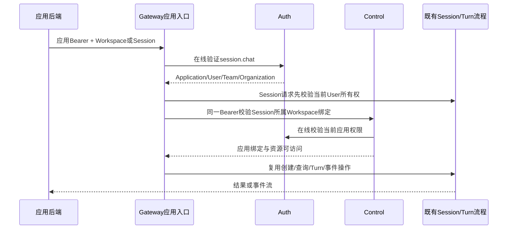

# 应用会话访问与 Caller

触发者是携带应用短期 Bearer 的受信业务后端；每次由 Auth 验证当前应用、User、Team Grant、成员和 scopes，再由 Control 校验当前应用绑定与 Workspace 权限。Gateway 的 Session 仍持有 User/Workspace 归属，不拥有应用映射。

不提供默认Workspace回退。请求带Cookie不替代Bearer；验证后不转发Cookie。Auth不可用拒绝，不回退mock身份。跨服务无共享事务；Session创建响应不明先查询，Turn沿用idempotency_key。事件连接在建立时验证，后续新请求重新检查权限；不承诺撤销主动中断已有SSE。

MCP Caller是独立出站身份声明：现有MCPIdentity验证Agent Token、Session、Control配置与实例上下文，取得User/Workspace/Team；每次直接上游HTTP请求由Auth确认登记目标origin、活跃Application、应用User映射、Grant和成员权限，Gateway签60秒专用typ/audience声明。GET/POST/DELETE均重新解析，静态或请求传入的X-Platform-Caller先删除。未登记不签，登记但身份不匹配拒绝；OAuth代理不携带声明。

Caller不替代既有MCP绑定/工具权限与业务委托协议；业务接收方校验可信公钥、issuer、audience、期限，再查询本地用户与资源权限。签名密钥不自动生成；缺少密钥时不签发。撤销不再签发，离线验签的旧Caller最长存活60秒。
