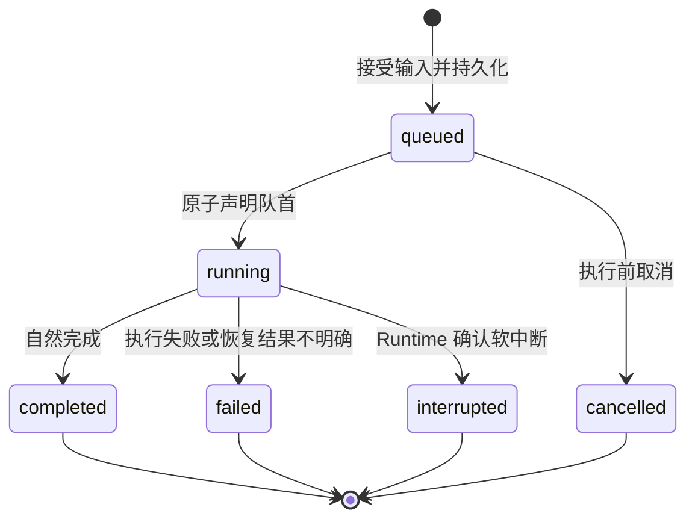

## 一句话职责

Runtime Session 拥有同一 Agent Session 的 Turn 接受与串行调度、Message、Universal Event、Session sequence、Chat Status 和 Runtime 执行恢复事实。

## 边界

### 做什么

- 使用 Gateway 分配的稳定 `session_id` 注册 Runtime Session，并固定运行配置版本。
- 把每次已接受输入持久化为 Queued Turn，按 Session 内 enqueue sequence 串行执行。
- 保证同一 Runtime Session 任一时刻最多一个 running Turn。
- 执行模型和工具调用，保存 Message、Agent Request 和可恢复 Universal Event。
- 原子分配 Session sequence，在数据库提交后向 Session Event Bus 发布通知。
- 接受当前 Turn 的软中断，保留已提交事实和仍在队列中的 Turn。
- 按 `session_id + after_sequence` 提供持久化事件回放。

### 不做什么

- 不验证浏览器 Cookie，不决定 Web 用户是否有权访问 Session；该职责属于 Gateway。
- 不拥有 Workspace、Agent 或 Plugin 的期望配置，只保存已注册的版本化运行快照引用。
- 不提供浏览器 SSE framing；Gateway 负责把查询结果和总线通知转换为 SSE。
- 不把 Redis、Kafka offset 或任一 Gateway 连接当成业务执行状态。

## 能力清单

| 能力 | 说明 | 对外接口/函数 |
|:---|:---|:---|
| 注册运行会话 | 使用稳定 Session ID 和版本化上下文创建 Runtime Session | `POST /api/v1/runtime-sessions` |
| 提交 Turn | 幂等创建 Queued Turn，并在可执行时声明队首为 running | `POST /api/v1/runtime-sessions/{session_id}/turns` |
| 中断 Turn | 软中断当前 running Turn | `POST /api/v1/runtime-sessions/{session_id}/turns/{turn_id}/interrupt` |
| 查询 Turn | 返回 Turn 与队列状态，用于结果不明确时协调 | `GET /api/v1/runtime-sessions/{session_id}/turns/{turn_id}` |
| 查询事件 | 按 Session sequence 回放 Universal Event | `GET /api/v1/runtime-sessions/{session_id}/events` |
| 查询历史 | 返回 Message 与 Chat Status | `GET /api/v1/runtime-sessions/{session_id}/messages`、Runtime Session 查询 |
| 解决 Agent Request | 持久化用户对确认、输入或权限请求的响应 | 现有 respond 接口演进 |

## 聚合与不变量

| 聚合根 | 包含对象 | 一致性边界 | 核心不变量 |
|:---|:---|:---|:---|
| Runtime Session | Turn Queue、Chat Status、Sequence Counter | 入队、声明执行与终态释放 | 同一 Session 最多一个 running Turn；enqueue、event 与 message sequence 各自严格递增 |
| Turn | Message 引用、Agent Request、执行结果 | 单次 Turn 状态变化 | 终态不可覆盖；Turn 固定属于一个 Runtime Session |
| Universal Event | Event payload | 单事件提交 | sequence 唯一且只有数据库提交后才能发布 |

Turn Queue 是 PostgreSQL 中的持久化事实，不是单进程内存队列。Agent 可以为每个活跃 Session 使用进程内异步锁减少竞争，但锁只保护调度临界区，数据库 Session 行锁和 running partial unique index 才是最终一致性边界。

### Turn 状态

- 只有最小 `enqueue_sequence` 的可执行 queued Turn 可以进入 running。
- 当前 Turn completed 后自动声明下一条 queued Turn；failed/interrupted 后默认暂停自动排空，等待显式 resume/cancel，避免在副作用结果不明确时级联执行。
- 中断只作用于当前 running Turn，不隐式删除 queued Turn。

## 领域事件

| 事件 | 产生条件 | 关键载荷 | 消费方 |
|:---|:---|:---|:---|
| `TurnQueued` | Turn 首次持久化为 queued | session_id, turn_id, enqueue_sequence | Gateway、Task Dispatch |
| `TurnStarted` | 队首原子进入 running | session_id, turn_id | Gateway、Analytics |
| `TurnCompleted` | running Turn 自然完成 | session_id, turn_id, usage, final_sequence | Gateway、Analytics、Task Dispatch |
| `TurnFailed` | Turn 进入 failed | session_id, turn_id, error_class, final_sequence | Gateway、Analytics、Task Dispatch |
| `TurnInterrupted` | Runtime 确认软中断 | session_id, turn_id, final_sequence | Gateway、Analytics |

以上终态事件同时表示可恢复 Universal Event；总线消息只是其传输副本。

## 数据模型

### `runtime_sessions`

| 字段 | 类型 | 含义 |
|:---|:---|:---|
| session_id | text PK | 与 Gateway Agent Session Registration 共享的稳定 ID |
| context_version | bigint | 已注册运行上下文版本 |
| status | text | active/paused/failed/deleted |
| chat_status | text | human/agent；可查询交互控制投影 |
| active_turn_id | text nullable | 当前 running Turn |
| runtime_session_id | text nullable | 底层 Runtime 返回的可恢复会话句柄；不得假设等于业务 session_id |
| next_turn_sequence | bigint | 下一条 Turn enqueue sequence |
| next_event_sequence | bigint | 下一条 Universal Event sequence |
| next_message_sequence | bigint | 下一条 Message 查询 sequence；与事件恢复游标独立 |
| created_at | timestamptz | 创建时间 |
| updated_at | timestamptz | 更新时间 |

### `turns`

| 字段 | 类型 | 含义 |
|:---|:---|:---|
| id | text PK | Turn ID |
| session_id | text | 所属 Runtime Session |
| idempotency_key | text | 调用方稳定幂等键 |
| enqueue_sequence | bigint | Session 内 FIFO 次序 |
| status | text | queued/running/completed/failed/interrupted/cancelled |
| input | jsonb | 已接受的用户输入 |
| context_version | bigint | 本 Turn 固定的运行上下文版本 |
| started_at | timestamptz nullable | 实际开始时间 |
| finished_at | timestamptz nullable | 终态时间 |
| error_class | text nullable | 稳定错误分类 |

#### 约束与索引

- `UNIQUE (session_id, idempotency_key)`：重复提交返回既有 Turn。
- `UNIQUE (session_id, enqueue_sequence)`：固定 Session 内执行次序。
- `UNIQUE (session_id) WHERE status = 'running'`：数据库层禁止并发执行。
- `runtime_sessions.active_turn_id` 只能引用本 Session 的 running Turn。

### `messages`

| 字段 | 类型 | 含义 |
|:---|:---|:---|
| id | text PK | Message ID |
| session_id | text | 所属 Runtime Session |
| turn_id | text | 所属 Turn |
| role | text | user/assistant/tool/system |
| content_ref | jsonb | 规范化内容或外部内容引用 |
| sequence | bigint | Message 查询次序 |
| created_at | timestamptz | 创建时间 |

Message 是面向历史查询的稳定模型；Universal Event 是恢复与订阅事实。Message 只能由 Turn 输入或已提交的完成事件生成，禁止两条独立写路径产生矛盾。
`UNIQUE (session_id, sequence)` 约束 Message Sequence；序号在持有 Runtime Session 行锁的事务内从 `next_message_sequence` 分配，禁止使用 `MAX(sequence)+1`。

### `universal_events`

| 字段 | 类型 | 含义 |
|:---|:---|:---|
| id | text PK | Universal Event ID |
| session_id | text | 所属 Runtime Session |
| turn_id | text nullable | 关联 Turn |
| sequence | bigint | Session 内严格递增恢复游标 |
| type | text | 事件类型 |
| payload | jsonb | 规范化载荷 |
| created_at | timestamptz | 提交时间 |

#### 约束与索引

- `UNIQUE (session_id, sequence)`。
- sequence 在写事件事务内从 Runtime Session 计数器原子取得；消息中间件 ID/offset 不得替代它。
- `item.started`、`item.delta` 等 Live Event Frame 不占 sequence；完成项、工具结果快照与生命周期事实占 sequence。

### `agent_requests`

| 字段 | 类型 | 含义 |
|:---|:---|:---|
| id | text PK | Agent Request ID |
| session_id | text | 所属 Runtime Session |
| turn_id | text | 所属 Turn |
| type | text | confirm/input/permission |
| payload | jsonb | 请求内容 |
| status | text | pending/resolved/cancelled/expired |
| response | jsonb nullable | 用户响应 |
| resolved_at | timestamptz nullable | 解决时间 |
| created_at | timestamptz | 创建时间 |

## 能力详细说明

### SubmitTurn

1. 锁定 Runtime Session，按 `session_id + idempotency_key` 查重。
2. 原子分配 `enqueue_sequence`，写入 queued Turn 和 user Message。
3. 若不存在 running Turn 且队列未暂停，同一调度临界区把队首声明为 running，并设置 `chat_status=agent`。
4. 返回稳定 `turn_id`、`queued|running` 和队列位置；调用方断线不影响状态。

### Runtime Session Handle

- 首次执行前 `runtime_session_id` 可以为空；Runtime 创建会话后必须先持久化其返回句柄，再接受后续 Turn 完成事实。
- 后续 Turn 和进程重启恢复只能使用已持久化句柄加载 Runtime 会话。业务 `session_id`、Gateway Registration ID 与底层 Runtime 句柄是不同命名空间。
- API key、Session Token 等短期凭据不属于 Turn input、Message 或该句柄。它们通过 write-only 执行信封到达 workflow，只在对应 Turn 的进程内执行上下文暂存；失败/中断立即清除，重启恢复时按 `context_ref` 重新协调。

### Runtime Event Durability

1. text delta 作为 Live Event Frame 发布，不持久化、不分配 sequence。
2. message `item.completed` 在同一事务写完整 assistant Message 和 Universal Event。
3. tool call 完成时以稳定 call/item ID 幂等写入一次。
4. tool result 首次立即形成快照，之后按 300ms 聚合；每次 flush 追加新 sequence，Turn 终态前强制 flush。
5. tool result 在 Agent 的持久化边界按 Runtime capability 做一次 UTF-8 安全截断，并保存截断元数据。
6. 数据库提交后发布总线；发布失败不回滚事实，由 Gateway 回放/补查恢复。

### ReplayEvents

只返回调用方授权范围内指定 Session 的 `sequence > after_sequence` 事件并按 sequence 升序分页。查询接口不返回 Live Event Frame，也不暴露数据库连接。

### 恢复

Agent 启动时扫描 running Turn 并与 Runtime adapter 的执行状态协调；能确认仍在运行时重新挂接，能确认未启动时可以用原 `turn_id` 恢复，结果不明确或可能已产生不可逆工具副作用时进入 failed，禁止自动重复整个 Turn。

## 关联关系

### 依赖的 Domain

- `media_agent_gateway/agent_session`：提供稳定 Session Registration、代表用户和版本化运行上下文。

### 被依赖的 Domain

- `media_agent_gateway/session_analytics`：消费 Turn 终态和 Usage 构建投影。
- `media_agent_gateway/agent_task`：使用稳定 task idempotency key 提交 Turn。

### 参与的 Workflow

- [execute_turn](../../workflow/0001-execute_turn/execute_turn.md)
- [agent_session_startup](../../../workflow/0002-agent-session-startup/agent_session_startup.md)

### 关联术语

- `Runtime Session`
- `Session Turn Queue`
- `Queued Turn`
- `Universal Event`
- `Session Sequence`
