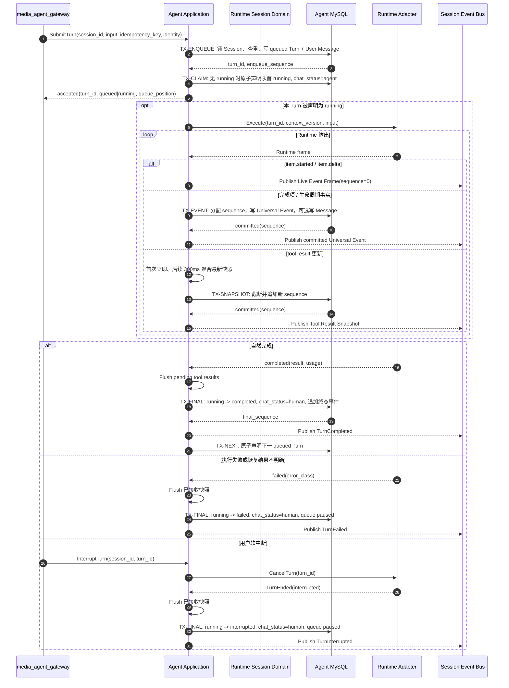

## 一句话说明

Agent 接受 Gateway 的幂等 Turn 命令后先持久化 Queued Turn，再由 Runtime Session 串行声明队首、执行模型与工具、提交可恢复事件并向 Session Event Bus 发布通知。

## 触发与结果

| 项目 | 内容 |
|:---|:---|
| 触发 | Gateway 代表已授权用户或 Agent Task 调用 `SubmitTurn` |
| 前置条件 | Runtime Session 已注册且 active；命令携带稳定 session_id、idempotency_key 和 context_version |
| 成功结果 | Turn completed；Message、最终 Tool Result Snapshot 和终态 Universal Event 可回放 |
| 排队结果 | 当前已有 running Turn，输入持久化为 queued 并返回队列位置 |
| 失败结果 | Turn failed，保留已提交事件；后续 queued Turn 默认暂停等待显式处理 |
| 中断结果 | 当前 Turn interrupted，保留已提交事件和 queued Turn |

## 执行时间线

### 步骤说明

1. TX-ENQUEUE 是接受命令的事实边界；只有 queued Turn 和 User Message 提交后才返回 accepted。HTTP/SSE 断开不会撤销已接受 Turn。
2. TX-CLAIM 锁定 Runtime Session，并依赖 `UNIQUE(session_id) WHERE status='running'`。进程内 Session Lock 可以包住 enqueue/claim 调度代码，但不能替代数据库约束。
3. Runtime 执行不持有数据库事务。临时帧只走总线；权威事件、Message 和工具快照先提交数据库，再发布总线。
4. 发布失败不把已提交事件回滚或把 Turn 标成失败；Gateway 通过 replay、缺口检测和周期补查取得事实。
5. 所有终止路径先停止 timer 并 flush 已接收工具快照，再提交终态。只有自然 completed 自动拉起下一 queued Turn；failed/interrupted 暂停队列，避免未知副作用后继续级联执行。
6. 重复 Submit、Runtime 重放和总线重复投递都以业务 ID/sequence 收敛，消息中间件的 offset 不属于业务幂等键。

## 状态与不变量

- Turn 状态由 Runtime Session Domain 决定，Gateway 和 Redis 不得直接修改。
- 同一 Session 最多一个 running Turn，不同 Session 可以并行。
- 队列次序只由 `enqueue_sequence` 决定；优先级需求必须作为显式新规则设计，禁止依赖到达某个 Agent 进程的先后。
- 客户端连接、Gateway 节点和订阅数量不影响 Turn 生命周期。
- Turn 终态不可覆盖；晚到 Runtime 事件只审计或按稳定 item ID 去重，不得复活终态 Turn。

## 关键参数

| 参数 | 产生方 | 使用方 | 语义 |
|:---|:---|:---|:---|
| session_id | Gateway | Agent | Runtime Session 稳定标识 |
| idempotency_key | Client/Agent Task | Agent | 同一业务输入的稳定标识 |
| turn_id | Agent | Runtime、Gateway | 单轮执行稳定标识 |
| enqueue_sequence | Agent DB | Agent 调度器 | Session 内 FIFO 次序 |
| sequence | Agent DB | Gateway、UI | Universal Event 恢复游标 |
| context_version | Session Registration | Runtime | 本 Turn 固定运行配置版本 |

## 一致性边界

| 事务 | 原子提交事实 | 不包含的外部副作用 |
|:---|:---|:---|
| TX-ENQUEUE | Queued Turn、User Message、enqueue sequence | Runtime 执行、总线发布 |
| TX-CLAIM | 队首 running、active_turn_id、chat_status=agent | Runtime 执行 |
| TX-EVENT | Session sequence、Universal Event、可选 Message | 总线发布、SSE 写入 |
| TX-SNAPSHOT | 规范化工具结果快照和新 sequence | 总线发布 |
| TX-FINAL | 已 flush 事件之后的 Turn 终态、chat_status、终态事件 | 总线发布、Analytics 更新、下一 Turn 执行 |

MySQL 与 Session Event Bus 不组成分布式事务。publish 失败时保留数据库事实；恢复由 Gateway replay/补查完成。若以后即时通知的故障恢复目标提高，再增加 Outbox Relay。

## 幂等、重试与补偿

| 步骤 | 幂等键 | 重试策略 | 补偿/恢复 |
|:---|:---|:---|:---|
| SubmitTurn | session_id + idempotency_key | 可安全重试 | 返回既有 turn_id |
| 声明执行 | session_id + enqueue_sequence | 唯一约束冲突后重读 | 已有 running 时保持 queued |
| Runtime 启动 | turn_id | 结果不明先查询 adapter | 不能证明安全时标记 failed，不重复副作用 |
| 完成项写入 | turn_id + item_id/call_id | 可重放 | 已存在时 no-op |
| 总线发布 | event_id/sequence | 有限重试 | Gateway 从 MySQL 补查 |
| 终态提交 | turn_id + expected_status | CAS | 既有终态胜出，晚到结果不覆盖 |

## 权限与失败

Gateway 先完成 Web 用户与 Session Registration 的资源授权，再以 mTLS 服务身份调用 Agent，并传递不可由请求体覆盖的代表用户、Workspace、Session 和 context version。Agent 校验调用服务身份及 Runtime Session 注册关系；工具访问继续使用 Session Token，由资源所属服务执行最终授权。

| 失败 | 分类 | 处理 |
|:---|:---|:---|
| Session 未注册或 context version 不匹配 | 不可重试，先修复注册 | 不创建 Turn |
| 幂等重复 | 成功等价 | 返回既有 Turn |
| MySQL 入队失败 | 可重试 | 不返回 accepted |
| Redis/总线不可用 | 通知降级 | 执行与持久化继续，Gateway 轮询补查 |
| Runtime 结果不明确 | 需协调 | 查询 adapter；无法证明安全则 failed |
| Gateway/UI 断开 | 非业务失败 | Turn 继续执行 |

## 结果事件

| 事件 | 产生条件 | 消费方 |
|:---|:---|:---|
| `TurnQueued` | queued Turn 提交 | Gateway、Task Dispatch |
| `TurnStarted` | Turn 进入 running | Gateway、Analytics |
| `TurnCompleted` | Turn 自然完成且终态提交 | Gateway、Analytics、Task Dispatch |
| `TurnFailed` | Turn failed 提交 | Gateway、Analytics、Task Dispatch |
| `TurnInterrupted` | Runtime 确认中断且终态提交 | Gateway、Analytics |
