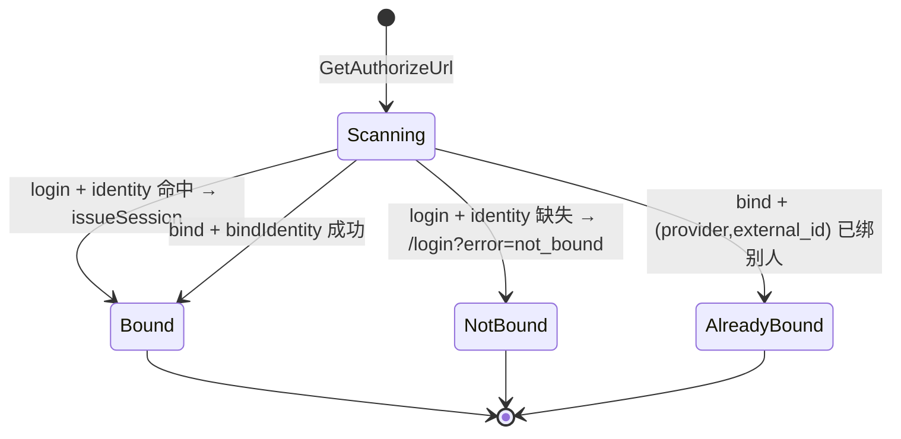

## 一句话说明
用户经企微扫码完成登录（state=login：查绑定→签 session cookie）或绑定（state=bind：手动验 cookie→写 identity 绑定）；wecom domain 主导，identity 提供映射/写入，auth 提供 session 签发与 platform token ensure。

## 执行时间线（每个接口内嵌内部处理）

```text
browser            media_auth                                    企微 corp API
   |                  |                                              |
   |-- GET /wecom/enabled -->|                                       |
   |<-- {enabled} -----|                                              |
   |-- GET /wecom/authorize?mode=login/bind -->|                     |
   |   wecom.GetAuthorizeUrl                                          |
   |   ├─ 校验 WECOM_CORP_ID/SECRET/AGENT_ID 齐备                     |
   |   └─ 拼 authorize URL(state=mode)                                |
   |<-- {url} --------|                                              |
   |-- 跳转企微扫码 --->|                            <---- 企微扫码 ----|
   |                  |                              |-- gettoken -->|
   |                  |                              |<-- corp_token -|
   |<==== 企微重定向 callback?code=&state= ====|                     |
   |-- GET /wecom/callback?code=&state= -->|                        |
   |   wecom.HandleCallback                                           |
   |   ├─ corp_token = getCorpAccessToken()  ────── gettoken ──────>|
   |   ├─ userid = 企微 auth/getuserinfo(code) ─── getuserinfo ───>|
   |   ├─ switch state:                                              |
   |   │   login:                                                    |
   |   │     identity.findUserIdentity('wecom', userid)              |
   |   │       无 → redirect /login?error=not_bound                  |
   |   │     查 users；system→system_account；无→user_not_found      |
   |   │     auth.issueSession(user) → Set-Cookie token(JWT 24h)     |
   |   │     service_token.ensurePlatformToken(user.id) [fire&forget]|
   |   │     → redirect /                                            |
   |   │   bind:                                                     |
   |   │     手动验 cookie JWT（callback 在 skip list）              |
   |   │       无效 → /login?error=auth_required                     |
   |   │     企微 user/get(userid) → display_name/metadata           |
   |   │     identity.bindIdentity(sub,'wecom',userid,...)           |
   |   │       已绑别人 → /?wecom_bind=already_bound                 |
   |   │       成功 → /?wecom_bind=success                           |
   |   └─ 上游异常 → /login?error=oauth_failed                       |
   |<-- 302 ----------|                                              |
```

## 关键流程参数传递
- `state`：高强度一次性随机值；media_auth 只保存 Hash，并关联 mode(login/bind)、发起用户（bind 时）、redirect target 和过期时间。callback 原子消费，禁止直接把 mode 当 state。
- `code`：企微一次性授权码，仅用于 `auth/getuserinfo` 换 userid，不落库。
- bind 态 `sub`：因 callback 在鉴权 skip list，不能依赖 middleware 注入，须在 handler 内手动 `verifySession(cookie)` 取得 `sub`，再传给 `identity.bindIdentity`。
- 登录成功由 media_auth 唯一签发 Cookie JWT；Edge 通过 Auth JWKS 本地验证，业务服务不接收原始 Cookie。

## 状态流转
本流程无持久状态机；`user_identities` 的存在性决定 login 成败：


## 幂等设计
- `bindIdentity` 幂等：`ON CONFLICT (user_id, provider) DO UPDATE`，重复绑定同 provider 只更新 display_name/metadata，不报错。
- `ensurePlatformToken` 幂等：部分唯一索引保证每用户至多一个 active platform token，重复触发直接返回现有。
- 企微 `code` 一次性：callback 重复点击因 code 已被企微消费会失败，由企微侧保证，media_auth 不缓存 code。

## 一致性边界

企微换取身份和读取用户资料均在数据库事务外。登录分支仅在身份已存在后签发 Cookie JWT；绑定分支在一个本地事务中写 `user_identities`，必要时同时创建 Platform Token。Cookie 签发失败不回滚已完成的绑定，用户可重新登录。

## 权限与失败

- 登录 callback 以企微返回的 external identity 查找用户；不得接受请求参数指定 user_id。
- 绑定 callback 必须重新验证当前 Cookie JWT，并要求 callback state 对应同一浏览器发起的绑定意图。
- 企微 code 无效、身份未绑定和身份已属于其他用户均不可重试；企微网络错误允许用户重新发起授权。
- 当前兼容的 mode 字符串 `state` 不提供充分 CSRF 防护；目标实现必须改为一次性随机 state，服务端保存 Hash、mode、发起用户和过期时间。

## 一致性边界

企微换取身份和读取用户资料均在数据库事务外。登录分支仅在身份已存在后签发 Cookie JWT；绑定分支在一个本地事务中写 `user_identities`，必要时同时创建 Platform Token。Cookie 签发失败不回滚已完成的绑定，用户可重新登录。

## 权限与失败

- 登录 callback 以企微返回的 external identity 查找用户；不得接受请求参数指定 user_id。
- 绑定 callback 必须重新验证当前 Cookie JWT，并要求 callback state 对应同一浏览器发起的绑定意图。
- 企微 code 无效、身份未绑定和身份已属于其他用户均不可重试；企微网络错误允许用户重新发起授权。
- 当前兼容的 mode 字符串 `state` 不提供充分 CSRF 防护；目标实现必须改为一次性随机 state，服务端保存 Hash、mode、发起用户和过期时间。
