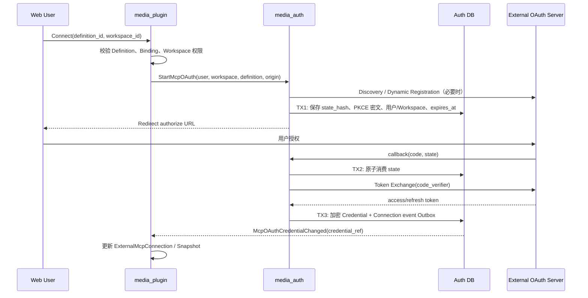

## 一句话说明

用户从 Plugin 发起 External OAuth MCP 连接；Plugin 校验 Definition 与 Workspace Binding，Auth 完成 Discovery、PKCE、callback 和加密凭据托管，成功后发布连接变化供 Plugin 更新 Connection 与 MCP Snapshot。

## 执行时间线

## 状态与不变量

授权意图为 pending/consumed/expired，state 只能消费一次。Credential 为 active/refreshing/reauth_required/revoked；长期 Token 只归 Auth。Plugin Connection 是投影，不得复制 Refresh Token。

## 一致性边界

Discovery、Registration、Token Exchange 均在事务外。TX1 持久化可跨副本恢复的授权意图；TX2 防止 callback 重放；TX3 原子保存加密凭据和 Outbox。Token Exchange 成功但 TX3 失败时不得重用已消费 code，应记录协调失败并要求重新授权。

## 幂等、刷新与恢复

`state_hash` 唯一且一次性；`user_id + server_origin` 唯一 Credential。刷新按 credential_id 单航班。瞬时错误按宽限策略重试，`invalid_grant` 直接进入 reauth_required。断开幂等，将 Credential revoked 并发布事件。

## 权限与安全

用户身份来自 Edge Web Session/API Token Internal JWT；Plugin 固定 user/workspace/definition，Auth 不信任 callback 参数覆盖。服务间使用可配置 mTLS。state、code_verifier、Access/Refresh Token 不进入 URL 日志、Trace、Outbox 或 Plugin；数据库使用 AEAD 密文与 key_version。

## 结果事件

产生 `McpOAuthCredentialConnected`、`McpOAuthCredentialReauthRequired` 或 `McpOAuthCredentialRevoked`，载荷只包含 credential_ref 和非敏感状态。
