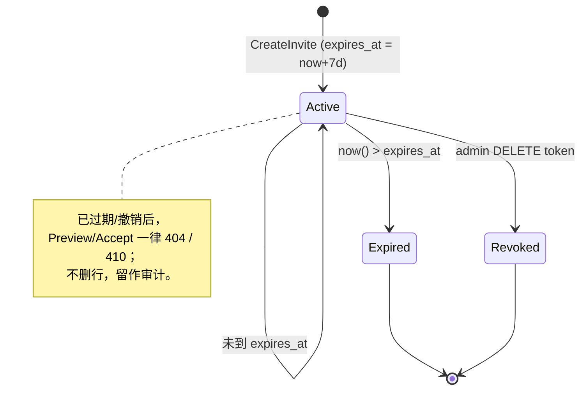

## 一句话说明
Team 所属 Organization 的成员持 `tinv_` token 预览并接受部门邀请；Team Domain 处理 Invite/Membership，Organization Domain 证明接受者已属于同一企业，接受操作对已入团者幂等。

## 执行时间线（每个接口内嵌内部处理）

```text
invitee               media_auth (team domain)              organization domain
   |                          |                                          |
   |-- GET /api/invites/{token} ----->|                                 |
   |   PreviewInvite                  |                                 |
   |   ├─ invite = getInviteByToken(token)                              |
   |   │    无 → 404                                                    |
   |   │    过期 → 410                                                  |
   |   ├─ team = getTeam(invite.team_id)                                 |
   |   │    无 → 404（team 已删，邀请残魂）                              |
   |   ├─ inviter = getUser(invite.created_by)  ← 只读 auth              |
   |   ├─ membership = getMembership(team.id, session.sub)               |
   |   └─ 返回 {team_id, team_name, inviter_name,                       |
   |            expires_at, already_member: !!membership}                |
   |<-- 200 ----|                                                        |
   |                          |                                          |
   |-- POST /api/invites/{token}/accept ->|                              |
   |   AcceptInvite                   |                                  |
   |   ├─ invite = getInviteByToken(token)                              |
   |   │    无 → 404                                                    |
   |   │    过期 → 410                                                  |
   |   ├─ team = getTeam(invite.team_id)                                 |
   |   │    无 → 404                                                    |
   |   ├─ orgMember = getOrganizationMembership(team.organization_id, session.sub)
   |   │    无 → 403（邀请不能把外部用户自动加入企业）                  |
   |   ├─ existing = getMembership(team.id, session.sub)                 |
   |   │    存在 → 返回 {team_id, already_member: true}  ← 幂等         |
   |   ├─ addTeamMember(team.id, session.sub, role='member')            |
   |   │    INSERT ... ON CONFLICT (team_id,user_id) DO NOTHING         |
   |   │    ← 无 INSERT 抛错；冲突（并发另一端也加）静默                  |
   |   └─ 返回 {team_id, already_member: false}                          |
   |<-- 200 ----|                                                        |
```

## 关键流程参数传递
- `token`：路径参数。`tinv_<base64url>` 格式；唯一识别一次邀请。Token 不绑定具体 user，但只允许 Team 所属 Organization 的现有成员接受，不能通过部门邀请自动取得企业成员资格。
- `session.sub`：所有 handler 入口由 media_auth session middleware 注入；invitee 必须已登录（cookie/bearer 任一），否则 middleware 直接 401。
- 入团 `role`：固定 `'member'`；不允许通过 invite 直升 admin。admin 任命由 `PATCH /api/teams/{id}/members/{userId}` 单独走。
- 不下发新 cookie：用户已是 platform auth 用户，session 不变；入团后通过 `ListMyTeams` 自然可见该 team。

## 状态流转
invite 的状态由"是否存在 + 是否过期"决定，无显式 status 字段：


## 幂等设计
- **AcceptInvite 幂等**：已入团者再点接受 → 直接 `already_member=true` 返回，不写库、不报错。
- **并发接受**：两个 tab 同时 Accept → 两边都过 `existing` 检查后都走 `addTeamMember`，ON CONFLICT 保证一行；两边都返回 `already_member=false` 但 DB 只多一行（无副作用）。
- **过期竞态**：`Preview` 通过后、`Accept` 触发前 token 刚过期 → Accept 内部重检 `expires_at` → 返回 410；不会写入半状态。
- **team 已删**：invite 因 `ON DELETE CASCADE` 已被清，`getInviteByToken` 返回 null → 404；不会指向幽灵 team。

## 一致性边界

Accept 先读取 Organization Membership，再在一个本地事务中重新读取并锁定 Invite、检查有效期与 Team 状态、插入 Team Membership。Organization Membership 与 Team Membership 是同服务不同聚合；接受事务提交前必须再次使用可识别版本确认企业成员仍有效。Preview 是非授权只读提示，不能替代 Accept 内的检查。通知或审计发布通过 Outbox，失败不回滚已建立的成员关系。

## 权限与失败

- Invite Token 是部门加入凭证，不是企业加入凭证；非本企业成员即使持有 Token 也必须拒绝。
- Cookie JWT 或用户 Service Token 决定接受者，body/path 不允许覆盖 user_id；角色固定为 member。
- Invite 不存在、撤销、过期或 Team 已删除不可重试；并发接受由唯一约束收敛为同一 Membership。
- Token 不得进入访问日志和 Trace；目标实现只保存高强度随机 Token 的 Hash，预览/接受时 Hash 查询。
- **invite 无一次性消费**：control-plane 现状是接受后 token 仍留痕（审计 / 防止合法邀请被反复 retry）。如业务要求"一次接受即失效"，需在 invite 上加 `consumed_at` 字段 + 接受时 UPDATE；当前不引入，留待按需建模。
