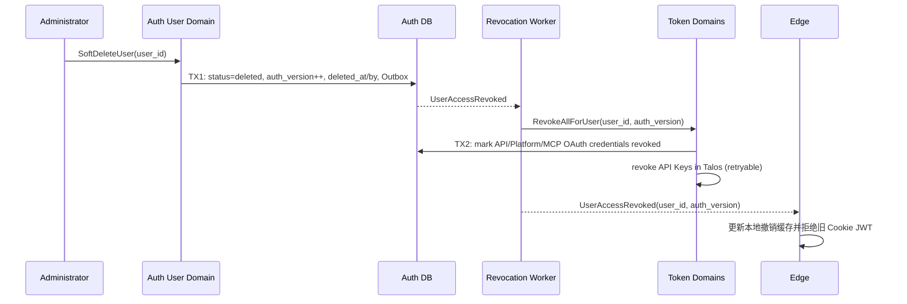

## 一句话说明

管理员软删除 User 后，Auth 原子提交 deleted 状态和撤销版本，再可靠撤销该用户的长期凭证并通知 Edge 拒绝尚未过期的旧 Cookie JWT；历史业务记录保留 user_id。

## 触发与结果

| 项目 | 内容 |
|:---|:---|
| 触发 | 管理员确认删除 User |
| 前置条件 | User 存在且非 deleted；不会删除最后一个 active admin |
| 成功结果 | User 为 deleted，所有新登录、Token 和代表调用被拒绝 |
| 部分失败 | User 仍为 deleted；凭证撤销和 Edge 通知通过 Outbox 重试 |

## 执行时间线

## 状态与不变量

`active -> disabled -> deleted` 或 `active -> deleted`；deleted 是终态。User ID、username 和历史资源引用不释放、不复用。删除不级联物理删除 Workspace、Session、Task、Message 或审计数据。

## 一致性边界

TX1 只提交 User 终态、auth_version 和 Outbox，是软删除的业务提交点。各 Token Domain 在 TX2 幂等撤销自己的凭证。Edge 缓存更新在事务外；短暂传播延迟通过 auth_version 撤销事件和可靠重试收敛。

密文Platform撤销必须参与TX2，使用独立用例`RevokeAllForUser(txCtx,user_id)`，同事务记录固定审计Outbox；不能调用会开启另一事务的独立撤销入口。兼容阶段旧凭据清理和新密文撤销均成功后才确认用户撤销事件；任一失败整笔本地事务回滚并保留重试。当前User状态与行锁禁止晚到登录确保重新发放。

## 幂等、重试与恢复

`user_id + auth_version` 是撤销幂等键。重复删除返回既有 deleted 状态。Token 已撤销视为成功；Edge 重复事件只保留最大 auth_version。撤销 Worker 失败持续重试并告警，不得把 User 恢复为 active。

## 权限与失败

- 只有管理员可触发，并禁止管理员删除自己导致系统无 active admin。
- disabled/deleted User 不能登录、续期 Cookie、创建 Token 或启动 Schedule/Agent Task。
- 删除提交前已经开始的请求和 Turn 允许自然结束；提交后禁止新调用。
- 资源所有权不会自动转移；需要转移 Workspace/Team owner 时必须在删除前完成独立业务操作。

## 结果事件

| 事件 | 产生条件 | 消费方 |
|:---|:---|:---|
| UserSoftDeleted | TX1 提交 | 审计、资源所有服务 |
| UserAccessRevoked | TX1 提交 | Token Worker、Edge |
