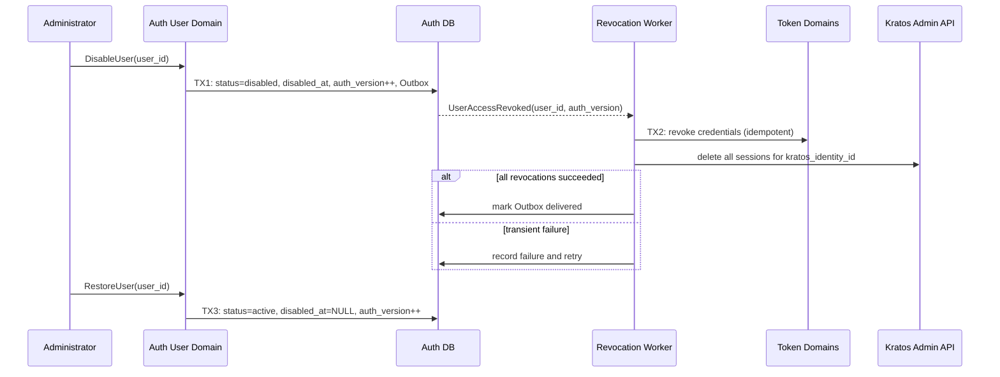

## 一句话说明

管理员禁用 User 时先原子提交业务状态和撤销事件，再可靠撤销全部长期凭证与 Kratos Web Session；恢复只重新开放登录资格，不复活旧凭证。

## 触发与结果

| 命令 | 前置状态 | 成功结果 |
|:---|:---|:---|
| `DisableUser` | active；非操作者本人；不导致 active admin 数量归零 | disabled、`auth_version + 1`、写入 `UserAccessRevoked` |
| `RestoreUser` | disabled | active、`auth_version + 1`；仍需重新登录/签发凭证 |

相同目标状态是幂等成功；deleted 是终态，不能禁用或恢复。

## 执行时间线

TX1 是禁用的业务提交点；从该时刻起，业务服务按事实源状态立即拒绝新请求。Token/Kratos 撤销属于提交后的可靠副作用，不得因外部失败回滚 User 为 active。

## 幂等、失败与晚到请求

- 撤销幂等键为 `user_id + auth_version`；Token 已撤销或 Kratos 已无 Session 均视为成功。
- Worker 在调用外部服务后、标记 delivered 前崩溃时重放相同撤销，不会创建新凭证。
- 禁用提交前已进入业务处理的请求允许自然结束；提交后的每个新请求都必须重新检查业务 User 状态。
- Restore 与尚未完成的旧撤销可以并发：旧撤销仍继续完成；因此恢复后旧 Session/Token 不会重新可用，用户必须获得新凭证。

## 身份与权限

- 操作者来自已认证的业务 User，必须为 active platform admin。
- Kratos Identity ID 只从 User 聚合读取，不能由管理请求传入。
- Kratos Admin URL 与凭证只属于服务端配置，不进入浏览器、事件载荷或日志。
