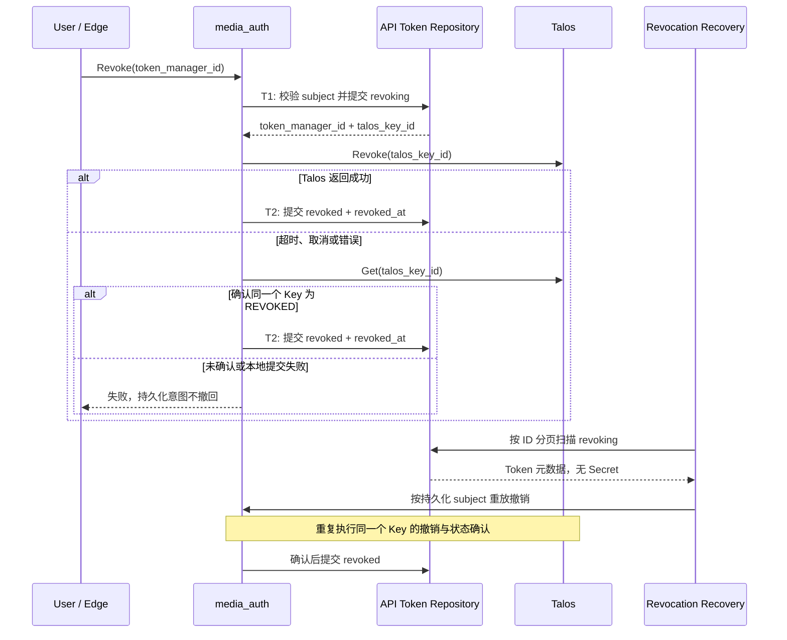
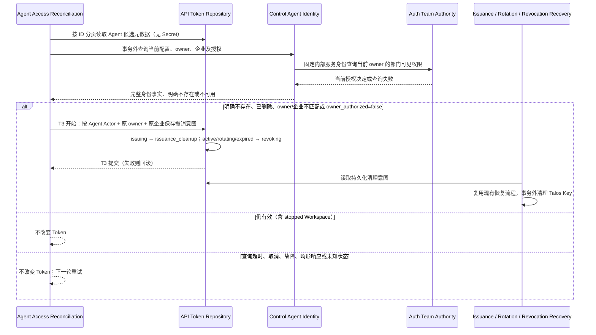

## 一句话说明

用户提交撤销后先禁止本地使用，再撤销 Talos Key；请求取消、超时或进程重启不会丢失撤销意图。

## 触发与结果

| 项目 | 内容 |
|:---|:---|
| 触发 | 当前 User 的撤销命令；后台扫描 revoking Token；后台复核 Agent Token 当前委托关系 |
| 前置条件 | 同步命令的 User 必须是 Token 的 subject；后台仅处理持久化撤销意图 |
| 成功结果 | Talos Key 已撤销，本地 Token 为 revoked |
| 失败结果 | 保留 revoking，验证拒绝，后台继续恢复 |

## 执行时间线

### 步骤说明

- T1/T2 都是 API Token 聚合的单次本地提交；外部调用不持有数据库事务。
- T1 提交后立刻 fail closed。后台任务不依赖原客户端连接、Cookie 或原请求 context。
- 查询失败、未知状态、Key ID 不匹配、404 都不算确认成功；仅明确的 `KEY_STATUS_REVOKED` 可结束不确定调用。
- 后台启动即扫描，之后每 10 秒处理一批最多 100 条，每条尝试有 15 秒期限。使用 ID keyset 游标，即使前页删除了已完成记录也不会跳过后页；失败记录不阻塞后页，完整扫描结束后从头重试。进程重启后从头扫描即可。

## 状态与不变量

| 状态 | 命令/事实 | 后继 |
|:---|:---|:---|
| active / rotating / expired | 有权 User 请求撤销 | revoking |
| revoking | Talos 已确认撤销且本地提交成功 | revoked |
| revoking | 外部/本地失败、取消 | revoking |
| revoked | 重复撤销 | revoked，不再调 Talos |

状态由 API Token 聚合维护。轮换提交必须比较旧 Key ID 和 active 状态，不允许把 revoking/revoked 改回 active。并发同步请求、后台扫描和多个服务实例可重放同一 Key 的撤销；没有重新签发副作用。

## 关键参数与一致性

`token_manager_id + talos_key_id` 是撤销的稳定操作标识；pending operation 由聚合中的 revoking 表达，不创建重复业务事实表。扫描游标是进度优化，不是幂等或授权凭据。后台从受信数据库取得 subject，仅恢复已提交意图，不接受外部 User 覆盖。

| 事务 | 原子事实 | 不包含 |
|:---|:---|:---|
| T1 | 归属校验、revoking | Talos 调用 |
| T2 | revoked、revoked_at | Talos 调用 |

## 幂等、重试与失败

- 以同一个 Talos Key ID 重试；错误响应后可查询确认终态，不创建第二把 Key。
- 数据库扫描失败保留游标；单条失败继续其他条目。取消不会清除 pending。
- 无论同步请求如何结束，持久化意图只由成功确认推进，不能补偿为 active。
- 日志仅包含 Token Manager ID 和固定失败说明，不包含 Secret、HTTP 响应正文或错误原文。

## 范围与结果事件

### Agent 委托失效的后台兜底

步骤说明：候选仅为 `actor_type=agent` 的 issuing/active/rotating/expired，最多100条，ID keyset 扫描；单条有15秒期限，失败继续后页，扫完从头重试，启动立即运行、之后每10秒处理下一批。身份查询不能占用数据库事务；短事务只保存精确 Actor/owner/企业的撤销意图，不调 Talos。重复扫描幂等，晚到签发在后续扫描捕获；已提交的撤销意图不会因授权恢复而激活。进程重启不依赖内存游标恢复。

Auth `AgentActorValidator.Assess` 区分明确失效与无法取得事实：只有 `(false,nil)` 可产生清理意图；交互验证对两者均拒绝。Control 使用专用内部服务凭据，不接受外部 Actor/owner 覆盖；日志只记录本地 Token ID 和固定原因，不记录凭据、来源正文或错误原文。数据库写失败保留原状态并重试；Talos 失败由既有恢复负责。

404 必须符合身份入口固定的 `error=agent identity not found` 响应契约；普通代理/路由404不构成失效证据，按来源不可用重试。来源服务URL仅允许根路径。

这是周期性兜底，不是生命周期事件的替代：可能遗漏两次扫描之间失效又恢复的关系，当前 Control 也没有独立 Agent disabled 事实。disabled/deleted/owner 解绑的可靠事件投递及消费仍为 `missing`，不能据此将完整生命周期门禁标记完成。

本流程只负责当前映射 Key 的撤销；rotating 期间撤销会阻止成功提交，并由 [Rotation Workflow](../0009-api-token-rotation/api_token_rotation.md) 继续清理未知 replacement。创建补偿另有职责。Talos Rotate 不接受 request_id，也不返回可再次查询的 Secret，不能套用本流程盲目重试。

无新增领域事件；列表中可观察 revoking/revoked 状态。
