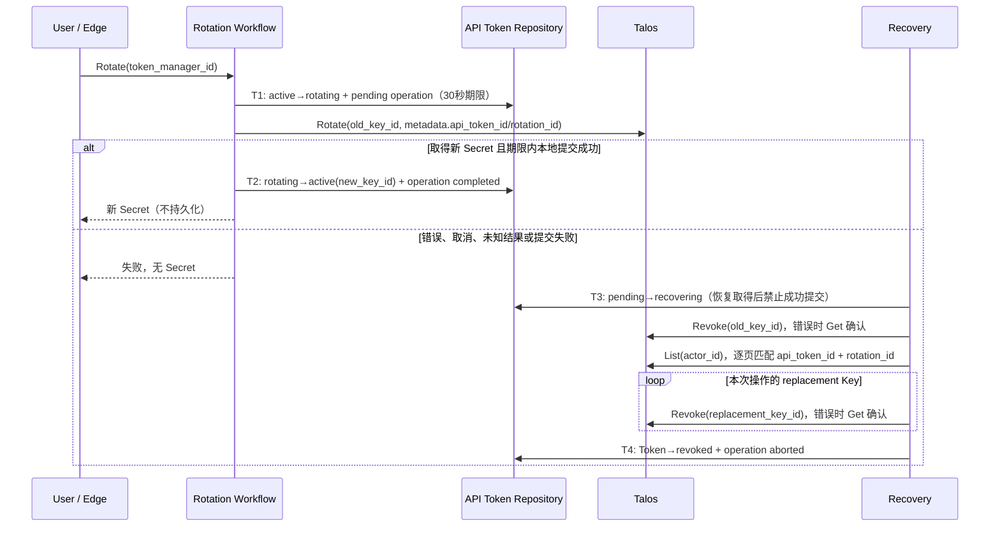

## 一句话说明

轮换正常完成时一次性返回新 Secret；轮换未能确认完成时，撤销旧 Key 和本次可能生成的新 Key，不重新执行 Rotate，也不保存或重放 Secret。

## 触发与结果

| 项目 | 内容 |
|:---|:---|
| 触发 | 当前 User 请求轮换；后台扫描过期 pending 或 recovering 操作 |
| 前置条件 | Token 属于当前 subject、active 且未过期 |
| 成功结果 | Token Manager ID 不变，绑定新 Talos Key，旧 Key 撤销，Secret 仅返回一次 |
| 失败结果 | Secret 不返回；Token fail closed，后台清理两侧凭证后进入 revoked，用户可创建新 Token |

## 执行时间线

### 步骤说明

- T1/T2/T4 各自在一个本地事务中提交 Token 与其操作记录；调用 Talos 时不持有数据库事务。操作记录是 API Token 聚合的依附实体，不是 Workflow 自有业务表。
- Talos Rotate 不支持 request_id。`rotation_id` 写入 replacement Key 的 metadata，只用于恢复定位，不当作 Talos 的幂等保证。
- 不确定结果不能通过“旧 Key 暂时还是 active”判定未执行：原调用可能晚到。恢复先撤销旧 Key，利用 Talos 的原子 Rotate 只接受 active Key 的约束阻止晚到轮换，再完整枚举该 Actor 的 Key，撤销匹配本次操作的 replacement。只能匹配两个 metadata 字段，不能撤销 Actor 的其他 Token。
- T2 要求操作仍为 pending、未超时、Token 仍为 rotating 且 Key ID 未变化。恢复取得或用户撤销后，晚到成功不得重新激活 Token。
- 若 T2 已提交但响应丢失，completed 操作不会被补偿，也不能再次返回 Secret。用户可主动再次轮换，不能自动重放 Secret。

## 状态与不变量

| 对象 | 转换 | 不变量 |
|:---|:---|:---|
| Token | active→rotating→active | 同一次操作在期限内成功提交；rotating 不可验证 |
| Token | rotating→revoking/revoked | 用户撤销或失败恢复，不能被晚到结果复活 |
| Operation | pending→completed | 仅成功提交路径，终态 |
| Operation | pending→recovering→aborted | 错误或超时后的清理，aborted 为终态 |

一把 Token 最多一条 pending/recovering 操作。同步错误可立即进入恢复；服务重启后只扫描 pending 的过期操作，避免与仍在交付 Secret 的请求竞跑。recovering 可由多个实例安全重放撤销和查询，不重发 Rotate。

## 关键参数与一致性边界

| 参数 | 产生方 | 使用方 | 语义 |
|:---|:---|:---|:---|
| operation.id | media_auth | 本地 CAS、Talos metadata | 稳定轮换尝试 ID，无 Secret |
| old_key_id | API Token | Talos | 本次轮换的旧 Key，恢复的晚到请求屏障 |
| deadline | media_auth | 本地提交、后台 | 30秒提交期限，非 Talos TTL |

| 事务 | 原子提交 |
|:---|:---|
| T1 | 归属/active/未过期 CAS、rotating、pending 记录 |
| T2 | 同一操作/旧 Key/期限 CAS、新 Key 映射、completed |
| T3 | 单条操作 recovering；completed 不能取得 |
| T4 | 确认外部 Key 已撤销后 Token revoked、operation aborted |

## 幂等、恢复和权限

- 轮换只能由 Token 的 subject 请求；后台只使用已提交的 Actor/Token/旧 Key 事实，不接受外部覆盖。
- 重复请求不重执行 pending 操作；Secret 无持久副本。多个 pending 被数据库部分唯一索引阻止。
- List 使用 actor_id 服务端过滤与游标分页，再匹配本次 metadata。列表失败、分页异常、撤销无法确认或本地提交失败保留 recovering，之后重试；禁止把 404 当作已撤销。
- 用户在 rotating 期间撤销，Token 立即 fail closed，pending 操作仍保留以清理未知 replacement。
- 每次恢复有超时；日志只有操作 ID 和固定失败说明。无新增领域事件；列表可观察 rotating/revoked。

## 架构映射

公开 Rotate API/CLI → API Token service 的归属校验 → `biz/workflow/api_token_rotation.go` → domain RotationRepository + Talos adapter。恢复后台使用同一 Workflow，事实表属于 API Token domain。
