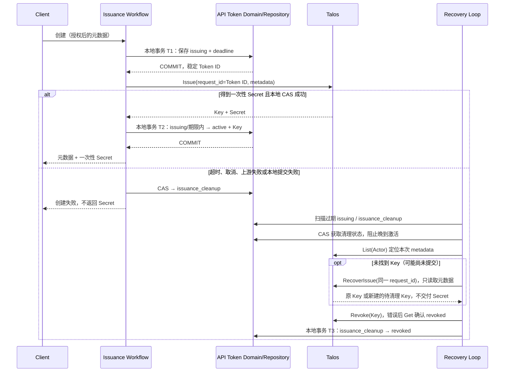

## 一句话说明

先提交 API Token 的创建意图，再调用 Talos；只有本地激活提交成功才交付一次性 Secret，否则持久清理本次 Key。

## 触发与结果

| 项目 | 内容 |
|:---|:---|
| 触发 | 已完成 User、Actor、Organization、scope 和有效期校验的创建命令 |
| 前置条件 | 持久记录成功；上游 request_id 使用本地生成的 Token ID |
| 成功结果 | Token active、绑定 Talos Key，当前请求返回 Secret |
| 失败结果 | issuing 或 issuance_cleanup 记录跨重启保留；全部清理确认后 revoked |

## 执行时间线

### 步骤说明

- 所有业务状态归 API Token 聚合；Workflow 不拥有额外业务事实表。Talos 调用发生在本地事务之外。
- issuing 尚无 Key 映射，不能验证。领取清理后同步请求不能再激活，即使 Talos 或数据库结果晚到。
- Talos 锁定版本以 request_id 唯一约束保证签发幂等；重放只返回 Key 元数据，不返回 Secret。恢复接口必须接受这种响应，正常 Issue 仍必须拒绝缺失 Secret。
- 没有找到 Key 时，单纯 List 不能阻止晚到 Issue。使用同一 request_id 再签发，得到唯一 Key 并撤销；若原调用根本未到达 Talos，恢复可能创建一个仅用于立即清理的 Key，其 Secret 不进入恢复 DTO。
- Talos 在检查幂等键前执行请求校验和 quota 检查。先完整枚举 Actor 的本次 Key，避免既有 Key 的清理受满额影响；无匹配 Key 且重放被 quota/配置拒绝时必须保留清理状态，不能假定无副作用。

## 状态与不变量

| 当前状态 | 条件/命令 | 下一个状态 |
|:---|:---|:---|
| 无 | 创建意图持久化 | issuing |
| issuing | 同步结果完整、未到 deadline、CAS 成功 | active |
| issuing | 请求失败、撤销或 deadline 到期 | issuance_cleanup |
| issuance_cleanup | 本次 Key 权威确认已撤销 | revoked |
| active | HTTP 响应丢失 | active；不能恢复或重放 Secret |

issuing/issuance_cleanup 不参与验证或轮换。撤销未完成创建时进入同一清理流程，不能用空 Key 调普通撤销。后台终止或请求断开不删除意图；多个恢复实例可重复调用上游幂等签发/撤销，但不得恢复 active。

## 关键参数

| 参数 | 产生方 | 使用方 | 语义 |
|:---|:---|:---|:---|
| Token ID | media_auth | 数据库、Talos request_id | 全局稳定签发尝试标识，不直接使用外部幂等键 |
| api_token_id / issuance_id | media_auth | Talos metadata、恢复 | 两者均为本次 Token ID，与 Actor 一起校验清理归属 |
| client_request_key | 客户端 | 本地数据库 | 在 created_by 范围内去重；不作为 Talos 全局 request_id |
| issuance_deadline | Workflow | 本地 CAS、后台 | 默认 30 秒，过期只允许清理 |

## 一致性边界

| 事务 | 原子提交 | 不包含 |
|:---|:---|:---|
| T1 | issuing、期限、授权元数据、客户端去重键 | Talos Issue |
| T2 | issuing → active、Key 映射 | HTTP Secret 交付 |
| T3 | 清理状态 → revoked、已确认 Key 映射 | Talos Revoke |

T1 未提交不调用 Talos。T2 失败不返回 Secret。T2 成功但 HTTP 交付失败不能自动撤销已完成 Token；用户通过列表发现并撤销或创建替代凭据。

## 幂等、重试与补偿

| 步骤 | 幂等键 | 重试策略 | 补偿/恢复 |
|:---|:---|:---|:---|
| 接受创建 | created_by + 非空 client_request_key | 非终态重复命令返回 conflict，不重放 Secret | revoked/expired 后可创建新的尝试 |
| Issue / RecoverIssue | Token ID | 恢复只复用同一 ID，不生成新 request_id | 校验 Actor 和 metadata 后撤销唯一 Key |
| 清理 | Token ID + Key ID | 启动即扫描，每 10 秒、keyset 每批100；每次15秒 | 上游或本地失败保留 issuance_cleanup |

请求失败时可用 `context.WithoutCancel` 发起独立、有界清理，但不能以这次最佳努力替代持久后台恢复。分页游标循环、异常列表或归属不符必须拒绝处理。

## 权限与失败

正常创建先执行现有 User/Actor/Organization 权威校验。后台只能处理持久化的服务生成 ID/Actor；不依赖原始 Session，不回查或保存 Secret。恢复 DTO 不包含 Secret 字段。Actor 或 metadata 不匹配时不撤销任何其他 Key。

| 故障 | 可观察结果 |
|:---|:---|
| T1 写库失败/幂等冲突 | 无 Talos 调用 |
| Talos 提交后响应丢失 | issuing/cleanup 保留，同 ID 恢复 |
| Revoke 响应丢失 | Get 精确 Key，只有 revoked 才可本地完成 |
| T2/T3 写库失败 | 后台重试；不能放弃意图或返回无法持久确认的 Secret |
| 上游未知字段/错误响应包含凭据 | 返回固定安全错误，不输出正文或异常字段 |

## 结果事件

无；后台从聚合的持久状态恢复，不新增 Secret Outbox。
