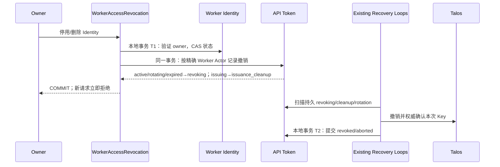

## 一句话说明

Owner 停用或删除自己的 Personal Worker Identity 时，在本地事务同时禁止身份访问和保存全部凭据的撤销意图；Talos 清理由已有后台恢复完成。

## 触发与结果

| 项目 | 内容 |
|:---|:---|
| 触发 | Owner 对 Worker Identity 发起 disabled/deleted 命令 |
| 前置条件 | 当前 User 与 Identity.owner_user_id 相同；目标状态合法 |
| 成功结果 | Identity 非 active，API Token 进入 revoking 或 issuance_cleanup |
| 失败结果 | 本地事务回滚；上游失败不影响已提交的禁止访问事实 |

## 执行时间线

Identity 与凭据为独立聚合，由 Workflow 明确协调同库事务；外部调用不进入 T1。扫描与清理复用 Issuance/Revocation/Rotation Workflow，不新建凭据副本或包含 Secret 的 Outbox。

## 状态与不变量

- Identity 使用 active→disabled、active/disabled→deleted；当前版本不提供重新激活命令，停用后创建新的身份，不复活旧凭据。
- 同状态命令幂等；deleted 为保留历史 ID 的终态。
- owner/Organization 不可转移；Credential ID 与 Worker Instance 不改变 Actor。
- 验证每次重新读取 Identity 的状态、owner、Organization，不能只凭 Actor 字符串前缀接受委托。
- 晚到签发结果不能恢复已进入清理的 Token。即使签发与停用发生竞态，非 active Identity 始终拒绝 Token 验证，后台应继续清理其未撤销凭据。

## 一致性与恢复

| 边界 | 原子事实 | 不包含 |
|:---|:---|:---|
| T1 | Identity 状态 + 当时存在的 Token 撤销意图 | Talos、客户端连接、正在执行的任务 |
| T2 | 各 Token 的确认终态 | Identity 状态回退 |

进程中断不丢失撤销意图。现有恢复循环按固定 Key/操作标识幂等清理；旋转中的 replacement 由 Rotation Workflow 清理，不能只撤销旧映射 Key。签发前需要校验当前 Identity；后台还需要扫描非 active Identity 的晚到凭据，不能以单次批量 UPDATE 宣称覆盖并发创建。

实现入口为 `biz/workflow/worker_access_revocation.go`：ChangeStatus 在 TxRunner 中调用 Identity.GetOwned/ChangeStatus 与 API Token.PrepareActorRevocation。后者单条状态表达式按精确 ActorType/Actor/owner/Organization 更新；不改已进入清理或终态的记录。ProcessBatch 每批100条非active Identity，ID keyset扫描，每项15秒，同库事务保存晚到撤销意图；Run 每10秒推进一页，错误项不阻塞后续项并在下一轮重试。扫描不缓存已完成身份，因为之后可能出现晚到签发。

## 权限与失败

owner 来自已验证 Session/User API Token，客户端不能覆盖 owner 或改绑 Organization。对其他 Owner 返回 not-found；数据库失败整笔回滚；Talos 不可用时状态保持不可访问。请求取消不恢复已提交状态；已开始任务是否终止仍由 Execution 负责，不由本流程擅自回写 Conductor。

## 结果事件

无对外事件；持久身份和 Token 状态足以驱动本服务内恢复。
