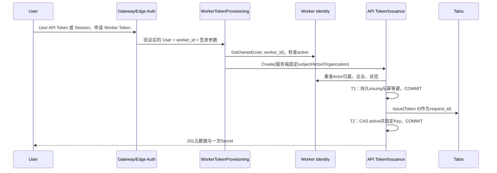

## 一句话说明

已验证的 User 为自己已有的 active Worker Identity 申请一次性交付的 API Token；服务端从身份事实派生 User、Worker Actor 和 Organization。

## 触发与结果

入口为 `CreateWorkerApiToken`，`POST /api/worker-identities/:id/api-tokens`。客户端只提供身份 ID、名称、scope、未来到期时间和可选幂等键，不提供 owner、Actor 或 Organization。其他Owner的身份返回404，非active返回403。空scope默认为五个workflow.worker.*能力，可选非空子集；禁止api.access、agent.gateway等其他scope。

## 执行时间线

编排不另外持有跨外部调用的事务、不创建新事实表。签发的持久状态、取消、丢失响应、本地提交失败和Secret交付失败沿用API Token Issuance；晚到签发与身份停用的竞态由身份实时验证和WorkerAccessRevocation扫描共同处理。两个本地事务之间发生停用时，凭据不得通过后续身份验证，即使签发响应已经生成。

## 幂等、权限与失败

- User来自media_auth已验证Session；现有middleware不允许不同act.sub的委托Actor调用管理API，不接受Worker或Agent自签User凭据。
- 幂等键按creator范围去重；重复请求409，不重发Secret；身份创建与Token签发是两个明确命令，不在失败后隐式创建第二个身份。
- 无效scope/时间400；授权失败403；未知或他人身份404；重复签发409；未配置Talos503；上游或DB错误只返回固定安全描述，不暴露Secret、SQL或上游响应。
- CLI必须先校验新输出文件，Secret仅0600保存；保存失败使用Owner User API Token撤销新Token，失败保留服务端恢复事实。

## 结果事件

无，持久状态和已有恢复流程负责生命周期；进程实例注册另属media_workflow。
