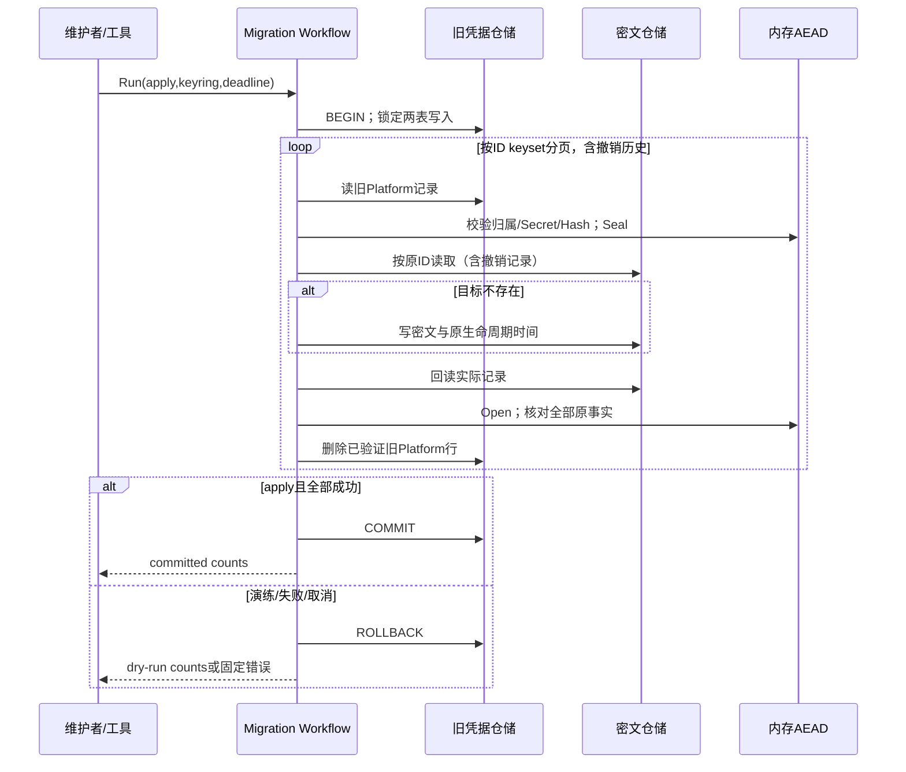

## 一句话说明

维护者在调用方已准备切换的维护窗口，执行离线工具，将全部旧Platform Token（含撤销历史）转移到独立密文表，保持ID、用户、Hash及生命周期时间不变。

## 触发与结果

| 项目 | 内容 |
|:---|:---|
| 触发 | 显式运行离线工具；默认演练，`--apply`才提交 |
| 前置条件 | 0015已应用、私有外部密钥可读；停止旧确保/读取/撤销调用方，准备切换新链路 |
| 成功结果 | 密文验证通过，旧Platform行删除；普通ServiceToken不变；只输出计数 |
| 失败结果 | 整批回滚；无部分迁移；错误不带凭据、SQL或连接信息 |

## 执行时间线

仓储只使用传入事务，Workflow拥有事务边界。锁阻止并行迁移和运行时写入竞争，但不能替代停机/切换：旧应用在提交后仍会重新创建明文。工具不自动启动、停机或切换服务。AEAD只做本地计算，事务内不调用Talos/KMS/HTTP。

旧来源仅是Platform维护投影，不保留ServiceToken业务Domain、CRUD或验证能力。完成迁移后，0017须在锁内确认所有旧Platform行已清空，再将旧表普通历史冻结为只读归档；有遗留Platform时拒绝整个归档迁移。归档表保持旧字段与ID供维护核对，不作为任何认证事实。新代码的用户撤销不修改归档，防止后台重试因写只读表而失败；完成后的维护工具重跑仍为零行。INSERT/UPDATE/DELETE/TRUNCATE均由数据库statement trigger拒绝，不能靠应用约定实现只读；管理员DDL权限不属于该防护边界。归档的down明确拒绝，不能自动回退重新启用旧凭据。

## 状态与不变量

无独立迁移状态表。唯一持久变化是同库事务中的旧记录移除与密文提交；不复活过期/撤销记录。已有相同ID目标必须可解密，且owner/Hash/创建/过期/撤销时间全部一致，否则拒绝覆盖；不同ID的Hash或当前用户冲突也整体失败。

## 关键参数

| 参数 | 产生方 | 使用方 | 语义 |
|:---|:---|:---|:---|
| legacy id | 原表 | 两侧仓储 | 稳定幂等键，不生成新ID |
| key version | 外部Secret配置 | AEAD | 已有目标须保留对应版本密钥 |
| apply | 维护者 | Workflow | 默认false，演练全部步骤后回滚 |
| deadline | 工具 | DB/Workflow | 有限等待，取消不算成功 |

## 一致性边界

| 事务 | 原子事实 | 不包含 |
|:---|:---|:---|
| 全量迁移事务 | 全部旧Platform移除与新密文写入 | 普通ServiceToken、API Token/Talos、运行时切换 |

## 幂等、重试与补偿

同一ID的完整事实比较允许恢复一致的预填充目标；完成后重跑返回0条。失败整批回滚，可重跑，不跳过坏记录或补写明文。提交结果不明确时重新演练/核对两表，不只靠退出码判断结果。

## 权限与失败

开启密文运行接线前，启动检查须确认0015/0016已应用且迁移无dirty状态、旧表无任何Platform行（含撤销历史），并分页核对全部密文记录的结构、Key版本和可解密/Hash一致性。缺失schema、未迁移事实、未知Key或损坏历史均拒绝启动；不修改/跳过/补发来掩盖失败。检查不返回Secret、不替代停止旧写入者或实际迁移，普通ServiceToken不计为未迁移Platform。

工具使用服务DatabaseConfig中的维护数据库凭据，无公开API，不接收User/Agent Token。密钥为私有regular文件，不作为命令行明文参数或日志输出。缺owner、无效Secret、Hash不一致、目标不可解密或事实冲突，须修复来源后重跑。固定安全错误；仅成功/演练输出计数。

## 结果事件

无。迁移不是新签发或撤销，不改变Talos或用户身份。
