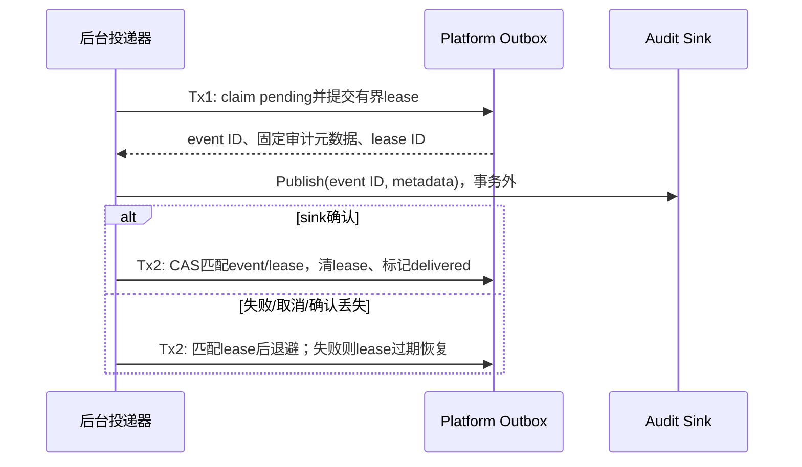

## 一句话说明

Auth后台恢复Platform Token用例同事务提交的审计Outbox，以event ID投递固定元数据到审计sink，不读取或解密Secret。

## 触发与结果

| 项目 | 内容 |
|:---|:---|
| 触发 | 后台周期扫描及进程重启 |
| 前置条件 | 用例已提交Outbox；sink及投递器已配置 |
| 成功结果 | sink接受event ID，随后本地标记delivered |
| 失败结果 | 保留未投递事实，有限退避后重试；关闭进程不丢事件 |

## 执行时间线

不得持有数据库事务调用sink。Claim不是已投递，只有sink确认后才能写delivered；若确认与本地提交之间崩溃，会再次投递同event ID。日志sink允许重复，但不是不可篡改/恰好一次账本；支持去重的sink必须按event ID去重。

## 状态与不变量

| 状态 | 转换 | 所有者 |
|:---|:---|:---|
| pending | claim→leased | platform_token Outbox |
| leased | 成功确认→delivered；失败/过期→pending | platform_token Outbox |
| delivered | 终态，不能重置 | platform_token Outbox |

并行投递器通过锁与lease避免常规重复领取；过期旧lease的晚到确认不能覆盖新lease。事件元数据不可在重试中变更，只有lease/attempt/next_attempt/delivered字段变化。

## 关键参数

| 参数 | 产生方 | 使用方 | 语义 |
|:---|:---|:---|:---|
| event ID | 用例事务 | sink/Outbox | 稳定幂等键 |
| lease ID | 后台claim | Outbox CAS | 区分每次领取，防止晚到结果 |
| timeout/lease TTL | 后台配置 | 发布器/claim | 发布超时须小于lease TTL |

## 一致性边界

用例事务只提交Token事实与Outbox；Tx1只领取，Tx2只确认/失败安排。sink是事务外副作用，至少一次投递，无Secret补偿或Token回滚。投递失败不回滚已经成功的用户命令。

## 幂等、重试与补偿

数据库失败不发布未知claim；sink失败或确认不明保留事件、退避至下次，不创建新event ID。进程退出后lease到期可重领。非空历史禁止down删除。坏元数据拒绝发布，保留未完成并报固定错误，不能把原载荷或诊断写日志。

## 权限与失败

后台仅需Outbox读写及sink服务身份，无用户Token、mTLS获取凭据权限或AEAD依赖。发布固定ID/操作/归属/caller/purpose/时间字段，禁止Header、URI、Secret、Hash、密文或错误原文。此Workflow是必须完成的目标，不以Outbox写入门禁宣称投递已完成。

## 结果事件

投递原审计event ID，不新增凭据生命周期事件。
