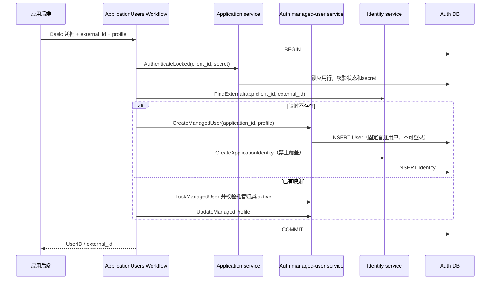

## 一句话说明
受信应用以自身 external_id 创建或更新托管用户，所有事实在 Auth 本地事务提交。

## 触发与结果
PUT /apps/v1/users/:external_id，HTTP Basic 证明应用；返回稳定 UserID，首次 201、重复 200。失败无部分 User 或 Identity。应用用户读取与短期凭证签发也通过本工作流核对映射和 User 状态。

## 执行时间线

应用行锁串行化同一应用的 provisioning、凭证签发、停用和轮换；User 行锁串行化资料更新与用户停用。锁顺序 Application → User。首次创建不查邮箱，不复用其他应用或本地用户。

## 状态与不变量
工作流无独立持久化状态；User active/disabled/deleted 归 auth，Application active/disabled 归 application。disabled/deleted 用户禁止 upsert、签发与读取，不自动恢复。已有映射不可重新绑定或被通用解绑接口删除。

## 关键参数
application_id 来自已验证 Basic；external_id 是应用稳定标识，最大256字节且不可为空。UserID 是平台随机标识；应用不提交 UserID、role、组织或密码。

## 一致性边界
单本地事务提交 User 和 Identity；重复请求只更新可覆盖的 display_name/email（最后提交者生效）。签发凭证在同一锁顺序下校验 Application、Identity、User，并保存一小时有效、固定 profile 用途的凭证哈希及版本。无外部调用、团队开通或长期 Platform Token 隐含副作用。

## 幂等、重试与补偿
upsert 的幂等键为 (application_id, external_id)，应用行锁避免并发孤立用户，唯一索引兜底。超时/断线后重复 upsert 返回同一 UserID；已提交事实不随连接断开回滚。凭证响应丢失可重新签发，旧凭证到期失效；不存明文以便重放。事务失败由调用者重试，不做资源删除补偿。

## 权限与失败
凭据错误或应用停用 401；身份不存在 404；用户已停用/删除 403；非法输入 400；数据库故障 503，不回退 Cookie 或默认用户。Bearer 用户资料请求通过凭证哈希、有效期、当前应用版本/状态、User版本/状态及身份归属联合检查；查询通过即该请求准入点，之前已准入请求可完成。

## 结果事件
无。凭证每次查询当前事实，不依赖撤销事件传播；User 既有撤销流程保持有效。

## 业务凭证扩展
Token命令可携带team_id/scopes。应用与User保持Application→User锁顺序；锁内检查Grant范围和当前组织/部门成员权限后保存绑定team/org/scope的短期凭证。只读内部校验重新查询Credential、Application、User、Identity及Grant，并由Team权限能力确认当前成员/功能；依赖故障拒绝。Grant变更先锁Application并递增版本，签发与撤销串行；成员撤销以权威查询的准入时点生效。已经开始的请求允许结束，重连/新请求必须再验。
