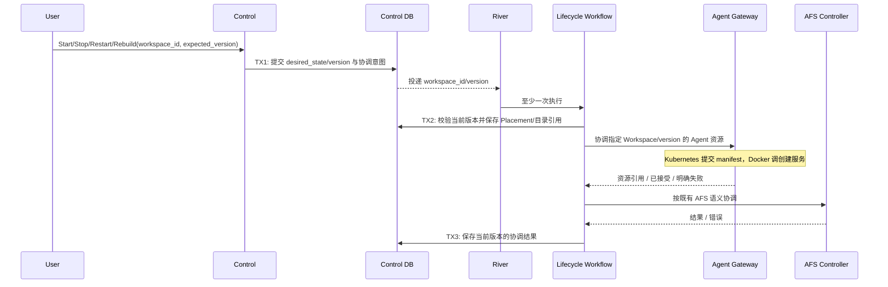
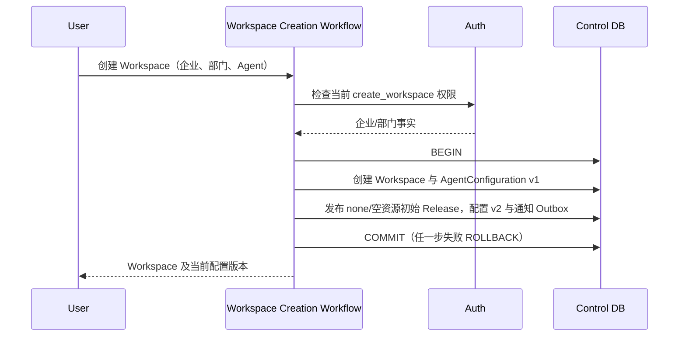

## 一句话说明

用户提交 start、stop、restart 或 rebuild 后，Control 保存 Workspace 业务期望状态与 Placement，通过 Gateway 协调 Agent 资源创建/生命周期，并按既有语义协调 AFS；Control 不直接调用自定义控制器探活或管理 Pod 副本。

## 触发与结果

| 项目 | 内容 |
|:---|:---|
| 触发 | 已授权用户的 Workspace 生命周期命令 |
| 成功 | 业务目标持久化；Gateway 按目标版本落地资源与 Agent 通信 |
| 失败 | 保留目标与失败原因，可按原 Workspace/version 重试 |
| 部署范围 | Kubernetes 使用自定义资源及 StatefulSet；Docker 本期只创建单实例，不做扩缩容 |

## 执行时间线

### 步骤说明

1. Control 拥有 Workspace 业务状态、配置与 Placement，不拥有 Pod 调度与探针执行。Gateway 的落地流程见 [agent_workload_provisioning](../../../media_agent_gateway/workflow/0009-agent_workload_provisioning/agent_workload_provisioning.md)。
2. Kubernetes 创建请求被接受不等于 Agent Ready；Gateway 使用 Kubernetes 客户端读取承载资源状态，并在可连接后直接与 Agent 通信。Runtime Controller 只创建/协调 StatefulSet、Headless Service、PVC 等资源，不实现第二套 Agent 健康管理循环。
3. Workspace Runtime Directory 仍以 Workspace 独占，Agent 挂载 /workspace，启动校验 mount identity。AFS 是既有外部依赖，不改其内部生命周期。
4. Kubernetes 的业务排空、Session 重绑由 Gateway/Agent 协调，StatefulSet 负责实际副本维护。Docker 本期不实现多副本和排空缩容。

## 状态与不变量

Workspace 决定 desired_state；资源创建结果、Agent Ready 和 Turn 状态是不同事实。每个 Workspace 独占目录，普通 stop/restart 保留目录；rebuild 不隐式清理用户文件，删除遵守既有回收策略。旧 version 任务与晚到结果不得覆盖新目标。

## 一致性边界

| 事务 | 原子事实 | 事务外操作 |
|:---|:---|:---|
| TX1 | 目标、版本、协调意图 | River/Gateway 调用 |
| TX2 | 当前协调版本、Placement/目录引用 | Kubernetes/Docker/AFS 操作 |
| TX3 | 当前版本协调结果与错误 | 用户通知 |

## 幂等、重试与补偿

Workspace/version 是协调键。Gateway 使用稳定资源名与归属校验确保重复 manifest/创建请求不生成另一套资源；结果不明确先查询创建结果。Control 不因 Gateway 超时回滚业务目标。版本过期结束旧协调；mount identity 不匹配不可自动覆盖。

## 权限与失败

Control 校验 Workspace manage 与环境授权后，以受信服务身份请求 Gateway。Gateway 从权威配置生成 manifest，不接受用户提供任意 Namespace、镜像、挂载路径或凭据。配置/隔离错误明确失败，基础设施瞬时错误有限重试，创建接受后按环境原生资源状态协调。

## 结果事件

沿用 WorkspaceStateConverged / WorkspaceConvergenceFailed 的业务协调结果；不得把 manifest 提交成功当作 Agent 可执行。

## Harness 映射

Control 的 biz/workflow 协调业务生命周期，domain 保存 Workspace/Placement。Gateway 的 biz/workflow 落地 Agent 资源并管理 Session 路由，Kubernetes/Docker 客户端属于其基础设施适配。自定义控制器不访问 Agent 执行数据库或调用业务状态接口。

受控 Agent 类型包含 codex、claude-code 与 goose；所选类型必须在部署提供的工作负载 profile 中有对应镜像与资源配置。

## 新建 Workspace 的初始配置

创建时先在事务外验证企业/部门权限与 Agent 类型，再在一个本地事务内提交 Workspace、稳定 Agent 配置及空选择的初始 Release（Prompt none，无 Skill/MCP）。初始 Release 包含系统 Prompt 模板版本，确保用户未选择任何资源也能创建具备系统指引的会话。初始配置与 Workspace 一起提交，失败整体回滚，不留下需要用户手工激活的半成品。该首次初始化不选择库最新版本，也不更新任何已有 Session。后续资源升级仍必须用户明确确认。

创建接口仍无客户端幂等键；事务已提交而响应丢失时由用户查询 Workspace 列表确认结果，不自动重发新建命令。
