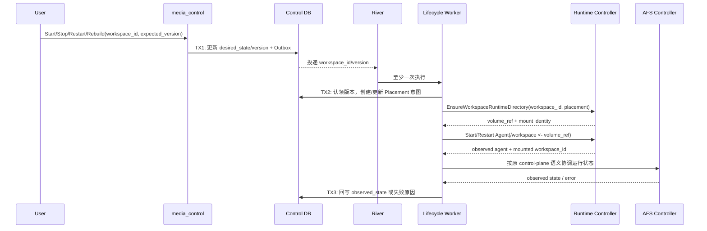

## 一句话说明
用户提交 start、stop、restart 或 rebuild 后，Control 先持久化 Workspace 期望状态，再协调 Placement、Workspace Runtime Directory 与既有 AFS Controller，直到收敛或进入可恢复失败。

## 触发与结果
| 项目 | 内容 |
|:---|:---|
| 触发 | Workspace 生命周期命令 |
| 前置条件 | 调用者有 Workspace manage 权限 |
| 成功结果 | 实际状态与期望状态收敛 |
| 失败结果 | 保留期望状态和失败原因，允许重试 |

## 执行时间线

### 步骤说明
命令只提交期望状态，不等待基础设施完成。Worker 只处理当前 version；旧版本消息直接结束。Runtime Controller 必须先确保 Workspace Runtime Directory，再启动 Agent；容器内固定挂载点为 `/workspace`，具体宿主路径属于部署适配器。Agent 启动时校验目录中的 mount identity 与配置 `workspace_id` 相同，冲突时拒绝启动，禁止误用其他 Workspace 文件。AFS Controller 是第三方依赖，保持原使用方式，不修改其代码和内部生命周期语义。

## 关键参数
`workspace_id` 固定租户边界，也是 Workspace Runtime Directory 的唯一归属键；`version` 同时作为乐观锁和幂等版本。

## 状态与不变量
Workspace 的 `desired_state` 由 Workspace 聚合决定，`observed_state` 是协调结果。二者短暂不一致是正常状态。每个 Workspace 只有一个 Workspace Runtime Directory；不同 Workspace 不共享目录。普通 stop/restart 不删除目录；rebuild 只重建容器和可再生运行文件，是否清理用户文件必须是显式独立命令。删除遵守回收期，晚到的旧 version 结果不得覆盖新期望。

## 一致性边界
| 事务 | 原子事实 | 事务外动作 |
|:---|:---|:---|
| TX1 | desired_state、version、Outbox | River 投递 |
| TX2 | 当前协调版本、Placement 意图/lease、volume_ref | 创建/挂载目录、启动 Agent、调 AFS Controller |
| TX3 | observed_state、错误、结果事件 | 通知订阅方 |

## 幂等、重试与补偿
`workspace_id + version` 是协调幂等键，Workspace Runtime Directory 以 `workspace_id` 幂等取得。外部结果不明确时先读取 Runtime/AFS 当前状态再决定继续，不重复创建资源。目录已存在但 mount identity 不匹配属于不可自动覆盖的隔离错误；瞬时错误退避重试，新 version 到达即使旧任务失效。无法收敛时保留 desired_state 和错误，管理员可重新发命令产生新 version。

## 权限与失败
入口用 Cookie JWT/用户 Service Token 校验 Workspace manage；内部调用通过可配置 mTLS 认证服务。配置错误不可重试，基础设施瞬时错误重试，权限撤销不回滚已提交命令但阻止后续用户命令。

## 结果事件
产生 `WorkspaceStateConverged` 或 `WorkspaceConvergenceFailed`。
