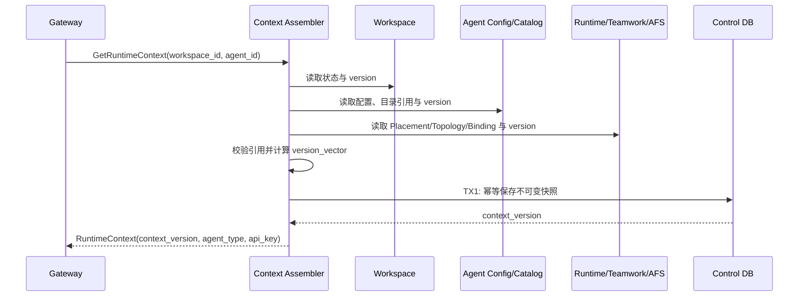

## 一句话说明
Agent 启动、用户明确确认运行配置更新或按固定版本查询时，Control 从各权威 Domain 组装一致版本的 Runtime Context 并下发给 Gateway/Runtime。

## 触发与结果
| 项目 | 内容 |
|:---|:---|
| 触发 | Session 启动查询、固定版本查询或用户明确确认的控制配置更新 |
| 前置条件 | Workspace 可运行且 Agent Configuration 有效 |
| 成功结果 | 返回或发布不可变 context_version 快照 |
| 失败结果 | 不发布半成品快照，返回明确缺失项 |

## 执行时间线

### 步骤说明
Assembler 不复制各 Domain 所有权，只保存组装结果及输入版本向量。读取期间任一来源 version 改变则丢弃本次结果并有限重试，不能发布混合版本快照。

Provider API Key 在 Agent Configuration 事务提交后才可被读取。Assembler 只在已验证 Workspace owner
且通过 `X-Control-Service-Token` 服务身份的同步内部响应中解密；同步用户链路从 Cookie 取得 owner，异步 Worker 使用受保护的 `X-Control-Acting-User-ID` 明确代表已持久化的 Task owner。不把明文写入快照表、Outbox、日志或错误。Gateway 不持久化明文，只将其随
单次 Agent 请求传给 `agent_type` 对应 Runtime；Runtime 仅通过子进程环境使用。

Control 持有 Configured Prompt 的内容与版本并提供已授权的运行配置；Agent 收到用户确认更新的通知后经 Gateway 拉取，Gateway 代理 Control 查询并在响应链路中生成独立 Platform Prompt 正文，不缓存控制配置。Agent 分别适配与加载。Control 不承担平台模板渲染，Gateway 不修改控制面的 Prompt 定义。

Configured Prompt 从此次已确认配置的互斥来源解析：不设置返回空正文，直接填写返回 Release 固定的正文，库引用返回选定 ID/版本的正文。不能根据资源库当前版本重新解释历史 Release，也不能将直接填写的正文写回共享资源。Platform Prompt 始终独立生成。

## 关键参数
`workspace_id`、`agent_id` 定位配置；`agent_type` 只能为 `codex` 或 `claude-code`；
`context_version` 供 Session 固定引用和变更检测。

## 状态与不变量
快照创建后不可修改；新配置产生新 `context_version`。既有 Agent Session 固定使用启动时版本，配置变化供新 Session 使用，不原地替换既有 Session 的运行快照，也不篡改历史 Turn。

## 一致性边界
各来源独立读取，无跨 Domain 事务。TX1 只提交快照、版本向量与可选 Outbox；发布通知在事务外。保存前重新核对版本向量，冲突则重组。

## 幂等、重试与补偿
`workspace_id + agent_id + version_vector_hash` 唯一。瞬时读取和版本冲突可有限重试；缺失/非法引用不可重试并返回具体配置路径。通知失败由 Outbox 重试，不删除有效快照。

## 权限与失败
Gateway 请求使用可配置内部服务身份；只有服务令牌匹配时 acting user header 才能建立身份，Assembler 仍按该固定 user_id 检查 Workspace owner，且不信任调用方提供配置内容。用户启动链路的最终访问判断由 `agent-session-startup` 执行。公开 Workspace 查询只投影 `api_key_configured`；密钥缺失可创建 Workspace，但首次需要 Provider 鉴权的 Turn 由对应 Runtime 返回明确错误。

## 结果事件
配置变更时产生 `RuntimeContextChanged`。
