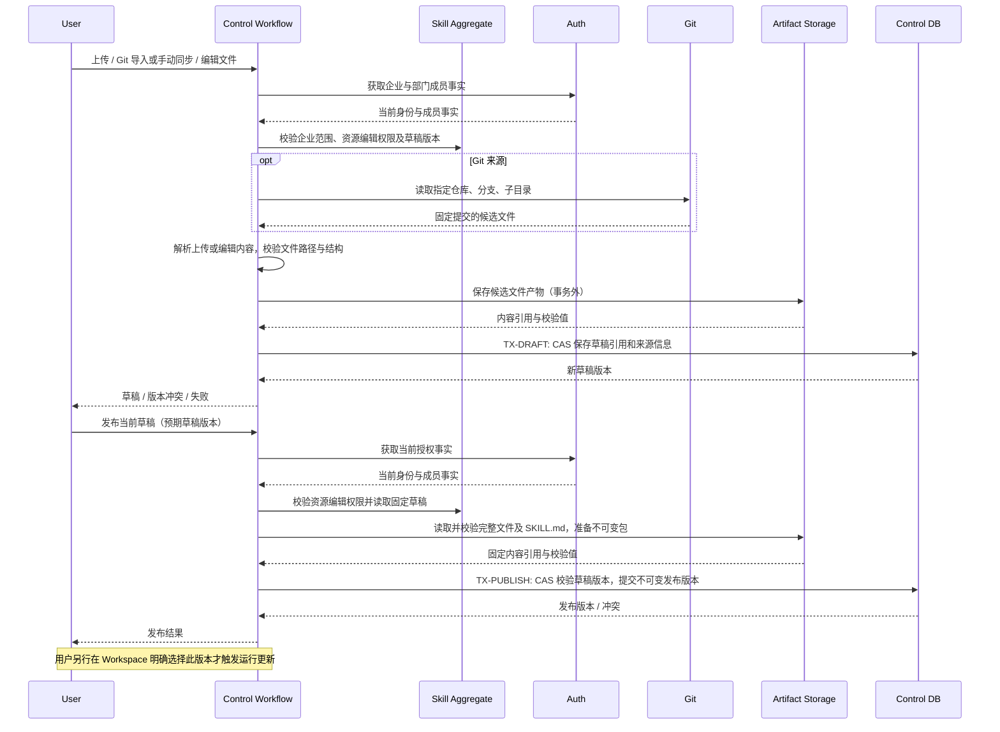

## 一句话说明

用户上传、从 Git 导入或在线编辑 Skill 文件后，通过发布动作形成可读取和下载的不可变版本；发布不自动修改任何 Agent 的选定配置。

## 触发与结果

| 项目 | 内容 |
|:---|:---|
| 触发 | 用户上传 ZIP/tar.gz、Git 导入或手动同步、在线编辑文件、发布草稿 |
| 前置条件 | 企业有效且用户对目标 Skill 具有编辑权限；新建资源按企业资源库权限创建 |
| 草稿结果 | 保存候选文件集合，供后续编辑和发布 |
| 发布结果 | 提交不可变版本及文件产物引用，可查看历史、下载并明确选择给 Agent |
| 非结果 | 不修改 Workspace 的已选资源，不发送 Agent 运行配置更新通知 |

## 执行时间线

## 状态与一致性边界

Skill 聚合决定草稿变更和版本发布；Workflow 协调授权、Git 与文件存储。草稿可多次编辑，发布版本不可修改。一个发布版本对应同一固定草稿的完整文件集合，不能把编辑中的部分文件混入发布包。

TX-DRAFT 仅提交草稿引用和来源事实，TX-PUBLISH 仅提交发布版本事实及相应聚合版本；Git、产物读写及 Auth 查询均在本地事务外。文件保存失败不提交指向缺失产物的版本；并发编辑导致预期草稿版本不符时返回冲突，由用户重读，不以旧内容覆盖新草稿。事务未引用的产物不对用户或 Agent 暴露，不在本阶段增加专门的后台回收服务。

## 权限、失败与生命周期

所有内容读写执行企业资源库权限；可读取的内容包括文件树、草稿、发布历史和版本包，写入与发布要求编辑权限。Grant 管理仍归 owner。禁止根据客户端提交的企业或资源 ID 直接授予权限。

归档包不能写到目标内容目录之外，不接受逃逸路径和可穿越的链接。Git 获取失败、包无效、入口缺失或存储失败均返回明确错误，保留已有草稿和发布版本。客户端断开不撤销已提交的草稿或发布；结果不明确时先查询当前草稿或发布历史，不自动创建第二个发布版本。Git 手动同步只更新候选内容，既有已发布包保持不变。

## 与运行配置的关系

草稿编辑、Git 同步和 Skill 发布均不是 Metadata Update。用户将发布版本配置给某个 Workspace 时，再执行该 Workspace 的 manage 权限和资源可读权限校验，并通过 [元数据更新工作流](../../../workflow/0010-agent-metadata-update/agent_metadata_update.md) 确认选择。Session 固定版本规则沿用已有设计。
