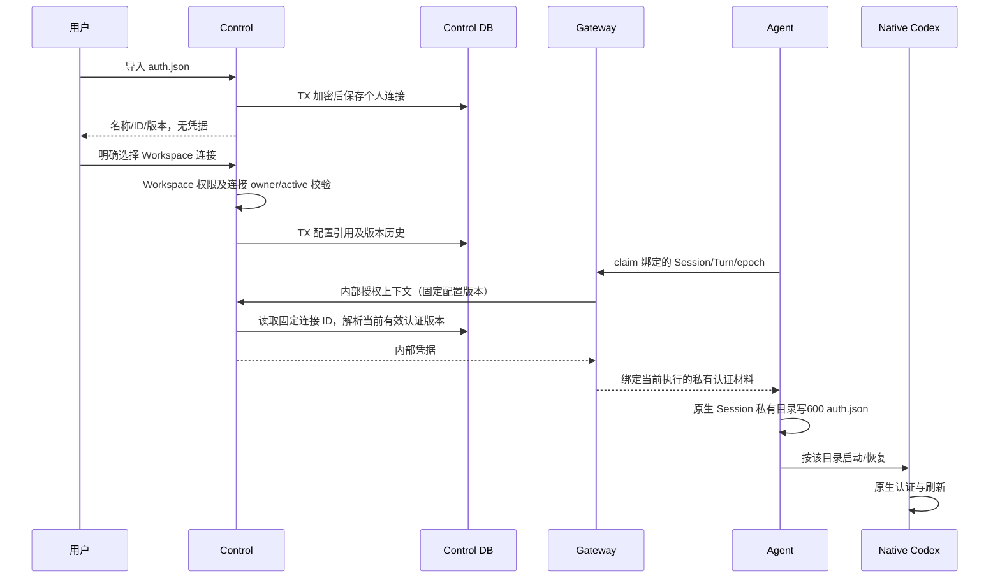

# 模型连接绑定与原生认证加载

每次 Workspace 配置变更保留历史连接身份；已有 Session 不隐式换到新连接。Session claim 校验仍由 Gateway 当前 owner/epoch/Turn 屏障执行；Control 只在内部 credential 和已授权 Workspace 上下文下输出认证。撤销或无法解密时拒绝加载，不降级使用开发者账号或另一连接。

Agent 仅在 Turn prepare 时装配凭据，文件不属于 metadata bundle。每个 Session 使用独立 CODEX_HOME；仅连接 ID/版本变化时原子替换认证，保留原生自动刷新结果，不在每轮覆盖成旧导入文件。失败为明确模型认证错误、队列暂停，用户更换认证后显式恢复。原生刷新状态留在私有运行目录；远端失效时用户重新上传更新个人连接。不得将原生 auth 文件、token 或 provider 错误原文推送到浏览器。

导入重复需用户选择原记录并 expected_version 替换；CAS 冲突409，不盲覆盖。Workspace 绑定失败不产生半条配置版本；原生写文件失败导致本轮 failed，不重放输入。撤销与绑定并发时下一 claim 拒绝，撤销不等待运行中的模型返回。

Workspace 明确更换连接时，同一事务写配置引用和历史，并沿用原 Release 的 Prompt/Skill/MCP 固定内容生成新 Release 与 Outbox；旧 Workspace 无 Release 时生成 none/空资源初始内容。不能因更换模型连接而升级资源。仅替换连接认证内容时不生成元数据 Release 或通知。
