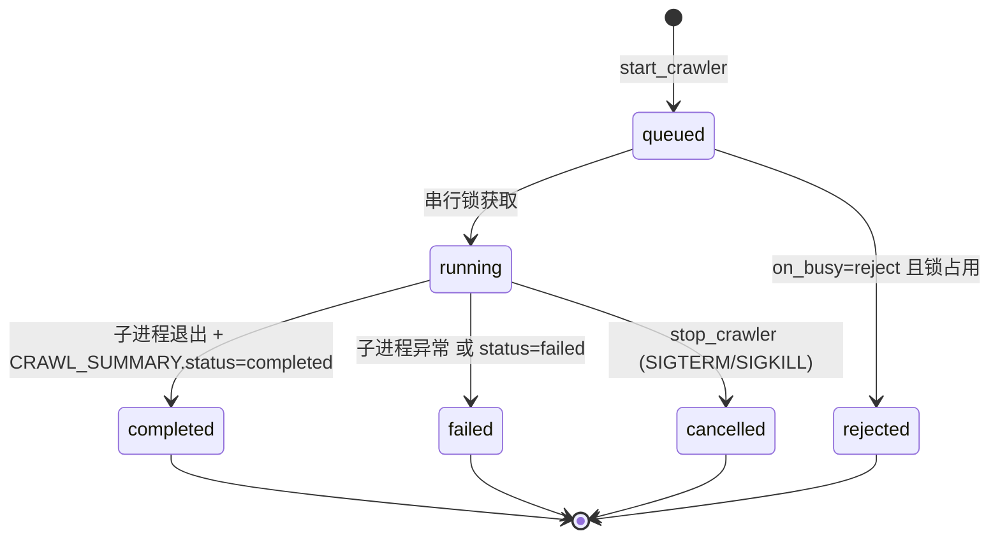

## 一句话说明

单个 Crawl Job 的端到端处理：agent/前端提交 `start_crawler` → 入队（PG jobs）→ 全局串行调度 → 子进程执行 Python 爬虫 → 读 checkpoint 推进度 + 捕获 CRAWL_SUMMARY → 更新终态。读路径（query_crawl_data 等）不受串行锁限制，全程并发。

## 执行时间线

```text
agent        media_crawler(crawl_job)            python mcp_runner.py           MySQL / Checkpoint
 |  start_crawler  |                                  |                              |
 |---------------->| 1. 校验入参 + 生成 job_id           |                              |
 |                 |    写 PG jobs(status=queued)       |                              |
 |<-- job_id ------|                                   |                              |
 |                 | 2. 全局串行锁(on_busy=queue 等待 / reject 返回)                    |
 |                 |    status=running                 |                              |
 |                 |-- subprocess(python mcp_runner)-->|                              |
 |                 |    注入 CLI: --platform --type      |                              |
 |                 |       --keywords --urls ...        |                              |
 |                 |    注入 env: MCP_MAX_NOTES_COUNT    |                              |
 |                 |       MCP_SAVE_DATA_OPTION 等       |                              |
 |                 |                                   | 3. 垫片注入 config.* 全局变量     |
 |                 |                                   |    main.main() 执行爬取          |
 |                 |                                   |    落库内容 ------------------->| 写 MySQL
 |                 |                                   |    写 checkpoint --------------->| 写文件
 |                 | 4. 轮询读 checkpoint 算进度          |                              |
 |                 |    crawled_count = len(crawled_note_list)                         |
 |                 |    current_keyword/page = checkpoint.current_search_*            |
 |                 |                                   |                              |
 |                 |    捕获 stdout: ---CRAWL_SUMMARY:{status,error}---               |
 |                 |<-- exit code ---------------------|                              |
 |                 | 5. 解析 CRAWL_SUMMARY              |                              |
 |                 |    更新 PG jobs(status=completed/failed, result_summary)           |
 |                 |    释放串行锁 → 唤醒下一个 queued job |                              |
 | get_crawl_status|                                   |                              |
 |---------------->| 返回 job 状态 + 进度 + 摘要          |                              |
```

## 关键流程参数传递

- **job_id**：media_crawler 生成（`job_{timestamp}_{rand}`），跨 MCP tool 传递，作为 job 主键与 get_crawl_status/stop_crawler 的入参。
- **CLI 参数**：start_crawler 入参拼成 `--platform --type --keywords --urls --enable_checkpoint --checkpoint_id --enable_comments --enable_sub_comments --hot_search_max_items --hot_search_per_item_count` 传子进程（与 `cmd_arg/arg.py` 的 typer 定义对齐）。
- **env 注入垫片**：`max_notes_count` / `save_data_option` / `start_page` 这三项爬虫既不在 CLI 也不读 env（硬编码在 `base_config.py`），经 `MCP_*` env 传给 `mcp_runner.py` 垫片，垫片 `setattr(config, ...)` 注入后再调 `main.main()`。
- **checkpoint_id**：新任务由爬虫运行时生成（`{platform}_{mode}_{YYYYMMDDHHMMSS}`），media_crawler 在 job 跑起来后扫 `data/checkpoints/` 按 mtime 定位最新匹配文件回填到 job 记录；续爬任务由上游传 checkpoint_id，经 CLI `--checkpoint_id` 透传。

## 状态流转



## 幂等设计

- **start_crawler 不幂等**：每次调用生成新 job_id。续爬靠传 checkpoint_id，而非重复提交同一 job。
- **get_crawl_status 幂等**：纯读，多次调用返回当前状态。
- **stop_crawler 幂等**：对已终态 job 调 stop 返回当前状态，不重复 kill。

## 一致性边界

创建 Job、认领串行锁、提交终态分别是独立本地事务；启动/终止子进程和扫描 checkpoint 均在事务外。Worker 在启动进程前提交 running 与 attempt；终态用 `job_id + attempt + expected_status` compare-and-set，旧进程结果不能覆盖新 attempt 或 cancelled。

## 权限与失败

- Agent 调 MCP 时使用 Session Token 解析 user/workspace/session；Crawler 以这些固定事实创建 Job，不接受参数覆盖 owner。
- Worker 使用服务身份处理 Job，不携带用户 Platform Token；对象写入 Storage 使用可配置 mTLS 和 Crawler namespace。
- 子进程启动失败可在确认未启动后有限重试；进程状态不明确时先按 pid/attempt 协调，不能启动第二个实例。
- stop 超时先 SIGTERM，超过宽限期再 SIGKILL；晚到 summary 只作诊断，不能覆盖 cancelled。
- checkpoint 发现失败不应把成功抓取误标为 failed，应记录结果不完整并允许独立恢复索引。
