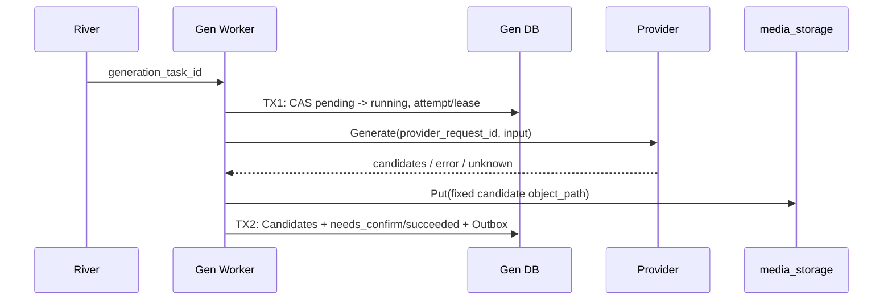

## 一句话说明

River 唤醒 Worker 后按 task ID 领取 Generation Task，事务外调用 Provider/Storage，再原子保存结果与集成事件。

## 执行时间线

Task 状态由 Generation 聚合决定；River Job 只负责至少一次唤醒。Provider 结果不明确时先按 provider_request_id 查询，禁止重新生成。Storage 写入发生在事务外，固定 Candidate 路径使重复 Put 内容一致。

## 状态与一致性边界

`pending -> running -> needs_confirm | succeeded | failed | cancelled`；单候选自动 succeeded，多候选进入 needs_confirm。用户要求重新生成时由 Generation 聚合记录 feedback、递增 attempt 并回到 pending。TX1 提交 attempt/lease，Provider 与 Storage 均在事务外，TX2 原子提交当前 attempt 的 Candidate、状态和 Outbox。若对象已写入但 TX2 失败，恢复执行按固定 Candidate 路径复用对象，不发起第二次 Provider 请求。

## 幂等设计

- River payload 只含 task ID，不含用户 Token。
- Claim 使用状态与 attempt 乐观条件；旧 Worker 结果不能覆盖新 attempt。
- Storage 路径按 Candidate ID 固定，重复 Put 必须内容一致。
- Provider 调用不可幂等时保存 provider request ID，用其查询恢复而不是重复创建。
- 用户主动 regenerate 是新的 attempt，不复用上一 attempt 的候选；它与基础设施失败后的恢复重试分开计数。

## 权限与失败

Task 创建时固定 user/workspace/session，Worker 只使用 mTLS 服务身份和已持久化事实，不携带 Platform Token。输入错误和 Provider 永久拒绝不重试；网络超时先协调 Provider；取消后的晚到 Candidate 只记录诊断，不改变 Task 终态。
