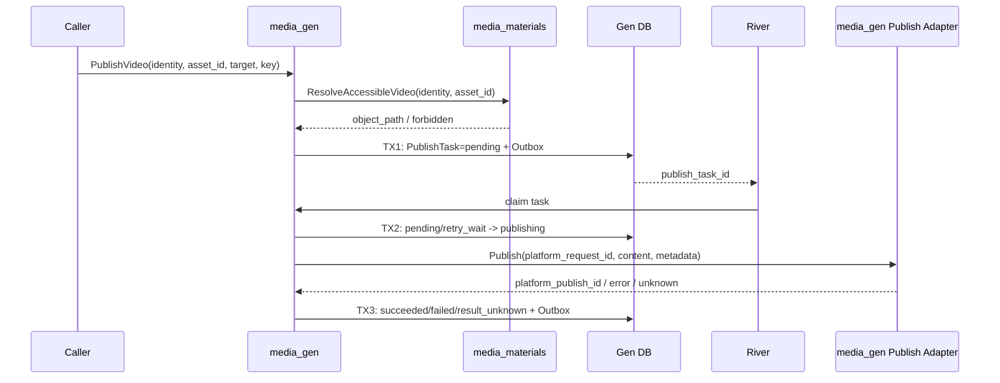

## 一句话说明

调用方显式提交已确认的视频 Asset，media_gen 验证资源后创建 Publish Task，通过目标平台适配器发布，并以平台发布 ID 协调结果直至成功或失败；生成流程不会自动触发发布。

## 触发与结果

| 项目 | 内容 |
|:---|:---|
| 触发 | `PublishVideo(asset_id, target, metadata, idempotency_key)` |
| 前置条件 | 用户可访问 Asset，媒体类型为 VIDEO，target 已启用 |
| 成功结果 | Publish Task succeeded，保存 platform_publish_id 和 URL |
| 失败结果 | failed 或 result_unknown，保留恢复信息 |

## 执行时间线

## 状态与不变量

`pending -> publishing -> succeeded/failed/result_unknown`；result_unknown 只能经平台查询进入 succeeded/failed。终态不可覆盖。同一用户、Asset、target 和 idempotency_key 只创建一个 Publish Task。

## 一致性边界

TX1 提交 Task 与 Outbox；资源读取、平台发布均在事务外；TX2 提交 attempt/lease；TX3 提交平台标识、URL、终态与结果事件。平台成功但 TX3 失败时必须以 platform_request_id 查询恢复。

## 幂等、重试与补偿

平台支持幂等键时透传稳定 platform_request_id。超时或连接中断先查询，不能盲目再次发布。永久内容拒绝直接 failed；限流和瞬时错误退避重试。已经公开发布的内容不能通过数据库回滚补偿，撤回必须是独立显式命令。

Publish Adapter 与 Publish Worker 同属 media_gen，可同进程部署；它不通过 media_crawler 发布，也不拥有任务状态。

## 权限与失败

Web 使用 Cookie JWT/用户 Service Token，Agent 使用 Session Token；Materials 执行 Asset 最终授权。Worker 使用 mTLS 服务身份，用户/Workspace 来自 Publish Task。平台凭据不得暴露给调用方、Agent、日志或 Trace。

## 结果事件

产生 `VideoPublished`、`VideoPublishFailed` 或 `VideoPublishResultUnknown`。
