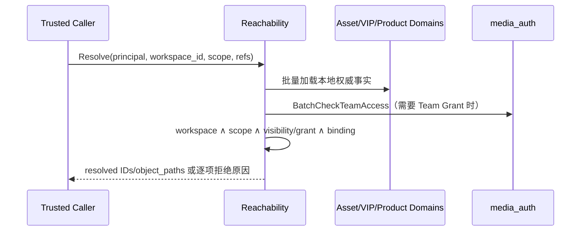

## 一句话说明

media_materials 加载 Material、Generated Asset、Virtual IP 与 Product 事实，统一判断当前 Principal 能否在指定 Workflow 中引用，并返回资源 ID、类型、Object Path 和 metadata。

## 触发与结果

| 项目 | 内容 |
|:---|:---|
| 触发 | 受信内部服务在 Workflow 提交或执行前调用批量 Resolve/Check |
| 前置条件 | Principal、Workspace 与 Workflow Scope 来自可信上下文；Asset Kind 已解析 |
| 成功结果 | 返回保持输入顺序的解析结果、object path、metadata 与事实版本 |
| 失败结果 | 任一必需输入不可达则 fail closed；批量响应可按契约返回逐项稳定拒绝原因 |

## 执行时间线

### 步骤说明

1. Reachability 按 resource type 批量加载本地权威事实，不允许调用方提供 visibility、owner、binding 等判定字段。
2. 涉及 team visibility/grant 时，按本次请求的 Team 集合一次性向 media_auth 查询成员关系；Auth 不可用时不降级放行。
3. Policy 依次验证 Workspace、Scope、资源 ACL 和容器可达性。Product 路径无资源级 user ACL，但仍要求 Principal 可进入 Workspace。
4. `ResolveAssetByKind` 只能得到唯一 active 资源；0 个或多个都返回不可解析，不做“取最新一条”的隐式选择。

## 关键参数

| 参数 | 产生方 | 使用方 | 语义 |
|:---|:---|:---|:---|
| principal | Edge 认证链 | Reachability/Auth | 用户身份；mTLS 只证明调用服务，不替代 Principal |
| workspace_id | 可信请求上下文 | 所有本地查询 | 必须与每个资源真实归属一致 |
| scope | Workflow 定义/提交上下文 | Policy | 必须与 Workflow 和每个资源一致 |
| refs / asset_kind | 调用方 | Resolver | 待解析引用与唯一选择条件 |

只返回 `object_path`、内联 `content` 与 metadata，不返回完整 URL 或二进制内容。

## 能力

| 能力 | 说明 |
|:---|:---|
| `AssetReachability` | 批量校验并解析 Material/Generated Asset 引用 |
| `CheckProductAccessible` | 校验 Product 的 Workspace/Scope 并解析绑定资源 |
| `CheckVirtualIPAccessible` | 校验 Virtual IP 的有效权限与绑定资源 |
| `ResolveAssetByKind` | 按 Asset Kind 选择匹配的 Material/Generated Asset |

## 幂等与失败

- 全流程只读，同一事实版本下结果确定。
- 资源不存在、Workspace/Scope 不一致或权限不足均 fail closed。
- 批量加载 Team Membership，禁止逐资源 N+1 Auth RPC。
- media_workflow 只保存解析后的资源 ID/Object Path 快照，不复制 Materials 业务记录。

## 状态与一致性边界

本流程是只读决策，不拥有持久化状态机，也不跨服务写事务。同一次批量解析应基于可识别的资源版本；调用方需要长期执行时保存解析 ID/Object Path 与版本快照，后续资源撤权按具体 Workflow 的策略处理。

| 读取边界 | 一致性要求 | 不包含 |
|:---|:---|:---|
| Materials DB 批量查询 | 同一次本地只读事务/一致性快照 | Auth Team Membership |
| Auth 批量查询 | 单次请求结果 | Materials 事实 |

两者不能形成分布式快照；最终授权以 Materials 事实版本和本次 Auth 响应共同决定，任何一侧失败均拒绝。

## 幂等、重试与补偿

| 步骤 | 幂等键 | 重试策略 | 补偿/恢复 |
|:---|:---|:---|:---|
| 本地批量读取 | 请求 refs 集合 | 可立即有限重试 | 只读，无补偿 |
| BatchCheckTeamAccess | principal + team ids | 超时可有限重试 | 仍失败则 fail closed |

## 权限与失败

| 失败 | 分类 | 处理 |
|:---|:---|:---|
| 资源不存在、已删除或无权限 | 不可重试 | 对外统一不可达，避免枚举 |
| Workspace/Scope 不匹配 | 不可重试 | 返回边界冲突 |
| Resolve 得到 0 或多条 | 不可重试 | 返回不可解析，要求调用方修正绑定 |
| Auth 超时/不可用 | 可重试 | 有限重试后 fail closed |
| 调用取消/超时 | 可重试 | 不保留状态，调用方可重新发起 |

## 权限与身份

服务间 mTLS 只证明调用服务；Principal 必须来自 Edge JWT 或 Session Token 的可信解析结果。Materials 不信任请求 body 覆盖 user/workspace，并对每个资源执行最终授权。

## 结果事件

只读流程不产生领域事件。
