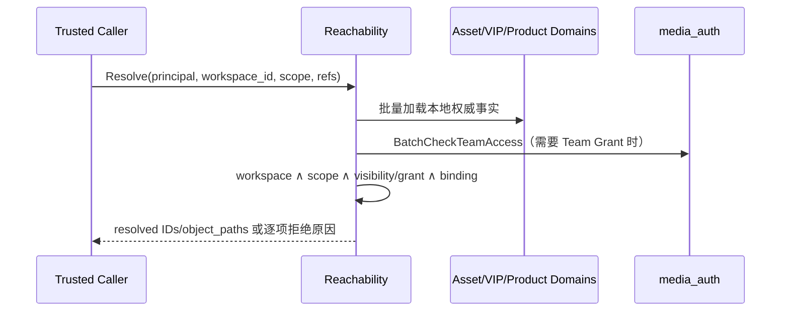

## 一句话说明

media_materials 加载 Material、Generated Asset、Virtual IP 与 Product 事实，统一判断当前 Principal 能否在指定 Workflow 中引用，并返回资源 ID、类型、Object Path 和 metadata。

## 执行时间线

## 关键参数

- Principal 来自 mTLS 受信调用链，不接受业务请求 Body 覆盖 user ID。
- `workspace_id` 必须与每个资源真实归属一致。
- `scope` 必须与 Workflow 和每个资源一致。
- 返回 `object_path`，不返回完整 URL 或二进制内容。

## 能力

| 能力 | 说明 |
|:---|:---|
| `AssetReachability` | 批量校验并解析 Material/Generated Asset 引用 |
| `CheckProductAccessible` | 校验 Product 的 Workspace/Scope 并解析绑定资源 |
| `CheckVirtualIPAccessible` | 校验 Virtual IP 的有效权限与绑定资源 |
| `ResolveAssetByKind` | 按 Asset Kind 选择匹配的 Material/Generated Asset |

## 幂等与失败

- 全流程只读，同一事实版本下结果确定。
- 资源不存在、Workspace/Scope 不一致或权限不足均 fail closed。
- 批量加载 Team Membership，禁止逐资源 N+1 Auth RPC。
- media_workflow 只保存解析后的资源 ID/Object Path 快照，不复制 Materials 业务记录。

## 状态与一致性边界

本流程是只读决策，不拥有持久化状态机，也不跨服务写事务。同一次批量解析应基于可识别的资源版本；调用方需要长期执行时保存解析 ID/Object Path 与版本快照，后续资源撤权按具体 Workflow 的策略处理。

## 权限与身份

服务间 mTLS 只证明调用服务；Principal 必须来自 Edge JWT 或 Session Token 的可信解析结果。Materials 不信任请求 body 覆盖 user/workspace，并对每个资源执行最终授权。Auth 不可用时 fail closed；不存在与无权限对外可统一返回不可达，避免枚举资源。
