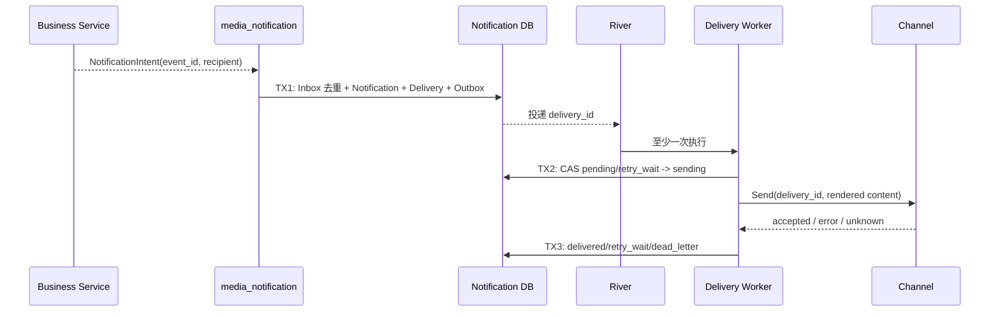

## 一句话说明
业务事件生成 Notification 后，按用户偏好拆分 Delivery，并通过渠道适配器重试投递直到成功、跳过或死信。

## 触发与结果
| 项目 | 内容 |
|:---|:---|
| 触发 | 业务通知事件 |
| 前置条件 | event_id、recipient_user_id 和类型完整 |
| 成功结果 | 站内通知持久化，允许渠道投递成功或按偏好跳过 |
| 失败结果 | 达到上限的 Delivery 进入 dead_letter |

## 执行时间线

### 步骤说明
Preference 在 TX1 创建 Delivery 前解析；禁用渠道记录 skipped 而非 failed。Channel 结果不明确时优先使用 provider message id 查询，不能立即重复发送导致用户收到两次。

## 关键参数
`event_id + recipient_user_id` 标识通知；`delivery_id` 是每个渠道尝试的稳定标识。

## 状态与不变量
Notification 的 read/unread 与 Delivery 状态相互独立。Delivery 为 pending/sending/delivered/skipped/retry_wait/dead_letter；delivered/skipped 为成功终态，dead_letter 仅能由显式重放创建新 attempt。

## 一致性边界
TX1 原子提交 Inbox、Notification、Delivery、Outbox；TX2 提交发送 lease；TX3 提交渠道结果。渠道调用严格位于事务外，River Job 不作为投递业务事实。

## 幂等、重试与补偿
`event_id + recipient + notification_type` 去重通知，`delivery_id` 传给支持幂等的渠道。瞬时错误指数退避；永久地址/权限错误直接死信。人工重放创建新 attempt 并引用原 Delivery，不篡改历史。

## 权限与失败
业务发布者以可配置 mTLS 服务身份写入并受事件类型 allowlist 约束；用户通过 Web Session/API Token Internal JWT 只能读取和更新自己的通知与偏好。渠道凭据由服务配置持有，不传给发布方。

## 结果事件
产生 `NotificationDelivered` 或 `NotificationDeliveryDeadLettered`。
