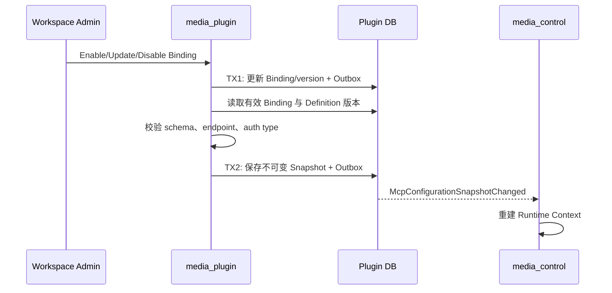

## 一句话说明
Workspace 启用关系变化后，Plugin 校验 MCP Definition 与配置，生成版本化快照并通知 Control 重新下发 Runtime Context。

## 触发与结果
| 项目 | 内容 |
|:---|:---|
| 触发 | Binding 创建、更新、禁用或 Definition 变更 |
| 前置条件 | Definition 已批准，配置通过 schema 校验 |
| 成功结果 | 发布不可变 snapshot_version |
| 失败结果 | 保留上一有效快照并报告无效项 |

## 执行时间线

### 步骤说明
Binding 是用户期望，Snapshot 是可重建发布结果。配置无效时保留 Binding 错误和上一有效 Snapshot；Agent 运行时从 Control 获得版本化配置并直接调用目标 MCP，不经过 Plugin。

## 关键参数
`workspace_id` 固定作用域；`snapshot_version` 供 Runtime 检测配置变更。

## 状态与不变量
Binding 的 enabled/disabled 由 Plugin Binding 聚合决定；Snapshot 创建后不可变。同一 Workspace 只有一个当前有效 snapshot_version，晚到构建结果不得覆盖新版本。

## 一致性边界
TX1 原子提交 Binding/version/Outbox；TX2 原子提交 Snapshot/当前指针/Outbox。Control 通知和 Runtime 重载均在事务外并允许重复。

## 幂等、重试与补偿
`workspace_id + binding_version_vector` 唯一标识快照。构建失败可在相同向量下重试；版本已变化则放弃旧结果。Outbox 重试不回滚 Binding；非法配置需用户修正。

## 权限与失败
Edge 传递已验证用户身份，Plugin 调 Control 检查 Workspace manage；服务间使用可配置 mTLS。Definition 未批准、schema 不匹配和 endpoint 禁止均不可重试；Control 暂时不可用可重试。

## 结果事件
产生 `McpConfigurationSnapshotChanged`。
