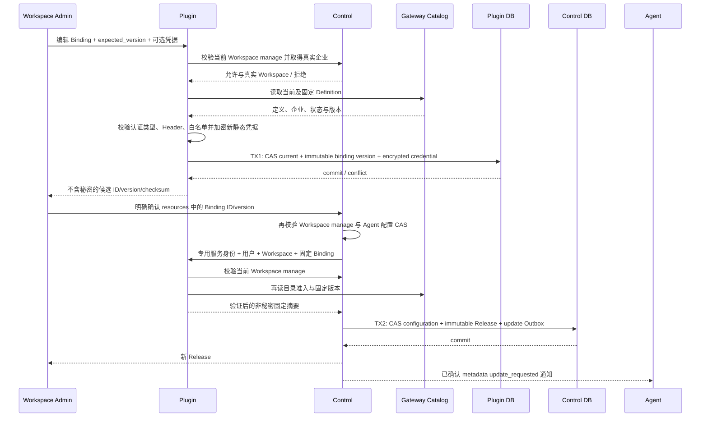

## 一句话说明

Workspace 管理员编辑 Binding 生成不可变候选版本；用户明确确认版本集合后，Control 才创建 Agent 配置 Release 并发送更新通知。

## 触发与结果

| 项目 | 内容 |
| --- | --- |
| 触发 | Workspace 管理员创建、编辑或停用 Binding，随后明确确认 Agent 配置 |
| 前置条件 | Control 授予 Workspace manage；Definition 属于平台或 Workspace 同一企业；启用时当前及固定定义均 enabled |
| 成功结果 | Binding 候选历史已保存；确认后 Control Release 固定 ID/version/checksum |
| 失败结果 | Binding 与 Control 各自原子回滚；已保存候选不会自动进入 Agent |

## 执行时间线

### 关键语义

Binding 聚合拥有当前启停、不可变配置历史与加密静态凭据引用。MCP 配置快照是 Control Release 内固定引用的集合，不另建自动发布的配置事实源。外部校验和加密在 TX1 之前；TX1 中不调用 Control/Gateway。Control 确认失败不会删除已保存候选，用户可重新确认。

## 生命周期与权限

编辑不通知 Agent，不修改已有 Session 的固定选择。运行请求由 Gateway 验证 Agent、Session 和执行上下文，再以专用服务凭据请求 Plugin；Plugin 校验当前 Workspace view，读取该 Session 的固定 Control Release，不能读取“最新候选”代替固定引用。旧版本继续保留；当前 Binding 或 Definition 停用/退役立即阻止后续调用。

静态凭据替换新建加密记录，旧固定版本仍引用原凭据；当前候选清空凭据不改变旧会话。用户要立即撤销所有旧版本调用时停用 Binding。OAuth 用户连接由 Auth 独立维护，断开后旧会话也必须重新授权。

## 一致性、并发与失败

TX1 原子提交 Binding/current、history、credential；TX2 由 Control 提交 Release 与通知 Outbox。跨服务无数据库外键、无分布式事务。创建依赖 Workspace/Definition 唯一约束，重复创建返回409；编辑 expected_version 冲突要求重读。确认沿用 Control idempotency_key 与内容摘要，重复确认不重复发布。

外部目录、Control 或 Auth 不可用时拒绝对应操作，不猜测权限或退回最新配置。CAS 失败不保留新凭据；调用结果不明不得自动重发写工具。API、历史、Release、Agent 文件与日志不包含静态密钥或 OAuth refresh token。

## 结果事件

Binding 编辑只返回候选版本。只有用户确认后的 Control Release 产生既有 `agent.metadata.update_requested`，广播、消息幂等与应用结果沿用元数据协议。
