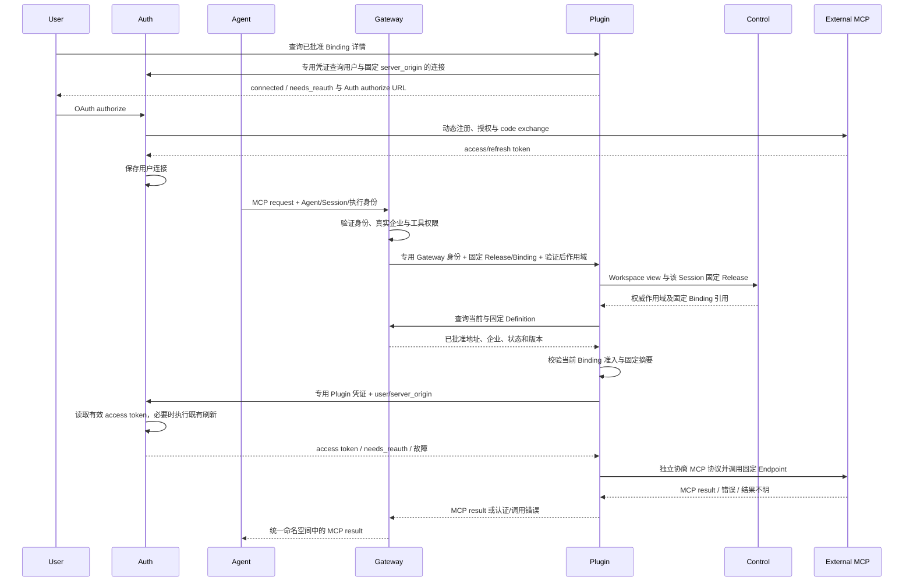

## 触发与结果

用户从 Binding 详情打开 Auth 既有 OAuth authorize，Auth 完成 callback 并持有连接。Agent 调用时只连接 Gateway；Plugin 在固定配置和当前准入均允许后使用 Auth 提供的可用 access token 代理外部 MCP。缺少连接返回 needs_reauth；服务故障或调用结果未知不得解释为成功。

## 执行时间线

## 一致性与生命周期

Auth 连接保存和刷新属于 Auth 本地事务；Plugin 不写连接副本，读取凭据与外部调用不进入 Binding 事务。用户关闭弹窗不取消已经完成的 Auth 保存。Gateway/Plugin 每次调用读取当前准入，Binding/Definition 停用或用户断开连接立即影响后续请求，不主动中断已经执行的外部工具。

Binding 编辑及 OAuth 连接不发布 Agent 配置通知。Session 固定 Control Release 不随最新 Binding 改变；OAuth 当前用户连接独立于固定配置，断开后需要重新授权。

## 权限、失败与重试

Agent 的 Token 不用于外部 OAuth；插件代理只接受专用 Gateway 凭证，作用域来自 Gateway 验证结果，不能从工具参数覆盖。Auth 可用凭据端口只接受专用 Plugin 凭证，响应 no-store，不返回 refresh token。Plugin 只使用目录固定 Endpoint；HTTP 重定向与 SSE 跨源 message Endpoint 不可携带凭据。

无连接时 Plugin 返回401 needs_reauth，Gateway 将其映射为可重连的 MCP 错误。Auth/Control/目录不可用时拒绝，不使用旧授权缓存。外部调用超时或响应丢失不自动重发，写工具结果未知时由用户核实。刷新行为沿用 Auth 既有服务，不新建后台连接同步、重试队列或单航班协调器。
