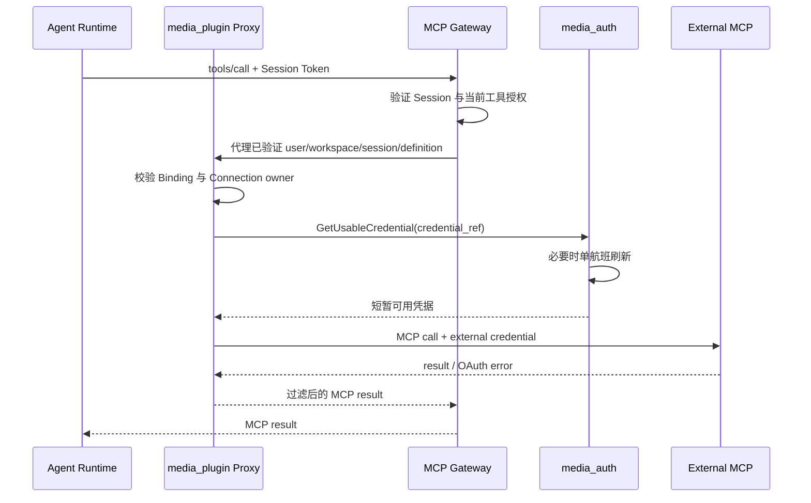

## 一句话说明
用户完成 OAuth 连接后，Plugin 仅在调用外部 OAuth MCP 时向 Auth 兑换受控凭据并代理请求。

## 触发与结果
| 项目 | 内容 |
|:---|:---|
| 触发 | 连接 OAuth 或调用外部认证 MCP |
| 前置条件 | Definition 批准，用户连接 active |
| 成功结果 | 外部 MCP 返回结果，长期凭据不暴露给 Agent |
| 失败结果 | 连接标记失效或返回可重连错误 |

## 执行时间线

### 步骤说明
只有外部 OAuth MCP 经 Plugin 代理。长期 refresh token 始终归 Auth；Agent 和 Plugin 数据库都不保存明文。Agent 只连接 Gateway；Plugin 使用受信 Gateway 传递的已验证上下文，不把入口 Token 当作外部 OAuth Token。身份以 Gateway 验证结果为准，不能由 MCP 参数指定其他用户。

## 关键参数
`user_id + definition_id` 定位连接；OAuth Credential 仅以引用跨服务传递。

## 状态与不变量
Connection 为 pending/active/invalid/revoked；invalid/revoked 不允许调用。OAuth Credential 状态由 Auth 决定，Plugin 只维护引用和连接投影。

## 一致性边界
连接状态与审计在 Plugin 本地事务提交；凭据读取/刷新在 Auth 事务提交；外部 MCP 调用不进入任何本地事务。外部返回成功后本地审计失败不能重放非幂等调用。

## 幂等、重试与补偿
只读或带外部幂等键的调用可重试；超时结果不明确时不得盲重试写工具。Auth 刷新按 credential_id 单航班；`invalid_grant` 将 Connection 投影标记 invalid 并要求用户重连。

## 权限与失败
可配置 mTLS 验证 Runtime/Gateway 服务；Session Token 解析用户和 Workspace；Plugin 校验 Workspace Binding 与 Connection owner；外部 MCP 再按其 OAuth scope 授权。Token、Authorization header 和敏感响应字段不得写日志。

## 结果事件
产生 `ExternalMcpConnectionInvalidated`。
