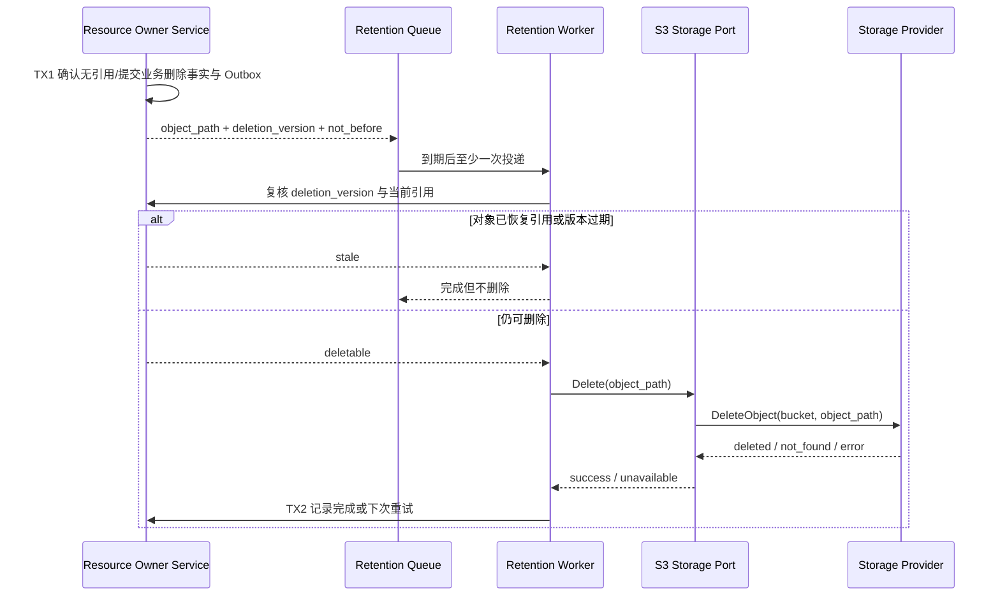

## 一句话说明

资源所有者确认对象已无业务引用或已完成删除决策后，Retention Worker 使用受限 S3 凭证幂等删除 Storage Provider 中的对象。

## 触发与结果

| 项目 | 内容 |
|:---|:---|
| 触发 | 业务服务产生待回收 Object Path，或周期任务发现超过保留期的未引用上传 |
| 前置条件 | 权威业务服务确认无有效引用；任务携带稳定 object_path 与 deletion version |
| 成功结果 | Provider 中对象不存在，任务记录完成 |
| 失败结果 | 保留任务及重试信息，不伪造业务删除成功 |

## 执行时间线

### 步骤说明

Storage Provider 不拥有业务引用关系，因此删除前必须回到资源权威服务复核。Provider 的 NotFound 等同幂等成功；删除超时结果不明确时先 HeadObject。首期素材迁移只实现上传与读取，本 Workflow 作为后续里程碑，不允许用 Bucket Lifecycle 按创建时间直接删除可能仍被引用的对象。

## 状态与不变量

任务状态为 `pending -> running -> completed`，失败回到 `pending` 并增加 attempt；永久配置错误进入 `dead_letter`。业务删除版本变化会使旧任务失效。物理删除不可补偿，故复核必须发生在 DeleteObject 之前。

## 关键参数

| 参数 | 产生方 | 使用方 | 语义 |
|:---|:---|:---|:---|
| object_path | Resource Owner Service | Worker / Storage Port | 稳定对象键 |
| deletion_version | Resource Owner Service | Worker | 防止晚到任务删除已恢复对象 |
| not_before | Resource Owner Service | Queue | 回收期结束时间 |

## 一致性边界

| 事务 | 原子事实 | 事务外动作 |
|:---|:---|:---|
| TX1 | 业务删除/无引用判断、deletion version、Outbox | S3 DeleteObject |
| TX2 | 回收完成或 retry/dead-letter 状态 | 无 |

跨事务通过 Outbox 与至少一次任务投递收敛。DeleteObject 成功而 TX2 失败时，重试得到 NotFound 并完成。

## 幂等、重试与补偿

| 步骤 | 幂等键 | 重试策略 | 补偿/恢复 |
|:---|:---|:---|:---|
| 任务投递 | object_path + deletion_version | 至少一次 | 旧版本任务复核后丢弃 |
| DeleteObject | bucket + object_path | 瞬时错误退避；超时先 Head | NotFound 视为成功；物理删除不可恢复 |

## 权限与失败

- Worker 使用只能删除指定 Bucket/Prefix 的服务凭证，不接受最终用户凭证。
- Provider 拒绝、凭证错误或 Endpoint 配置错误进入可观测告警；不得降级为匿名删除。
- Resource Owner Service 不可用时 fail closed，不执行物理删除。

## 结果事件

成功可产生 `StoredObjectDeleted` 运维事件；它不替代业务资源删除事实。
