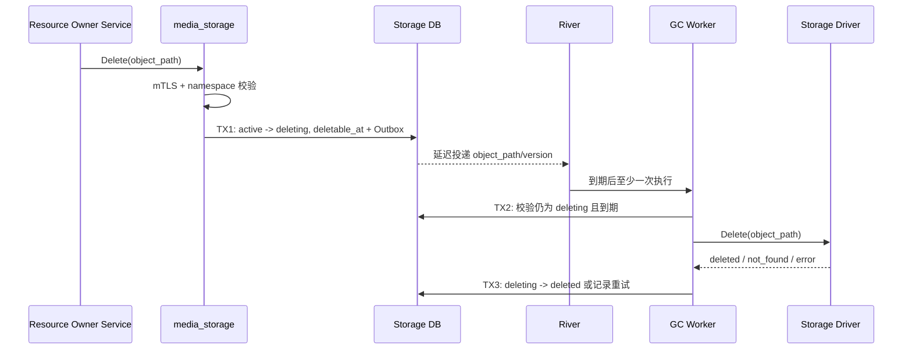

## 一句话说明
业务所有者标记对象删除后，Storage 等待回收期，再通过所选 Driver 幂等删除物理对象并提交清理结果。

## 触发与结果
| 项目 | 内容 |
|:---|:---|
| 触发 | 合法服务请求删除 Object Path |
| 前置条件 | mTLS 服务身份可访问对应 namespace |
| 成功结果 | 回收期结束后元数据与物理对象均进入 deleted |
| 失败结果 | 保留 deleting 状态和重试信息 |

## 执行时间线

### 步骤说明
Storage 只验证调用服务是否可操作命名空间；“业务资源能否删除”由 Owner Service 在调用前决定。Driver 返回 not_found 等同成功。回收期内 Owner 可取消删除，version 递增使旧 GC Job 失效。

## 关键参数
`object_path` 是幂等键；`deletable_at` 实现可配置回收期。

## 状态与不变量
`active -> deleting -> deleted`，回收期内允许 `deleting -> active`；deleted 为终态。只有当前删除 version 的 Worker 可以提交 deleted，晚到 Job 不得删除已恢复对象。

## 一致性边界
| 事务 | 原子事实 | 事务外动作 |
|:---|:---|:---|
| TX1 | deleting、deletable_at、version、Outbox | River 延迟投递 |
| TX2 | GC lease/attempt | Driver.Delete |
| TX3 | deleted 或 retry_at/error | 运维告警 |

## 幂等、重试与补偿
`object_path + deletion_version` 去重任务。Driver 不存在视为成功；超时结果不明确时先 Head 对象，存在才重试 Delete。瞬时错误退避；永久权限/配置错误进入 dead letter。物理删除完成后不能补偿恢复。

## 权限与失败
Storage 通过可配置 mTLS 校验服务及 namespace，不接受最终用户凭证，也不判断业务所有权。取消删除必须来自同一 namespace 的合法服务；回收期已过且物理删除开始后可能返回冲突。

## 结果事件
产生 `StoredObjectDeleted` 或运维告警。
