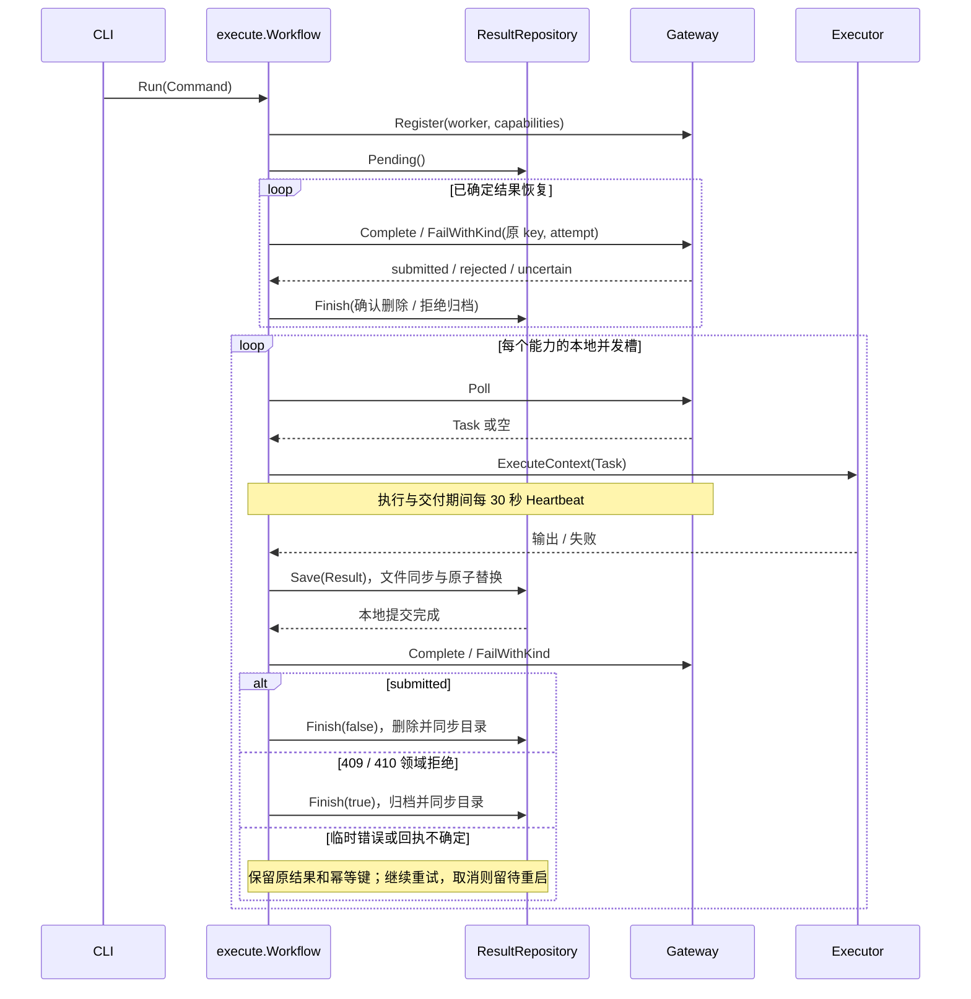

## 一句话说明

CLI 触发 Worker 生命周期，先恢复确定结果，再按能力并发领取并交付。

## 触发与结果

| 项目 | 内容 |
|:---|:---|
| 触发 | CLI 构造 execute.Command 调用 Workflow.Run |
| 前置条件 | 入口已验证配置并独占打开凭证隔离结果日志；能力来自 Executor 并经白名单选择 |
| 成功结果 | 网关确认 submitted 后移除本地 pending |
| 失败结果 | 临时错误继续重试；拒绝结果归档；存储失败取消各工作协程并返回入口 |

## 执行时间线

### 步骤说明

注册失败直接返回；恢复路径只调用网关与结果端口，绝不调用 Executor。恢复交付不创建或延长生成租约。所有已知结果重放后，先串行恢复未关闭生成检查点，再按能力领取新 Task；每次领取前通过 Admission 获取实例容量和就绪，恢复使用独立 RecoveryAdmission，不因已耗尽的生成额度阻止现有产物恢复。Save 失败不发送结果，Finish 失败保留可恢复事实并返回错误；其他工作协程收到取消并退出。pending 执行留在原 Task 重试并保留容量，取消不写失败回执；abandoned 执行停止且不再交付。

## 状态与不变量

| 原状态 | 事件 | 结果 |
|:---|:---|:---|
| 尚未保存 | Save 成功 | pending |
| pending | submitted | 删除 |
| pending | 领域拒绝 | rejected 归档，不再重发 |
| pending | 网络异常、取消、回执非 submitted | pending |

网关拥有租约与任务终态；本地日志只拥有结果事实。客户端断线不改变服务端状态。相同 key 的不同结果禁止覆盖；同次重试使用原 Dispatch/Attempt/key，晚到结果由网关接受或拒绝。

## 关键参数

| 参数 | 产生方 | 使用方 | 语义 |
|:---|:---|:---|:---|
| worker ID | CLI | Gateway | 稳定实例身份 |
| dispatch / attempt | Gateway | Executor、ResultRepository | 执行身份 |
| key | Workflow | Gateway、ResultRepository | dispatch:attempt:complete 或 :fail；恢复沿用原键 |
| trace parent | 输入信封 | correlation、Gateway | 关联元数据，移出 Provider 输入 |

## 一致性边界

| 本地事务 | 原子事实 | 外部调用 |
|:---|:---|:---|
| Save | 已确定 Result，fsync 文件、rename、fsync 目录 | 不在事务内 |
| Finish | 删除或归档，fsync 目录 | submitted/拒绝后执行 |

Save 后崩溃由 Pending 重放；确认响应丢失重复交付由原幂等键消解，无重新执行补偿。

## 幂等、重试与补偿

| 步骤 | 幂等键 | 重试策略 | 恢复 |
|:---|:---|:---|:---|
| Poll | 网关管理 | 异常 1 秒，空 300ms | 新领取由网关决定 |
| 执行 | Dispatch/Attempt | 本地无盲重试 | 通过 ExecutionRecovery 恢复检查点，同次不重新 Poll |
| 交付 | 原结果 key | 1 秒直到确认、拒绝或取消 | 重启先重放 |
| Heartbeat | Dispatch/Attempt | 30 秒，失败记录脱敏事件 | 不把心跳结果解释成新资格 |

## 权限与失败

Worker Bearer 仅发送 Gateway，上传签名 PUT 不携带 Token。最终 Task/资源归属和上传授权由网关服务端复核；本地命名空间含 endpoint、worker ID、凭据哈希，权限保持目录 0700、文件 0600。

| 错误 | 处理 |
|:---|:---|
| Permanent() 明确 false | transient 失败交付 |
| 其他执行错误 | permanent 失败交付 |
| 409/410 | client 转领域 ErrResultRejected，workflow 归档 |
| 存储错误 | 返回错误，CLI 非零退出 |
| 取消 | 停止重试，保留尚未确认的结果 |

## 结果事件

无领域事件；worker_task_completed、worker_task_failed、worker_result_rejected 等为脱敏运行日志。
