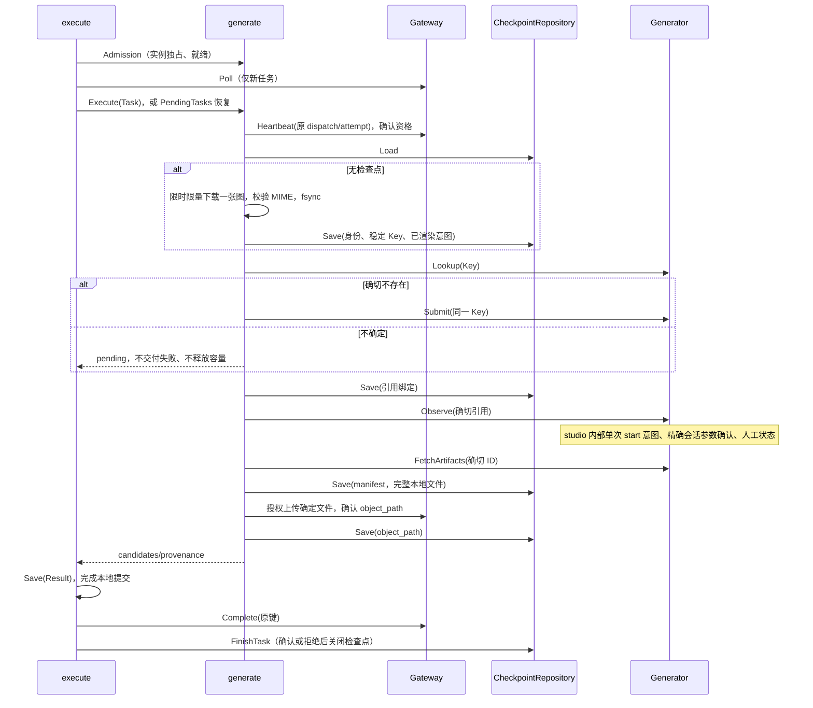

## 一句话说明

生产 Executor 实现协调 execution 与 doubao：在专用实例容量内执行首帧视频，所有不确定副作用停留同一 Attempt。

## 触发与结果

仅 doubao.i2v.first_frame_prompt@1，prompt + 恰好一张图片。成功产生 VIDEO object_path 候选；人工、网络和不确定提交保留检查点，取消不提交失败以免触发新 Attempt。

## 执行时间线

## 一致性边界与状态

检查点状态只前进：意图 → 引用 → 确切产物 manifest → object_path → closed。结果日志另行 Save。每次检查点原子写入并同步文件/目录，持有进程独占锁。签名 URL 只用于当次输入下载，绝不写入检查点；本地意图与产物目录保持私有。

studio stable Key 对应确定 task ID 和请求摘要，创建经过 TaskService/Repository；请求不同则拒绝。start/确认均先持久化单次意图再触发，丢响应或重启后不能用 retry/start 再次生成。无法证明已受理的场景转人工。

## 幂等、重试与补偿

| 步骤 | 稳定身份 | 恢复 |
|:---|:---|:---|
| 生成 | credential 隔离 namespace + dispatch + attempt | Lookup 三态；不确定不重发 |
| 下载 | Reference + Artifact ID | 完成文件与摘要；不使用下载目录最新文件 |
| 上传 | Task/Attempt/候选位置及内容摘要 | 重复申请授权确认已有对象 |
| 交付 | 原 dispatch:attempt:complete | 结果日志先于发送；confirmed 后关闭检查点 |

## 权限与失败

恢复先调用现有 Heartbeat：服务端校验 Worker Actor、Credential、实例、Attempt、原生执行状态，再刷新 callback。拒绝则关闭过期检查点，不重新 Poll 推断资格。网络异常保持原事实和本地容量。执行期间定时心跳同样拒绝时停止继续副作用。

专用实例使用独立用户目录和进程锁，不复制其他实例浏览器数据。进程由明确 launch command 启动、发现文件 PID/本地 token/readiness 复核，只终止本次启动且仍受当前对象持有的进程。公开网关 Bearer 不进入 studio 或签名 PUT。

## 结果事件

无领域事件；输出脱敏阶段事件。真实生成、资格恢复、上传、审批分别记录验收证据。
