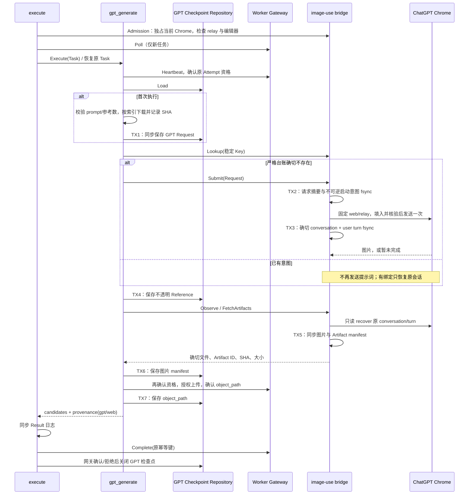

## 触发与结果

execute 在领取前取得浏览器容量并检查 relay/登录；仅领取 GPT 两项 Capability。生成 Workflow 返回单个图片 object_path 候选，后续审批与产物登记仍由 media_workflow 拥有。与豆包工作流无依赖。

## 时间线与事务

每个事务是独立本地提交，不在文件锁内访问网关。参考图临时签名只用于下载；每张图片用索引派生独立目录，避免覆盖。

## 生命周期与恢复

| 已保存事实 | 恢复行为 |
|:---|:---|
| Request | Lookup；只在权威不存在时 Submit |
| 已有启动意图，无会话绑定 | needs_human，不重发 |
| 有 conversation/turn 绑定 | 限频 recover，绝不再次发送提示词 |
| Artifact manifest | 复验字节、MIME、大小、SHA，再上传 |
| Object Path | 直接重建候选，不再生成或上传 |
| closed | abandoned，不重开 |

当前 Chrome 仅一条连接和一个生成槽，既有上游跨工具锁也必须真正持有。其他工具或用户切换会话、编辑/新增 turn 时拒绝把新内容当原结果。登录、平台挑战、额度与不确定发送留待人工；不换账号、不回退到 Codex。

空队列轮询的浏览器准入只读取当前专用会话，不执行导航；有草稿或生成中控件时拒绝准入。就绪结果最多缓存 5 秒，提交、观察及读取产物后失效。首次准备页面通过显式 `check_gpt_browser.py --open` 完成，避免后台轮询不断刷新页面或清除输入。

唯一 Send 确认后先写入确认回执，身份绑定允许最多 120 秒页面传播时间；即使绑定超时，也不能推断未发送或重发。恢复复用当前原会话页面并保留页面用于下载后核验；同一 file_id 在工具和助手消息中重复出现只算一个产物，多个不同文件保留人工检查。

## 资格与失败

调用前与长时间 CLI 运行期间检查原 Task/Attempt 的 Heartbeat；无法确认资格则取消自己启动的进程组。网络不确定保留原台账，服务端明确拒绝时关闭检查点、停止副作用。终止客户端不能证明远端生成取消；重启只能恢复原引用。上传与交付复用现有公共端口和幂等键，不操作 Conductor 或审批。

恢复准入不创建新浏览器或再次领取旧任务。浏览器会话不随 Worker 生命周期销毁；不会关闭用户 Chrome。输出仅安全状态码和既有 trace/执行身份，原 CLI 的提示词、Cookie、内部地址与错误正文不进入 Worker 日志。
